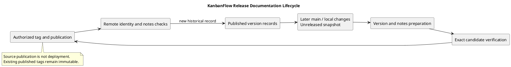

# KanbanFlow Releases

> **Policy amendment (2026-10-10):** Membership mutations are now owner-only; DEC-003/PB-001's bypass is fixed. Earlier open-policy text and diagrams below describe the preceding state. See [QA corrections](../SDLC/06-testing/qa-corrections-2026-10-10.md) for the selected rule and regression evidence.

## Purpose and evidence boundary

This section records published source releases and provides working guidance for preparing, verifying, publishing, upgrading, and assessing rollback. The [changelog](../../CHANGELOG.md) remains the main released change history.

A release record describes a particular source version and its reported validation. It does not establish production deployment, a service-level guarantee, or verified data recovery. Historical results are not fresh test evidence for current main.

## Latest source tag

[v1.1.1](v1.1.1.md) — 2026-10-10: membership security, session recovery, formatting/license corrections, and documentation. This source tag is separate from the historical GitHub Release records below.

## Published release index

| Version | Published UTC date | Main focus | Record |
| --- | --- | --- | --- |
| v1.1.0 | 2026-10-07 | Light/Dark/System themes and broader UI/UX. | [Local record](v1.1.0.md) · [GitHub release](https://github.com/Farhad-Valizadegan/Web-KanbanFlow/releases/tag/v1.1.0) |
| v1.0.2 | 2026-10-06 | Session configuration, analytics refresh, and naming. | [Local record](v1.0.2.md) · [GitHub release](https://github.com/Farhad-Valizadegan/Web-KanbanFlow/releases/tag/v1.0.2) |
| v1.0.1 | 2026-10-06 | Privacy, authorization, ordering, and interactions. | [Local record](v1.0.1.md) · [GitHub release](https://github.com/Farhad-Valizadegan/Web-KanbanFlow/releases/tag/v1.0.1) |
| v1.0.0 | 2026-07-25 | Initial portfolio release. | [Local record](v1.0.0.md) · [GitHub release](https://github.com/Farhad-Valizadegan/Web-KanbanFlow/releases/tag/v1.0.0) |

Dates are publication dates recorded by GitHub, not reconstructed implementation or decision dates. The older v0.1.0 tag exists but had no published release in the retrieved release list; no complete release claims are inferred from it.

This index is maintained documentation, not a live GitHub feed. Verify current remote records when preparing a new release.

## Release operations directory

| Document | Purpose |
| --- | --- |
| [Unreleased changes](unreleased.md) | Snapshot of later commits and working changes; distinguish them from published versions. |
| [Release checklist](release-checklist.md) | Preparation, verification, publication, and final checks. |
| [Verification template](verification-template.md) | Exact commit/environment evidence and known gaps. |
| [Upgrade and rollback](upgrade-and-rollback.md) | Compatibility, configuration, rebuild, data, and recovery boundaries. |
| [Release notes template](release-notes-template.md) | User-visible changes, validation, upgrades, and limitations. |
| [Version policy](../Project-Management/versioning-strategy.md) | Major/minor/patch assessment and metadata consistency. |
| [Release pipeline](../Project-Management/release-pipeline.md) | Manual source-release sequence and current automation limits. |

## How to use the section

### Understand a published version

Read its record and published notes, resolve the exact tag, and review known issues and upgrade effects. Consult later release records for corrections without backdating them into an older version.

### Assess current source

Compare main with the latest published tag and inspect actual Git history. Main can advance without a new application version. The unreleased document is a snapshot that needs maintenance; it is not an automatically complete commit list.

### Prepare a new release

Agree scope/version, align metadata, record changes and upgrade effects, and verify the final candidate. Publish only within the authorized action, then confirm the tag and release identities.

### Upgrade or recover

Review the target version, environment, data compatibility, and backup/recovery needs. Follow the project setup and upgrade guidance. Do not use database reset commands as ordinary upgrade steps or assume code rollback restores data.

## Source and delivery identities

| Identity | Meaning |
| --- | --- |
| Working tree | Local changes that may not be committed. |
| Main commit | Integrated source, possibly newer than the published release. |
| Annotated tag | Source identity for a version when pushed and verified. |
| GitHub release | Published title/notes associated with a tag. |
| Runtime deployment | Application services running in a particular environment. |

These states must be verified separately. A successful push or CI job does not prove release-note publication or production availability.

## Required evidence for a release

- Exact source commit and tag identity.
- User-visible changes and compatibility assessment.
- Relevant test/build/browser/concurrency results tied to that candidate.
- Environment and configuration assumptions.
- Upgrade, migration, dependency, rebuild, and restart effects.
- Known defects, failed/skipped checks, and operational limitations.
- Published notes and final remote identity verification.

Use the verification template rather than copying old passing counts into a new release.

## Current verification and automation limits

The [CI workflow](../../.github/workflows/ci.yml) runs backend tests and frontend lint/build for main pushes and pull requests targeting main. It does not automatically publish tags/releases, deploy services, or restore data.

Backend tests use [in-memory SQLite](../../backend/phpunit.xml). MySQL contention, browser usability, production operation, and recovery require relevant separate evidence. Static/build success alone cannot close those boundaries.

## Known issue and historical qualifications

The manager remove/re-add role-change loophole remains unresolved. Keep it visible in release notes until the policy is agreed and backend direct/indirect paths are regression-verified. See the [decision register](../Project-Management/decision-register.md).

Earlier release notes may describe issues later corrected, including authentication defaults, analytics refresh, and the local folder rename. Preserve that historical context and identify the later correction instead of implying the older release had it.

## Record structure and maintenance

Each release document should identify the version, publication/source links, changes, historical validation, upgrade effects, and known issues. New records must not fabricate reviewers, dates, research, or checks.

Keep package/lockfile metadata, README version, changelog, tag, and notes consistent when preparing an actual release. This documentation update does not bump the application version or create a tag.

Correct inaccurate notes explicitly; never silently retarget a published version tag. If publication fails, inspect remote state before retrying or recreating records.

## Diagrams and related documentation

Each document includes inline PlantUML, an editable source in [diagrams](diagrams/), and a GitHub-visible PNG preview. Update both source copies and regenerate previews when diagrams change.

Related guidance:

- [Quality and risk plan](../Project-Management/quality-and-risk-plan.md)
- [Milestone index](../Project-Management/milestones.md)
- [SDLC guides](../SDLC/README.md)
- [Sprint guides](../Sprints/README.md)
- [Project setup](../../README.md)

## PlantUML diagram

[Editable source](diagrams/README.puml)

