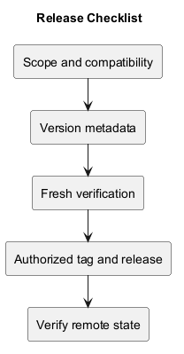
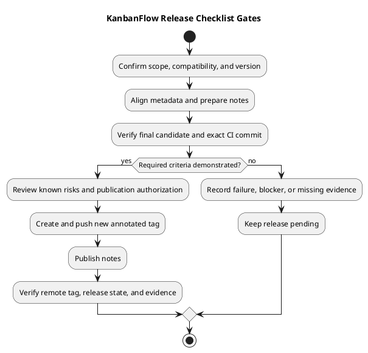

# KanbanFlow Release Checklist

> **Policy amendment (2026-10-10):** Membership mutations are now owner-only; DEC-003/PB-001's bypass is fixed. Earlier open-policy text and diagrams below describe the preceding state. See [QA corrections](../SDLC/06-testing/qa-corrections-2026-10-10.md) for the selected rule and regression evidence.

## How to use this checklist

Copy or reference this checklist for an actual release candidate. Tick an item only after it is demonstrated; record not-applicable items with a reason and keep pending/failed checks explicit.

This document is a template, not a completed release or deployment record. No version bump, tag, publication, or production action is authorized merely by editing it.

## Release identity record

| Field | Value to record |
| --- | --- |
| Intended version/tag | Actual agreed value. |
| Previous published tag | Comparison baseline. |
| Candidate commit | Full SHA after final metadata/source changes. |
| Environment | Runtime, database, browser, and isolated setup. |
| Review/evidence | Actual reviewer and result links when available. |
| Publication authorization | Actual scope and evidence. |
| Known issues | Residual defects and verification gaps. |

Use the [verification template](verification-template.md) for detailed evidence.

## 1. Scope and compatibility

- [ ] Identify user-visible changes since the previous published tag.
- [ ] Confirm included scope and exclusions.
- [ ] Review API/behavior compatibility and affected permissions.
- [ ] Assess migrations, stored data, configuration, runtime, and dependencies.
- [ ] Review security consequences and rollback limitations.
- [ ] Select the version using the [version policy](../Project-Management/versioning-strategy.md).
- [ ] Identify open decisions and dependencies.

A commit prefix or file count does not determine version significance. Keep the manager remove/re-add loophole visible unless an agreed policy and enforcement evidence close it.

## 2. Metadata and release notes

- [ ] Align frontend package and relevant lockfile version metadata.
- [ ] Update README version and changelog.
- [ ] Prepare notes describing changed behavior rather than only commit titles.
- [ ] State fresh validation and distinguish it from historical results.
- [ ] Document migration/configuration/dependency and rebuild/restart effects.
- [ ] Record known issues, skipped checks, and operational limits.
- [ ] Check comparison and source links.

Use the [notes template](release-notes-template.md). Say no migrations or dependency changes only after inspecting actual scope. Metadata should not introduce unrelated dependency churn.

## 3. Source review and final candidate

- [ ] Review the complete scoped diff, including documentation and metadata.
- [ ] Confirm no secrets, unrelated changes, or unapproved data are included.
- [ ] Integrate through the agreed review workflow.
- [ ] Record the exact final candidate SHA.
- [ ] Check pending working changes without discarding unrelated work.

If source or metadata changes after verification, assess the new commit and rerun affected checks. Do not tag an unverified follow-up because an earlier commit passed.

## 4. Automated verification

- [ ] Run relevant backend tests in an isolated test configuration.
- [ ] Run frontend lint.
- [ ] Run frontend build, including TypeScript checks.
- [ ] Confirm applicable CI jobs passed on the exact integrated candidate.
- [ ] Record command, environment, result, and evidence.
- [ ] Classify failures and skipped required checks explicitly.

Current [CI](../../.github/workflows/ci.yml) runs backend tests and frontend lint/build on main pushes and pull requests into main. [Backend tests](../../backend/phpunit.xml) use in-memory SQLite; this does not establish MySQL contention.

## 5. Affected runtime and risk checks

Apply checks proportionate to the release. Mark genuinely unaffected items not applicable with a reason.

- [ ] Authentication and session configuration, including failure/expiry paths.
- [ ] Backend direct and nested-resource authorization.
- [ ] Task persistence, assignment, movement, ordering, and WIP behavior.
- [ ] Failed optimistic updates, rollback, and state after refresh.
- [ ] Relevant MySQL concurrency/stale-state scenarios in isolation.
- [ ] Keyboard focus/dialog/movement and narrow layouts.
- [ ] Theme readability and preference persistence.
- [ ] Collaboration, notifications, and analytics refresh when affected.

Build success is not browser usability. Generic passing tests cannot close a risk whose boundary was not exercised. Follow the [quality plan](../Project-Management/quality-and-risk-plan.md).

## 6. Documentation checks

- [ ] Verify relative links and moved-file references.
- [ ] Compare inline PlantUML with standalone source.
- [ ] Render affected previews and inspect readability.
- [ ] Separate proposed work, historical validation, and fresh evidence.
- [ ] Confirm current release records and unreleased snapshot descriptions are accurate.

Use [documentation traceability](../Project-Management/documentation-traceability.md).

## 7. Publication readiness gate

- [ ] Review demonstrated criteria and remaining risks.
- [ ] Record an explicit decision for unmet criteria rather than marking them passed.
- [ ] Confirm authorization for tag/release publication.
- [ ] Confirm the intended version is unused locally and remotely.
- [ ] Confirm the exact candidate identity and final notes.

Readiness is pending when required policy or evidence is missing. A documentation update alone does not resolve an authorization defect.

## 8. Tag and publish

- [ ] Create an annotated tag on the verified commit.
- [ ] Push the exact new tag.
- [ ] Publish the intended title and complete release notes.
- [ ] Preserve existing published tags; do not silently move or reuse them.
- [ ] Record the actual publication result.

A tag push and release-note publication are distinct operations. Follow the [release pipeline](../Project-Management/release-pipeline.md).

## 9. Final remote verification

- [ ] Resolve the remote tag to the intended commit.
- [ ] Verify published release tag, title, notes, and draft/prerelease status.
- [ ] Confirm source comparison and CI evidence links.
- [ ] Verify local/remote main synchronization when included in the task.
- [ ] Confirm unrelated local work was preserved.
- [ ] Link the published release and record residual limitations.

Main may advance after publication; the release tag still anchors its source.

## 10. Failure handling

- [ ] Inspect remote state after a failed publication command before retrying.
- [ ] Preserve committed work when push fails.
- [ ] If the tag exists but release creation failed, retry notes publication without retagging.
- [ ] Keep failure evidence and known gaps visible.
- [ ] Use a new verified version for released code fixes; make notes corrections explicit.

An error message alone may not establish final remote state. Do not reset or recreate the repository merely because publication failed.

## Deployment and recovery boundary

Deployment is separate from source publication and requires environment-specific authorization and checks. Before deployment claims, assess configured URLs/cookies, compatible assets/data, smoke checks, backup protection, and recovery evidence.

Read [upgrade and rollback guidance](upgrade-and-rollback.md). Code rollback does not restore records or automatically undo migrations. Older versions may reintroduce security defects.

## Closure and maintenance

Link the actual release record in the [index](README.md), preserve historical evidence, and update the checklist when tooling or release practices change. No automatic release, deployment, or completed-check ledger is claimed by this template.

## PlantUML diagram

[Editable source](diagrams/release-checklist.puml)

