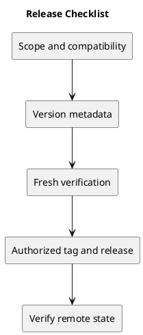

# Release Checklist

## Preparation

- Identify the exact scope and release candidate commit.
- Check compatibility, migrations, configuration, and rollback implications.
- Select the version using the [version policy](../Project-Management/versioning-strategy.md).
- Align package/lockfile version metadata, README version, changelog, and release notes.
- Record known issues and unresolved checks.

## Verification

- Run frontend lint and build, including TypeScript checks.
- Run relevant backend tests in the isolated test configuration.
- Exercise affected browser journeys and relevant concurrency scenarios.
- Verify CI on the exact release commit; record evidence using the [template](verification-template.md).
- Check documentation links, PlantUML sources, and image previews.

## Publication

- Confirm authorization to publish the release.
- Verify the candidate commit and clean release state.
- Create an annotated tag on the reviewed commit; do not move an existing published tag.
- Publish clear notes with changes, validation, upgrade effects, and known issues.
- Verify remote main/tag identities and published notes.

Deployment is a separate authorized operation. CI currently runs on main pushes and pull requests targeting main; it does not automatically publish tags or deploy.

## PlantUML diagram

[Editable source](diagrams/release-checklist.puml)

