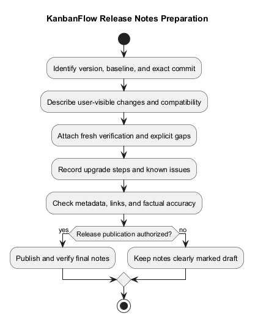
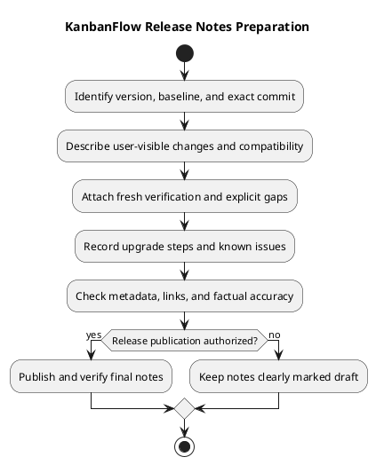

# KanbanFlow Release Notes Template

> **Policy amendment (2026-10-10):** Membership mutations are now owner-only; DEC-003/PB-001's bypass is fixed. Earlier open-policy text and diagrams below describe the preceding state. See [QA corrections](../SDLC/06-testing/qa-corrections-2026-10-10.md) for the selected rule and regression evidence.

## Purpose and use

Use this document to prepare notes for an actual KanbanFlow source release. It provides a copyable format and review guidance; it is not itself a published release, version approval, or deployment record.

Replace all placeholders with observed facts. Keep draft identity and missing evidence explicit. Do not invent dates, reviewers, test counts, user research, compatibility claims, or publication links.

## Copyable notes format

The following block is a template. Optional sections may be removed when genuinely irrelevant; required upgrade and known-gap information must remain clear.

````markdown
# KanbanFlow <version>

Status: <Draft or Published>
Published UTC date: <Actual date when published, or pending>
Tag: <Exact version tag>
Source commit: <Full SHA>
Previous release: <Baseline tag>

<One short paragraph describing the concrete user-visible outcome.>

## Added
- <New capability and who benefits; omit if none.>

## Fixed
- <Trigger/problem and corrected behavior; omit if none.>

## Changed and compatibility
- <Behavior, API, permission, runtime, or data effects.>
- <Affected users and any incompatible transition.>

## Validation
| Check | Tested commit/environment | Result | Evidence |
| --- | --- | --- | --- |
| Backend tests | <SHA, runtime, database> | <Actual result/counts> | <Log or CI link> |
| Frontend lint/build | <SHA, runtime> | <Actual result> | <Evidence> |
| Browser journeys | <SHA, browser, scenarios> | <Actual result or not run> | <Evidence/reason> |
| Relevant contention/recovery checks | <Environment/scenario> | <Actual result or not applicable with reason> | <Evidence/reason> |

<Explicit failed, skipped, or unverified boundaries.>

## Upgrade
- Migrations/data: <Actual required changes, or checked none.>
- Configuration: <Actual settings/host changes, or checked none.>
- Dependencies/runtime: <Actual requirement changes, or checked none.>
- Assets/services: <Rebuild/restart instructions as applicable.>
- Compatibility/recovery: <Limits and link to verified guidance.>

## Known issues
- <Open defect, policy decision, or verification gap and practical impact.>

## Source and publication
- Release: <Actual published URL, or pending in draft.>
- Comparison: <Actual previous-tag to new-tag comparison.>
- Verification record: <Actual evidence link.>
````

## Identity and version rules

Confirm the actual version using the [version policy](../Project-Management/versioning-strategy.md). Publication date is the actual release date, not a guessed implementation date.

Record exact commit/tag identity. Main can advance after release; immutable tag/commit references anchor historical evidence. A draft or local tag is not a published release.

Keep package/lockfile metadata, README version, changelog, notes, and tag consistent for the selected candidate. This template update does not bump the application version.

## Describe changes for users

Lead with the problem and resulting behavior. Explain additions, fixes, and compatibility effects at the level needed to understand the release. A raw commit list is supporting history rather than sufficient release notes.

For permission changes, identify affected users and access effects. For configuration fixes, identify the concrete host/session or runtime dependency. Avoid unrelated implementation detail, unsupported productivity claims, and vague descriptions such as “improvements” without explaining them.

## Validation and evidence

Record checks actually run against the final candidate. Historical counts from older releases cannot demonstrate a changed commit. Include the environment and actual logs/CI links when available.

Current [CI](../../.github/workflows/ci.yml) runs backend tests and frontend lint/build. [Backend tests](../../backend/phpunit.xml) use SQLite; they do not establish MySQL contention. Builds do not establish browser usability, deployment, or backup recovery.

Use the [verification template](verification-template.md). Label not-run and not-applicable checks honestly with a reason rather than implying they passed.

## Upgrade communication

Assess migrations, stored data, API/behavior compatibility, configuration, dependencies, assets, and service restarts. Say “none” only after reviewing the actual change.

Use deployment-specific URLs and avoid publishing secrets. Local development examples must be labeled local. Refer to [upgrade and rollback guidance](upgrade-and-rollback.md); a code checkout does not restore records or automatically reverse schema changes.

No database reset command should be presented as an ordinary upgrade step.

## Known issues and policy decisions

Keep the manager remove/re-add role-change loophole in notes while it remains unresolved. Do not declare it fixed because unrelated membership tests or CI passed.

Record other open defects, failed criteria, and operational limits specific to the candidate. The absence of a reported issue is not a guarantee of defect-free software.

If an older defect is fixed, name the corrected behavior and actual evidence. Preserve historical release context rather than silently changing what an earlier version delivered.

## Draft, publication, and correction

Prepare notes before publication and verify the final candidate after metadata/source changes. Follow the [release checklist](release-checklist.md) and [pipeline](../Project-Management/release-pipeline.md).

Publishing notes and pushing a tag are distinct operations. Verify final title, body, tag, draft/prerelease status, and source identity. If publication fails, inspect remote state before retrying.

Correct factual notes errors explicitly. Do not silently move a published source tag; released code fixes need a new verified version.

## Review checklist

- Is the version and exact source identity correct?
- Are user-visible changes explained and scope accurate?
- Are permission/compatibility effects explicit?
- Do validation claims have fresh candidate evidence?
- Are upgrade steps checked and environment-specific?
- Are known issues and unverified boundaries visible?
- Do publication/comparison/evidence links point to real records?
- Are secrets and personal data absent?
- Is source publication distinct from production deployment?

## Maintenance and examples

Consult the [release index](README.md) and existing version records for historical examples. Update this template when evidence practices, metadata, tooling, or operational requirements change.

Synchronize the PlantUML source and rendered preview. Do not copy historical results from examples into a future release.

## PlantUML diagram



[Editable source](diagrams/release-notes-template.puml)

