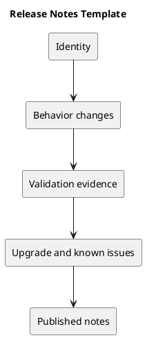

# Release Notes Template

Use this outline for a future release; it is not a published release record.

## Identity

Record KanbanFlow version, publication date, exact commit/tag, and comparison link.

## Changes

Describe the user-visible problem and resulting behavior. Separate additions, fixes, and compatibility effects. Avoid copying the commit list without explanation.

## Validation

List checks actually run against the candidate, their results, and evidence links. Distinguish historical results from fresh verification.

## Upgrade

State migrations, dependency changes, configuration updates, rebuild/restart requirements, and known rollback implications. Explicitly say when none apply only after checking.

## Known issues

List unresolved defects, policy decisions, and verification gaps. Do not mark them resolved without evidence.

## Publication links

Include the published release and source comparison once available. Keep the changelog and release record consistent.

## PlantUML diagram

[Editable source](diagrams/release-notes-template.puml)

