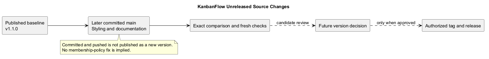
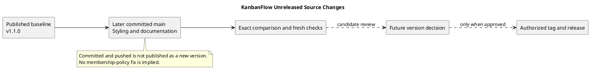

# KanbanFlow Unreleased Changes

## Baseline and snapshot identity

The latest published GitHub release checked for this update is [v1.1.0](v1.1.0.md), published on 2026-10-07. Its source tag resolves to af22a01afc05c40447d69c4f15a088daecf33597.

This inventory covers subsequent committed changes through **7ce8e331a136530e43cd60cecf473fb943842472**. It is a maintained snapshot, not an automatically complete live feed. The commit that updates this inventory will necessarily be later than its recorded boundary.

The older text described milestone organization and release documents as local-only. Those changes were committed and pushed in 70ca77a; that stale description is corrected here.

## User-visible fix

Board creator/date and project start/due dates now appear as plain metadata instead of input-like bordered boxes. Commit 0d208ff delivered the change after v1.1.0.

This fix is committed on main but has not created a new published patch version. Existing theme/UI features from v1.1.0 are the baseline rather than new additions in this inventory.

## Documentation additions and completion

- Documentation categories, index, and diagram guidance.
- Project definitions covering assumptions, goals, problem, context, risks, scope, stakeholders, and external systems.
- Management guides for refinement, decisions, traceability, milestones, backlog, quality, release pipeline, roadmap, sprint workflow, and versioning.
- Historical milestone files grouped under Project-Management/Milestones, with corrected formatting, expanded historical records, and diagrams.
- Release records, index, checklist, notes template, verification template, and upgrade/rollback guidance.
- Eight SDLC phase guides and sprint planning/review/retrospective templates.
- Inline PlantUML sources, standalone editable files, and GitHub-visible PNG previews.

These documents are guidance and historical records. They do not establish new production deployments, completed real sprints, approved membership policy, or a demonstrated backup restore.

## Committed source inventory

| Commit | Recorded change |
| --- | --- |
| [0d208ff](https://github.com/Farhad-Valizadegan/Web-KanbanFlow/commit/0d208ff) | fix(ui): display board and project metadata without input-style boxes |
| [549a6b9](https://github.com/Farhad-Valizadegan/Web-KanbanFlow/commit/549a6b9) | docs: add documentation structure and diagram guide |
| [748712e](https://github.com/Farhad-Valizadegan/Web-KanbanFlow/commit/748712e) | docs: define KanbanFlow project scope with PlantUML diagrams |
| [7759f7e](https://github.com/Farhad-Valizadegan/Web-KanbanFlow/commit/7759f7e) | docs: improve project definitions and render PlantUML previews |
| [372c828](https://github.com/Farhad-Valizadegan/Web-KanbanFlow/commit/372c828) | docs: add project management guidance with PlantUML diagrams |
| [70ca77a](https://github.com/Farhad-Valizadegan/Web-KanbanFlow/commit/70ca77a) | docs: complete release records and organize milestones |
| [52e93b2](https://github.com/Farhad-Valizadegan/Web-KanbanFlow/commit/52e93b2) | docs: add SDLC phase guides and PlantUML diagrams |
| [6a815d1](https://github.com/Farhad-Valizadegan/Web-KanbanFlow/commit/6a815d1) | docs: complete sprint guides and templates with PlantUML diagrams |
| [eda0885](https://github.com/Farhad-Valizadegan/Web-KanbanFlow/commit/eda0885) | docs: complete assumptions and constraints with updated diagram |
| [ec11f99](https://github.com/Farhad-Valizadegan/Web-KanbanFlow/commit/ec11f99) | docs: complete KanbanFlow overview and product goals |
| [8a9a872](https://github.com/Farhad-Valizadegan/Web-KanbanFlow/commit/8a9a872) | docs: complete KanbanFlow system context and boundaries |
| [83b7a63](https://github.com/Farhad-Valizadegan/Web-KanbanFlow/commit/83b7a63) | docs: complete KanbanFlow problem statement and validation goals |
| [b63e6fa](https://github.com/Farhad-Valizadegan/Web-KanbanFlow/commit/b63e6fa) | docs: complete risk register and success criteria |
| [95e554d](https://github.com/Farhad-Valizadegan/Web-KanbanFlow/commit/95e554d) | docs: complete scope boundaries and stakeholder responsibilities |
| [db6b20e](https://github.com/Farhad-Valizadegan/Web-KanbanFlow/commit/db6b20e) | docs: complete product scope boundary and exclusions |
| [bf8e3c6](https://github.com/Farhad-Valizadegan/Web-KanbanFlow/commit/bf8e3c6) | docs: complete stakeholder and external system definitions |
| [00a31b9](https://github.com/Farhad-Valizadegan/Web-KanbanFlow/commit/00a31b9) | docs: complete project management index and workflow |
| [322a50d](https://github.com/Farhad-Valizadegan/Web-KanbanFlow/commit/322a50d) | docs: complete backlog refinement process and acceptance guidance |
| [9b20425](https://github.com/Farhad-Valizadegan/Web-KanbanFlow/commit/9b20425) | docs: complete decision register and policy closure guidance |
| [9d81853](https://github.com/Farhad-Valizadegan/Web-KanbanFlow/commit/9d81853) | docs: complete documentation traceability and evidence guidance |
| [09e0146](https://github.com/Farhad-Valizadegan/Web-KanbanFlow/commit/09e0146) | docs: complete milestone register and evidence boundaries |
| [a9017b4](https://github.com/Farhad-Valizadegan/Web-KanbanFlow/commit/a9017b4) | docs: complete product backlog outcomes and acceptance criteria |
| [2d52200](https://github.com/Farhad-Valizadegan/Web-KanbanFlow/commit/2d52200) | docs: complete risk-based quality and verification plan |
| [576edd0](https://github.com/Farhad-Valizadegan/Web-KanbanFlow/commit/576edd0) | docs: complete release pipeline and publication verification |
| [f584eb9](https://github.com/Farhad-Valizadegan/Web-KanbanFlow/commit/f584eb9) | docs: complete roadmap priorities and dependency evidence |
| [f317e35](https://github.com/Farhad-Valizadegan/Web-KanbanFlow/commit/f317e35) | docs: complete sprint workflow and evidence-based closure |
| [3b5b9f5](https://github.com/Farhad-Valizadegan/Web-KanbanFlow/commit/3b5b9f5) | docs: complete feature traceability and verification mapping |
| [8707f93](https://github.com/Farhad-Valizadegan/Web-KanbanFlow/commit/8707f93) | docs: complete versioning strategy and release metadata rules |
| [052644a](https://github.com/Farhad-Valizadegan/Web-KanbanFlow/commit/052644a) | docs: complete milestone 5 collaboration record and diagram |
| [6e2647c](https://github.com/Farhad-Valizadegan/Web-KanbanFlow/commit/6e2647c) | docs: complete milestone 6 notification record and diagram |
| [af95282](https://github.com/Farhad-Valizadegan/Web-KanbanFlow/commit/af95282) | docs: complete milestone 7 analytics and assignment record |
| [e26a586](https://github.com/Farhad-Valizadegan/Web-KanbanFlow/commit/e26a586) | docs: complete milestone 8 CI evidence and readiness boundaries |
| [12c56df](https://github.com/Farhad-Valizadegan/Web-KanbanFlow/commit/12c56df) | docs: complete release index and delivery evidence guidance |
| [fbd27c4](https://github.com/Farhad-Valizadegan/Web-KanbanFlow/commit/fbd27c4) | docs: complete release checklist and publication gates |
| [7ce8e33](https://github.com/Farhad-Valizadegan/Web-KanbanFlow/commit/7ce8e33) | docs: complete release notes template and evidence guidance |

This table is generated from the local v1.1.0-to-snapshot Git history when preparing this document. Commit titles identify changes; actual diffs and evidence establish their effects.

## Compatibility and upgrade assessment

The inventoried changes consist of metadata styling and documentation. They do not introduce a recorded schema migration or dependency upgrade. Rebuild frontend assets to deliver the styling change in an environment serving built assets.

A future release still requires inspection of the final candidate, including any changes after this boundary. Do not copy this assessment into a later release without checking the actual diff.

## Verification evidence and limits

Frontend lint/build passed when the styling change was made. A later local project check recorded 163 backend tests and 470 assertions plus frontend lint/type/build success. Those results are historical session evidence, not a fresh execution against this document's snapshot.

Documentation updates recorded link checks and diagram rendering. This update verifies its references and renders its own preview; it does not claim a new complete application QA pass. Use the [verification template](verification-template.md) for exact commit/environment results when preparing a release.

## Open issues and unclaimed work

The manager remove/re-add role-change loophole remains unresolved. Owners should manage membership until DEC-003 is agreed and PB-001 enforcement is verified.

Dedicated user guidance and environment-specific backup/restore work remain backlog candidates. The conceptual release and operational documents do not close those items. No new availability, capacity, performance, or recovery guarantee is implied.

## Release preparation

Before turning these changes into a release:

1. Recompute the source inventory from the previous published tag.
2. Review all later commits and the working-tree state.
3. Agree scope and version using the [version policy](../Project-Management/versioning-strategy.md).
4. Align metadata and notes, then verify the exact final candidate.
5. Follow the [release checklist](release-checklist.md) and [pipeline](../Project-Management/release-pipeline.md).
6. Publish only within the authorized action and verify remote identities.

This documentation update does not bump the package version, create a tag, or publish a GitHub release.

## Evidence and maintenance links

- [Exact inventoried comparison](https://github.com/Farhad-Valizadegan/Web-KanbanFlow/compare/v1.1.0...7ce8e331a136530e43cd60cecf473fb943842472)
- [Current comparison, which changes as main advances](https://github.com/Farhad-Valizadegan/Web-KanbanFlow/compare/v1.1.0...main)
- [Published release index](README.md)
- [Product backlog](../Project-Management/product-backlog.md)
- [Decision register](../Project-Management/decision-register.md)
- [Upgrade and rollback](upgrade-and-rollback.md)

Refresh the boundary and inventory when new commits are included or a new release becomes the baseline. Preserve the distinction between local edits, committed/pushed source, and published versions. Regenerate the diagram preview when its source changes.

## PlantUML diagram

[Editable source](diagrams/unreleased.puml)

