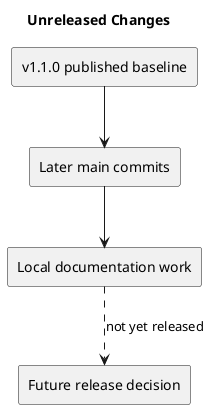

# Unreleased Changes

The latest published release is v1.1.0. The following main commits are later changes, without a new release version:

| Commit | Change |
| --- | --- |
| 0d208ff | Board creator/date and project dates use plain metadata styling. |
| 549a6b9 | Documentation categories and diagram guide. |
| 748712e | Project definition documents and PlantUML sources. |
| 7759f7e | Expanded definitions and rendered diagram previews. |
| 372c828 | Project management guidance and diagrams. |

The milestone-folder reorganization and this Releases documentation are local working changes at the time of writing. Check Git status and history before preparing a release; this list is a snapshot, not an automatically maintained feed.

## Open issue

Manager remove/re-add can bypass intended owner-only role changes. No new release or fix is implied by these documentation changes.

## PlantUML diagram

[Editable source](diagrams/unreleased.puml)

