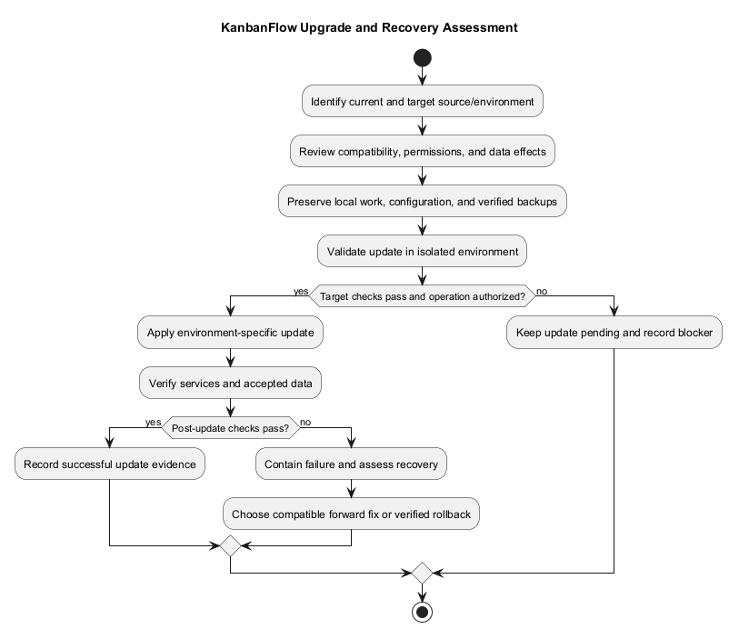
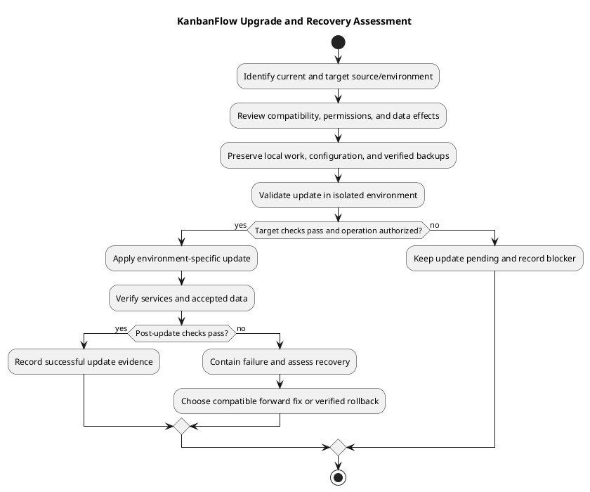

# KanbanFlow Upgrade and Rollback Guidance

## Purpose and limits

This guide provides an assessment and verification sequence for updating KanbanFlow source/assets/configuration and deciding how to recover if an update fails.

It is not a demonstrated production runbook. Hosting topology, backup retention, recovery objectives, and verified restore procedures have not been established here. Production writes, deployment, and data restoration require the authorized operation and environment-specific evidence.

## Identify the starting point

Record:

- Current source commit/tag and target version.
- Whether the running assets match that source.
- Actual PHP/Node/dependency and database environment.
- Deployment layout, configuration locations, and service controls.
- Local changes, untracked files, and environment values that must be preserved.
- Known issues and security behavior in both versions.

Main may be newer than a published tag. Package metadata alone does not establish which source or assets are running.

## Compatibility review

| Area | Assess before changing |
| --- | --- |
| Source/API | Routes, request/response behavior, permissions, and supported consumers. |
| Database | Schema/data changes, migration requirements, and old/new source compatibility. |
| Configuration | Hosts, stateful origins, cookies, secrets, and cache effects. |
| Dependencies | Lockfile changes and required runtime/extensions. |
| Frontend | Built assets, routes, and affected browser journeys. |
| Recovery | Available backups, restore evidence, and safe source/assets/configuration combinations. |

Read the exact target release notes and diff. A migration is not automatically reversible, and a code checkout is not a data recovery operation.

## Preserve before updating

Preserve unrelated source work and environment files without committing secrets. Record the known-good version and relevant lockfiles/assets.

Before data-affecting changes, use an actual verified backup procedure for the target environment. Identify what it protects, where it is stored, how restoration is verified, and who may perform it. This guide does not invent a backup command or imply a successful restore.

Avoid destructive database reset commands as routine upgrade steps. Do not overwrite local work or reuse deployment-specific secrets from examples.

## Known release requirements

| Release | Recorded upgrade effects |
| --- | --- |
| [v1.0.1](v1.0.1.md) | No migrations/dependency upgrades reported; rebuild/restart as applicable. Private-board access restrictions affect users who previously accessed another user's board. |
| [v1.0.2](v1.0.2.md) | No migrations/dependency upgrades reported; align session hosts/origins and clear stale configuration. |
| [v1.1.0](v1.1.0.md) | No migrations/dependency upgrades reported; rebuild frontend assets for themes/UI changes. |

These are historical release claims, not a blanket guarantee for future candidates or later main commits.

For the documented local v1.0.2 setup, APP_URL and VITE_API_URL use http://localhost:8000; FRONTEND_URL uses http://localhost:5173; SANCTUM_STATEFUL_DOMAINS includes localhost:5173,localhost:8000. Use actual deployed domains and transport outside local development.

## Update sequence

1. Agree the target source and operation scope.
2. Review compatibility and preserve required work/data/configuration.
3. Validate the target in an isolated environment.
4. Install dependencies from the intended lockfiles when required.
5. Apply only assessed migrations/configuration changes.
6. Build matching frontend assets and manage services using the environment's procedure.
7. Refresh affected configuration caches when needed.
8. Verify application behavior and persisted state.
9. Record exact identity, results, and limitations.

Use the [setup guide](../../README.md) for project commands. Backend configuration cache clearing is a targeted configuration action, not a replacement for service and cookie checks. Do not regenerate the application key as an ordinary existing-installation update step.

## Post-update smoke checks

| Check | Evidence to observe |
| --- | --- |
| Identity/services | Intended source/assets and reachable backend/database. |
| Authentication | Sign-in, sign-out, existing session behavior, and protected requests. |
| Authorization | Permitted resources accessible; relevant denied/private paths rejected. |
| Task data | Existing records readable and accepted edits persist after refresh. |
| Ordering/WIP | Relevant workflow movements and rejected actions behave correctly. |
| UI | Affected themes, navigation, keyboard focus, and narrow layouts. |
| Collaboration/analytics | Relevant comments, notifications, and summaries agree with accepted records. |

Use isolated test accounts/data where appropriate. Do not treat a health endpoint or build success as proof of every journey.

## Failure containment and recovery choice

If checks fail, record the trigger, affected users/data, exact versions, and evidence. Avoid repeated mutations or destructive actions that make the state harder to recover.

Choose between a scoped forward correction and a compatible rollback based on the actual cause, data state, security consequences, and available recovery evidence. Do not silently declare a failed update successful.

## Rollback compatibility assessment

| Layer | Required assessment |
| --- | --- |
| Source | Known-good commit and supported behavior. |
| Assets | Frontend output matches the selected source/API. |
| Configuration | Selected version accepts the current environment settings. |
| Dependencies | Installed packages/runtime match intended lockfiles. |
| Data/schema | Older code can safely read/write the current records. |
| Security | Returning to older permission/session behavior does not introduce unacceptable exposure. |

Rolling back v1.0.1 security/privacy corrections can reintroduce defects. Review version-specific consequences rather than assuming older means safer.

## Data restoration boundary

Restore only from a backup whose coverage and procedure have been verified for the environment. Validate the restore in isolation before production use. Reconcile data created after the backup and document what may be lost.

Code rollback, asset replacement, and configuration changes do not restore deleted records or reverse all migrations. Restoration is its own authorized operation, not an implicit step in source publication.

## Verification and recovery record

Record exact current/target/recovery commit identities, environment, preserved artifacts, compatibility decisions, operations performed, check results, and remaining gaps.

Use the [verification template](verification-template.md). Backend SQLite tests do not demonstrate production MySQL recovery or contention. Browser usability and post-update behavior need relevant runtime evidence.

## Open issues and related guidance

The manager remove/re-add role-change loophole remains unresolved; updating documentation or rolling back unrelated code does not fix it. See the [decision register](../Project-Management/decision-register.md).

- [Release index](README.md)
- [Release checklist](release-checklist.md)
- [Release pipeline](../Project-Management/release-pipeline.md)
- [Quality plan](../Project-Management/quality-and-risk-plan.md)
- [Operational backlog candidate PB-003](../Project-Management/product-backlog.md)

## Maintenance

Update this guide when runtime, schema, deployment configuration, or actual recovery procedures change. Keep historical release requirements distinct from current target assessment, and synchronize PlantUML source and preview.

No deployment, backup restore, or new release is performed by this documentation update.

## PlantUML diagram

[Editable source](diagrams/upgrade-and-rollback.puml)

