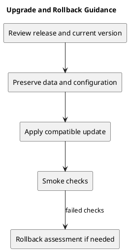

# Upgrade and Rollback Guidance

## Before updating

Read the target release notes and compare its tag with the installed version. Preserve local changes and environment files. Back up relevant data and configuration using a verified operational procedure before changes that affect them. Record the current source version and dependency lockfiles.

## Updating the known releases

v1.0.1, v1.0.2, and v1.1.0 report no migrations or dependency upgrades. Rebuild frontend assets after frontend updates. For v1.0.2, align local hosts and Sanctum origins as described in its [release record](v1.0.2.md). Restart services and verify sign-in, resource access, and affected journeys.

Use the [setup guide](../../README.md) for project commands. Do not run database reset commands as an upgrade step.

## Rollback assessment

Identify a known-good source version and compatible assets/configuration. Validate the rollback in an isolated environment before production use. Never assume a code checkout reverses database changes or recovers lost records. Data restoration requires its own verified backup procedure and authorization.

Rolling back privacy or authorization fixes can reintroduce defects. Evaluate security implications before selecting an older version. No production rollback has been demonstrated by this guide.

## PlantUML diagram

[Editable source](diagrams/upgrade-and-rollback.puml)

