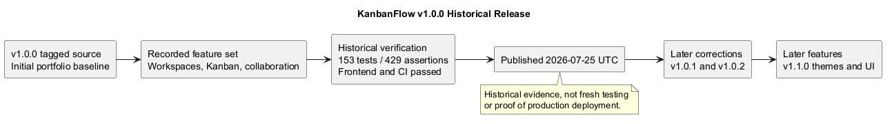
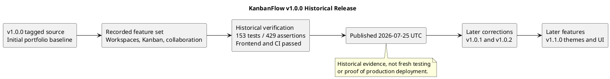

# KanbanFlow v1.0.0

## Release identity

| Field | Recorded value |
| --- | --- |
| Version/tag | v1.0.0 |
| Published UTC timestamp | 2026-07-25T15:46:22Z |
| Published title | KanbanFlow v1.0.0 |
| Tagged source commit | b01f5efe2d5547e0c3ac3e3188ca96ccbb63119c |
| Role in history | First complete portfolio release described by the published notes. |

- [Published release](https://github.com/Farhad-Valizadegan/Web-KanbanFlow/releases/tag/v1.0.0)
- [Tagged source](https://github.com/Farhad-Valizadegan/Web-KanbanFlow/tree/v1.0.0)
- [Exact source commit](https://github.com/Farhad-Valizadegan/Web-KanbanFlow/commit/b01f5efe2d5547e0c3ac3e3188ca96ccbb63119c)

Publication metadata was read from GitHub; source identity was resolved from the local tag. This record does not move or replace the tag, edit the published release, or claim a fresh execution of its tests.

## Release purpose

v1.0.0 established a portfolio baseline for the full-stack Kanban project management application. Its feature set organized shared work into workspaces, projects, boards, columns, and tasks, with collaboration and progress summaries.

“Complete portfolio release” describes the published baseline. It does not mean defect-free software, a formally audited security posture, or a production service with availability guarantees.

## Published feature scope

| Area | Scope described in published notes |
| --- | --- |
| Authentication | Laravel Sanctum authentication. |
| Organization | Workspace and project management. |
| Permissions | Role-based authorization. |
| Workflow | Boards, columns, tasks, drag-and-drop ordering, and WIP limits. |
| Ownership | Task assignment and reassignment. |
| Collaboration | Comments and activity tracking. |
| Awareness | Database notifications and workspace analytics. |
| Interface | Responsive React and Tailwind interface. |

These are historical release claims. Later patches refined privacy, authorization, ordering, authentication configuration, and analytics refresh; do not infer their corrections were already present here.

## Published technology description

The notes identify Laravel 13, PHP 8.4, React 19, TypeScript 6, MySQL, Tailwind CSS 4, TanStack Query, and dnd-kit.

For exact version ranges, lockfiles, and runtime requirements at this release, inspect the tagged source. Current main manifests may differ and must not be treated as immutable v1.0.0 evidence.

## Historical verification

| Check | Published result |
| --- | --- |
| Backend suite | 153 tests passed. |
| Backend assertions | 429 passed. |
| Frontend ESLint | Passed. |
| TypeScript build | Passed. |
| Vite production build | Passed. |
| GitHub Actions | Passed. |

These results come from the published release notes, not a fresh test run. The notes do not supply an exact browser matrix, contention/restore result, or per-check log here; none is invented.

Test counts describe historical execution, not complete requirement coverage or user success. CI/build success does not demonstrate production deployment, accessibility, or data recovery.

## Installation and compatibility

For historical installation, inspect the v1.0.0 tagged README and configuration rather than assuming current setup instructions match unchanged. For current development setup, use the [project README](../../README.md).

The published v1.0.0 notes do not provide a detailed migration/dependency upgrade declaration for an earlier installation. Do not infer that every path into this baseline requires no data changes.

Review the target environment, preserved source/configuration, database state, and lockfiles before using an old version. Do not use database reset commands as ordinary upgrade steps.

## Later corrections and features

| Later release | Relevance when assessing v1.0.0 |
| --- | --- |
| [v1.0.1](v1.0.1.md) | Private-board access, removed-member comment permissions, login handling, keyboard/rollback behavior, and ordering consistency. |
| [v1.0.2](v1.0.2.md) | Local session-host configuration, analytics refresh, and naming. |
| [v1.1.0](v1.1.0.md) | Themes, navigation, search, accessible controls, and broader UI improvements. |

This is retrospective context from later records, not a fabricated list of findings known at the original publication date.

The manager remove/re-add role-change loophole remains unresolved in current planning. Refer to the [decision register](../Project-Management/decision-register.md); this historical baseline does not close it.

## Use, licensing, and operational boundaries

The published v1.0.0 notes state that source is provided for portfolio review and include restrictions on reuse without prior written permission. Preserve that historical statement without treating other package metadata as a definitive grant of rights.

This document does not change repository licensing, establish permission to reuse source, or resolve licensing discrepancies. Consult actual repository/publisher terms before reuse.

A source release is separate from deployment. No production uptime, capacity, backup retention, or restore guarantee is established by these notes.

## Upgrade and rollback assessment

Prefer reviewing later published corrections before selecting an operational baseline. Returning to older privacy or authorization behavior can reintroduce defects.

Read [upgrade and rollback guidance](upgrade-and-rollback.md). Code checkout does not restore records or automatically reverse schema/configuration changes. Validate compatibility and recovery in an isolated authorized environment.

## Evidence maintenance

Keep source/tag identity and historical results stable. New checks against this tag should be recorded separately with exact environment and results using the [verification template](verification-template.md).

Use the [release index](README.md) for published history and [unreleased snapshot](unreleased.md) for later untagged source. This documentation change does not publish a new version.

## PlantUML diagram

[Editable source](diagrams/v1.0.0.puml)

