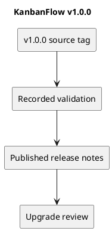

# KanbanFlow v1.0.0

Published on 2026-07-25 (UTC date), as recorded by GitHub.

[Published release](https://github.com/Farhad-Valizadegan/Web-KanbanFlow/releases/tag/v1.0.0) · [Tagged source](https://github.com/Farhad-Valizadegan/Web-KanbanFlow/tree/v1.0.0)

## Changes

Initial complete portfolio release: authentication, workspace/project management, Kanban workflows, task assignments, comments, activity, database notifications, and analytics.

## Historical validation

153 tests and 429 assertions; frontend lint, TypeScript/build, and GitHub Actions passed according to published release notes.

These are historical release results, not a fresh test run of this tag.

## Upgrade and compatibility

Use the setup guide for initial installation. Later patch releases correct privacy, authentication, ordering, and analytics behavior. This record does not treat v1.0.0 as the recommended current baseline.

## Known issue

The manager remove/re-add role-change loophole requires an agreed membership policy and backend enforcement. Earlier defects may have been addressed in later releases; read the latest release record before using a historical version.

## PlantUML diagram

[Editable source](diagrams/v1.0.0.puml)

