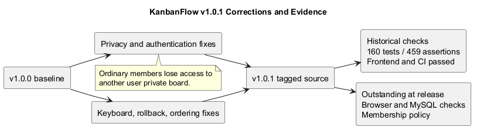
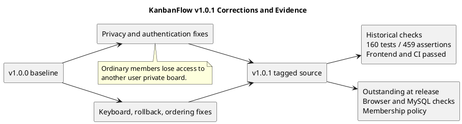

# KanbanFlow v1.0.1

## Release identity

| Field | Recorded value |
| --- | --- |
| Version/tag | v1.0.1 |
| Published UTC timestamp | 2026-10-06T20:51:27Z |
| Published title | KanbanFlow v1.0.1 — Security and usability fixes |
| Tagged source commit | cceb9f6550a35275e23fa518f575ecd017c70e0e |
| Previous release | v1.0.0 |
| Recorded type | Patch release for review findings. |

- [Published release](https://github.com/Farhad-Valizadegan/Web-KanbanFlow/releases/tag/v1.0.1)
- [Tagged source](https://github.com/Farhad-Valizadegan/Web-KanbanFlow/tree/v1.0.1)
- [Source comparison](https://github.com/Farhad-Valizadegan/Web-KanbanFlow/compare/v1.0.0...v1.0.1)

Publication metadata comes from GitHub and source identity was resolved from the tag. This expanded record does not edit the published release or retarget its source.

## Purpose

v1.0.1 corrected access-control and Kanban interaction issues found during local review. It combined privacy/session feedback, role-aware controls, movement rollback, keyboard interaction, and ordering consistency.

A security/usability patch does not establish an audit certification or defect-free behavior. The published notes explicitly retain open issues and verification gaps.

## Privacy and authentication corrections

| Change | Recorded behavior |
| --- | --- |
| Private-board access | Listings, tasks, comments, analytics, and activity respect visibility. Creators and current workspace owners/managers retain the specified private access. |
| Removed-member comments | Editing/deletion requires current workspace access, even for the comment author. |
| Login limits | Five requests per minute per account/IP pair and thirty per minute per IP. |
| Authentication errors | Structured JSON feedback replaces inappropriate HTML responses. |

These are historical release behaviors. Inspect tagged implementation for exact rules, and current source for later changes.

## Interface and movement corrections

- Management controls reflect the signed-in user's workspace role.
- Direct member-role updates are reserved for owners in the recorded implementation.
- Member operations show permission, validation, expired-session, and connection errors.
- Task movement updates lists optimistically; failed moves restore prior lists and refresh server data.
- Board, column, and task dragging includes keyboard support and handle-focus behavior.

The published keyboard instructions are: focus a move handle, press Space, use arrow keys, then Space to drop or Escape to cancel. Browser checks of these flows were still outstanding at publication.

## Ordering and stale-state handling

The notes record renumbering after board/column deletion, parent-row locks for ordered creation/movement, and locking/rechecking a task's current column before movement, editing, or deletion.

Seven backend regressions and deterministic board visibility were added. These changes address specified correctness boundaries but do not by themselves demonstrate MySQL contention safety; that check remained outstanding then.

## Historical validation

| Check | Published result |
| --- | --- |
| Backend suite | 160 tests and 459 assertions passed. |
| Frontend lint | Passed. |
| TypeScript/production build | Passed. |
| GitHub Actions | Both jobs passed for cceb9f6. |

[Recorded CI run](https://github.com/Farhad-Valizadegan/Web-KanbanFlow/actions/runs/37528446171).

These are historical results from published notes, not a fresh execution against v1.0.1. Backend tests used in-memory SQLite. No numerical coverage or production-readiness guarantee is inferred from counts.

## Upgrade and compatibility

The release reports no database migrations or dependency upgrades. Rebuild frontend assets and restart application services as appropriate for the environment.

**Access effect:** ordinary members who previously accessed another user's private board lose that access. Review this consequence with affected users rather than describing the patch as having no behavior change.

Preserve local work/configuration and assess exact source/assets compatibility before updating. Consult [upgrade and rollback guidance](upgrade-and-rollback.md); code rollback does not restore records.

## Issues and gaps open at publication

| Historical issue/gap | Published position |
| --- | --- |
| Local hosts/stateful origins | Examples mixed localhost and 127.0.0.1 and omitted frontend port in defaults. |
| Manager indirect role changes | Removing/re-adding a member could bypass intended owner-only role changes. |
| Analytics cache | Project mutations did not invalidate workspace analytics. |
| Browser verification | Keyboard movement and rollback checks outstanding. |
| MySQL concurrency | Contention testing outstanding; SQLite evidence insufficient. |

This table preserves the publication-time state. It is not a claim that all these issues remain open today.

## Later resolution context

[v1.0.2](v1.0.2.md) corrected local session configuration and analytics refresh and recorded isolated browser and MySQL contention checks. [v1.1.0](v1.1.0.md) later added themes and broader UI behavior.

The manager remove/re-add loophole remains unresolved in current planning. Follow the [decision register](../Project-Management/decision-register.md) and [PB-001](../Project-Management/product-backlog.md); the direct-update restriction alone does not close it.

## Operational and rollback limits

A published source patch is not a deployed service. No uptime, capacity, backup/restore, or complete browser-support guarantee is established here.

Rolling back these privacy/authorization corrections can reintroduce access defects. Assess security and data compatibility before selecting an older version; use isolated checks and explicit operation authorization.

## Evidence and maintenance

New verification of this tag should record exact environment, scenarios, results, and gaps using the [verification template](verification-template.md). Preserve historical identity and label later corrections separately.

See the [release index](README.md), [quality plan](../Project-Management/quality-and-risk-plan.md), and [release checklist](release-checklist.md). Synchronize PlantUML source and preview when this document changes.

## PlantUML diagram

[Editable source](diagrams/v1.0.1.puml)

