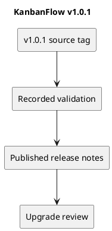

# KanbanFlow v1.0.1

Published on 2026-10-06 (UTC date), as recorded by GitHub.

[Published release](https://github.com/Farhad-Valizadegan/Web-KanbanFlow/releases/tag/v1.0.1) · [Tagged source](https://github.com/Farhad-Valizadegan/Web-KanbanFlow/tree/v1.0.1)

## Changes

Enforced private-board visibility and current membership for comment changes; added login rate limits and JSON errors; improved role-aware controls, keyboard dragging, optimistic rollback, and ordered-record consistency.

## Historical validation

160 tests and 459 assertions; frontend lint, TypeScript/build, and CI passed according to published notes. Browser rollback/keyboard checks and MySQL concurrency checks were outstanding at this release.

These are historical release results, not a fresh test run of this tag.

## Upgrade and compatibility

No migrations or dependency upgrades. Rebuild the frontend and restart application services as appropriate. Ordinary members lose access to another user's private board. Host/session configuration, analytics refresh, and the manager remove/re-add loophole were known issues.

## Known issue

The manager remove/re-add role-change loophole requires an agreed membership policy and backend enforcement. Earlier defects may have been addressed in later releases; read the latest release record before using a historical version.

## PlantUML diagram

[Editable source](diagrams/v1.0.1.puml)

