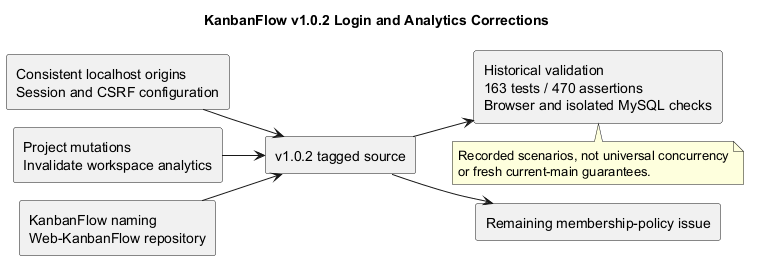
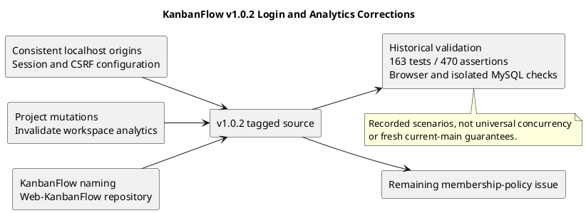

# KanbanFlow v1.0.2

## Release identity

| Field | Recorded value |
| --- | --- |
| Version/tag | v1.0.2 |
| Published UTC timestamp | 2026-10-06T21:27:39Z |
| Published title | KanbanFlow v1.0.2 — Login and analytics fixes |
| Tagged source commit | 6891034c5310040051bbe641fe39375ada6228f8 |
| Previous release | v1.0.1 |
| Recorded type | Patch for session configuration and analytics, including naming changes. |

- [Published release](https://github.com/Farhad-Valizadegan/Web-KanbanFlow/releases/tag/v1.0.2)
- [Tagged source](https://github.com/Farhad-Valizadegan/Web-KanbanFlow/tree/v1.0.2)
- [Source comparison](https://github.com/Farhad-Valizadegan/Web-KanbanFlow/compare/v1.0.1...v1.0.2)

Metadata comes from the published notes; source identity was resolved from the tag. This document does not retag the version or change published release notes.

## Purpose and changes

v1.0.2 addressed local sign-in configuration and stale workspace analytics after project changes. It also included naming updates made after v1.0.1.

| Area | Recorded correction |
| --- | --- |
| Local hosts | Consistent localhost defaults so session and CSRF cookies use compatible hosts. |
| Stateful origins | Trust the Vite frontend port and document frontend/stateful-domain configuration. |
| Analytics refresh | Invalidate affected workspace analytics after project creation, editing, or deletion. |
| Regression coverage | Three authentication tests for trusted origins, login/logout, and registration sessions. |
| Naming | KanbanFlow in titles, defaults, documentation, and metadata; Web-KanbanFlow repository/setup links. |
| Package metadata | Frontend version advanced to 1.0.2 without dependency changes. |

These are historical changes, not proof that every deployment configuration or future mutation path is correct.

## Session and configuration effect

The patch aligned default frontend/backend host examples and documented the frontend origin. Cookies, stateful origins, and CSRF interaction depend on actual browser hosts; merely reaching both services does not establish an authenticated session.

For the recorded local setup:

```dotenv
# backend/.env
APP_URL=http://localhost:8000
FRONTEND_URL=http://localhost:5173
SANCTUM_STATEFUL_DOMAINS=localhost:5173,localhost:8000

# frontend/.env
VITE_API_URL=http://localhost:8000
```

These are local development values, not production configuration. Use the actual deployed domains/transport and appropriate cookie settings elsewhere. Do not copy real secrets into records.

After relevant environment changes, clear stale Laravel configuration and restart development services. See the [setup guide](../../README.md) and [upgrade guidance](upgrade-and-rollback.md).

## Analytics refresh effect

Accepted project create/edit/delete operations refresh affected workspace summaries instead of leaving stale cached totals. Browser observations in the published notes cover live project-count refresh.

This is a specific invalidation correction, not a guarantee of instantaneous synchronization across all users or all future mutation types.

## Historical automated validation

| Check | Published result |
| --- | --- |
| Backend suite | 163 tests and 470 assertions passed. |
| Frontend lint | Passed. |
| TypeScript/build | Passed. |
| Authentication regressions | Trusted origins, login/logout, and registration-session coverage added. |

These counts and results are historical. They are not a fresh run against this tag or current main, and they do not establish full measured coverage.

## Historical browser and MySQL checks

| Scenario | Recorded outcome |
| --- | --- |
| Login | Isolated browser check passed. |
| Project-count refresh | Displayed analytics refreshed after changes. |
| Keyboard task reorder | Ordering persisted after reload. |
| WIP rejection | Rejected move restored the original column. |
| Competing task creation | Four requests respected a one-task WIP limit in disposable MySQL data. |
| Competing column creation | Four requests allocated distinct ordered positions in disposable MySQL data. |

These close the specific earlier verification gaps described in v1.0.1 for the tested scenarios. They do not prove every concurrency interleaving, browser, or production workload.

Backend automated tests use SQLite; distinguish them from the separate recorded MySQL experiments. No raw run artifact or additional environment details are invented here.

## Upgrade and compatibility

The published release reports no migrations or dependency upgrades. Rebuild frontend assets after source updates and manage services according to the actual environment.

Preserve local work/configuration, align session hosts/origins, clear stale configuration when needed, and verify sign-in plus affected analytics/workflow journeys. Inspect tagged source for exact historical requirements; current main may differ.

Do not use database reset commands as an ordinary upgrade step. A source checkout does not restore data.

## Issues at publication and later context

| Item | Publication-time position | Later/current context |
| --- | --- | --- |
| Manager remove/re-add role changes | Unresolved pending policy decision. | Remains open in current planning. |
| Local folder rename | Blocked by an open process; repository already renamed. | Current local folder is Web-KanbanFlow. |

The later folder state is identified explicitly rather than rewriting historical notes. [v1.1.0](v1.1.0.md) subsequently added themes and broader UI improvements.

Owners should manage membership until the policy and enforcement are resolved. See [DEC-003](../Project-Management/decision-register.md) and [PB-001](../Project-Management/product-backlog.md).

## Operational and recovery boundaries

Source publication is not production deployment. This record establishes no uptime, capacity, recovery objective, or complete browser-support guarantee.

Before rollback, assess source/assets/configuration/data compatibility and security consequences. Older versions can reintroduce session, analytics, or access defects. Follow [upgrade and rollback guidance](upgrade-and-rollback.md) with authorized isolated checks.

## Evidence maintenance

Preserve tag identity and historical results. Fresh checks should identify exact commit, environment, scenarios, results, and gaps using the [verification template](verification-template.md).

Use the [release index](README.md), [quality plan](../Project-Management/quality-and-risk-plan.md), and [release checklist](release-checklist.md). Synchronize PlantUML source and preview whenever this record changes.

## PlantUML diagram



[Editable source](diagrams/v1.0.2.puml)

