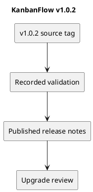

# KanbanFlow v1.0.2

Published on 2026-10-06 (UTC date), as recorded by GitHub.

[Published release](https://github.com/Farhad-Valizadegan/Web-KanbanFlow/releases/tag/v1.0.2) · [Tagged source](https://github.com/Farhad-Valizadegan/Web-KanbanFlow/tree/v1.0.2)

## Changes

Aligned localhost session/CSRF configuration, refreshed workspace analytics after project changes, added authentication regression coverage, and standardized KanbanFlow naming.

## Historical validation

163 tests and 470 assertions; frontend checks, isolated browser login/analytics/keyboard/rollback checks, and disposable MySQL contention checks passed according to published notes.

These are historical release results, not a fresh test run of this tag.

## Upgrade and compatibility

No migrations or dependency upgrades. Set APP_URL and VITE_API_URL to http://localhost:8000, FRONTEND_URL to http://localhost:5173, and SANCTUM_STATEFUL_DOMAINS to localhost:5173,localhost:8000 for local development. Clear backend configuration cache and restart services. Use actual deployment URLs elsewhere. The folder rename was pending then; the current local folder is Web-KanbanFlow.

## Known issue

The manager remove/re-add role-change loophole requires an agreed membership policy and backend enforcement. Earlier defects may have been addressed in later releases; read the latest release record before using a historical version.

## PlantUML diagram

[Editable source](diagrams/v1.0.2.puml)

