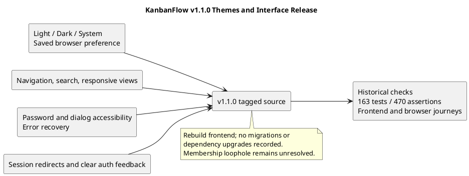

# KanbanFlow v1.1.0

## Release identity

| Field | Recorded value |
| --- | --- |
| Version/tag | v1.1.0 |
| Published UTC timestamp | 2026-10-07T16:15:02Z |
| Published title | KanbanFlow v1.1.0 — UI improvements and light/dark themes |
| Tagged source commit | af22a01afc05c40447d69c4f15a088daecf33597 |
| Previous release | v1.0.2 |
| Recorded focus | Minor feature release for themes and broader interface behavior. |

- [Published release](https://github.com/Farhad-Valizadegan/Web-KanbanFlow/releases/tag/v1.1.0)
- [Tagged source](https://github.com/Farhad-Valizadegan/Web-KanbanFlow/tree/v1.1.0)
- [Source comparison](https://github.com/Farhad-Valizadegan/Web-KanbanFlow/compare/v1.0.2...v1.1.0)

Publication metadata comes from GitHub; source identity was resolved from the tag. This documentation update does not alter the published release or move its tag.

## Purpose

v1.1.0 introduced application-wide appearance selection and a more consistent interface across navigation, resource lists, authentication, dialogs, and recovery states.

The release addresses specified user interactions, not a measured productivity benefit or a complete accessibility certification.

## Themes and preference behavior

| Capability | Published behavior |
| --- | --- |
| Light | Light appearance option. |
| Dark | Dark appearance option. |
| System | Follows the computer/browser system appearance signal. |
| Persistence | Preference is saved in the browser. |
| Tab synchronization | Theme changes synchronize between tabs through the implemented browser behavior. |

The selector is at the top right. Browser-local preference is not an account setting synchronized across devices. Readability of future views requires fresh checks; historical theme coverage does not automatically validate later styling.

## Navigation and layout changes

- Persistent navigation with workspace/project/board breadcrumbs.
- Route titles and a keyboard skip link.
- Redesigned welcome page.
- Consistent cards, typography, fields, focus indicators, and mobile layouts.
- Not-found and unexpected-error recovery screens.

These changes are part of the v1.1.0 tagged source. Later metadata styling commits must not be backdated into this release.

## Resource-list search

Workspace, project, and board lists gained search, result counts, and helpful empty-result feedback. Board reordering is disabled while filtered so a partial list is not used as the reorder context.

Search behavior is a list interaction improvement, not a third-party indexing or global search-service guarantee.

## Password, validation, and dialog interaction

Password visibility controls and field-linked validation feedback improve form interaction. The workspace creation dialog includes focus containment, Escape dismissal, opener focus restoration, and background scroll locking.

The published validation reports keyboard dialog checks, but it does not establish a complete assistive-technology or supported-browser matrix.

## Authentication and failure feedback

Existing authenticated sessions open the dashboard instead of seeing a sign-in form that could fail through a backend redirect. Authentication feedback distinguishes unavailable servers, expired sessions, rate limits, and server errors.

Correct configured hosts, origins, cookies, and CSRF behavior remain prerequisites. This release does not replace the configuration requirements documented in [v1.0.2](v1.0.2.md).

## Historical automated verification

| Check | Published result |
| --- | --- |
| Backend suite | 163 tests and 470 assertions passed. |
| Frontend lint | Passed. |
| TypeScript checks | Passed. |
| Production build | Passed. |

These are historical results rather than a fresh run against this tag or current main. Backend SQLite tests do not establish MySQL contention behavior.

## Historical browser coverage

Published notes record checks using isolated test data for:

- Light/dark appearance and saved preference.
- Mobile layout.
- List-search feedback.
- Password controls.
- Keyboard dialogs.
- Existing-session redirects.
- Board readability.

This is scenario coverage, not a guarantee for every browser, screen, or assistive technology. No invented browser version, numerical accessibility score, or additional test result is added here.

The earlier repository publication record also identified successful CI on the merged main commit. [Recorded CI run](https://github.com/Farhad-Valizadegan/Web-KanbanFlow/actions/runs/37649938024). Treat that link as historical evidence, not current-main verification.

## Upgrade and compatibility

The published release reports no migrations or dependency upgrades. Rebuild the frontend after updating and manage services as appropriate to the actual environment. Existing application data is not reset by the documented update process.

Preserve local changes/configuration and verify sign-in, affected navigation, themes, and saved task behavior. Consult [upgrade and rollback guidance](upgrade-and-rollback.md); source checkout does not restore database records.

## Known issue

Managers can bypass intended owner-only role changes by removing and re-adding a member with a different role. The published notes retain this issue pending a membership-policy decision.

Owners should manage membership meanwhile. See [DEC-003](../Project-Management/decision-register.md) and [PB-001](../Project-Management/product-backlog.md). Theme and interface improvements do not close backend permission gaps.

## Later untagged changes

Current main includes later styling and documentation changes without a new published version. In particular, the later plain-metadata treatment of board creator/date and project start/due dates is not part of the original v1.1.0 release claim.

Use [unreleased changes](unreleased.md) and actual Git history for those updates. A maintained inventory is a snapshot, not a live complete feed.

## Operational and recovery boundaries

A GitHub source release does not demonstrate production deployment, uptime, capacity, or backup restoration. Recovery requires environment-specific compatibility assessment and authorized procedures.

No browser test is inferred merely from a successful build, and no production guarantee is inferred from historical CI.

## Evidence maintenance

Preserve the exact tag identity and distinguish published notes, recorded session evidence, and any new verification. Use the [verification template](verification-template.md) for fresh check records.

See the [release index](README.md), [checklist](release-checklist.md), and [quality plan](../Project-Management/quality-and-risk-plan.md). Synchronize inline/standalone PlantUML and its preview when this record changes.

## PlantUML diagram

[Editable source](diagrams/v1.1.0.puml)

