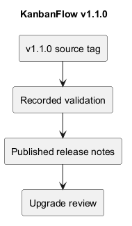
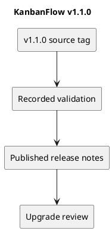

# KanbanFlow v1.1.0

Published on 2026-10-07 (UTC date), as recorded by GitHub.

[Published release](https://github.com/Farhad-Valizadegan/Web-KanbanFlow/releases/tag/v1.1.0) · [Tagged source](https://github.com/Farhad-Valizadegan/Web-KanbanFlow/tree/v1.1.0)

## Changes

Added persistent Light/Dark/System themes, navigation and breadcrumbs, responsive layouts, resource-list search, accessible password/dialog controls, recovery screens, and existing-session redirects.

## Historical validation

163 tests and 470 assertions; frontend lint/type/build, browser theme persistence/mobile/search/password/dialog/session checks, and CI passed according to published notes.

These are historical release results, not a fresh test run of this tag.

## Upgrade and compatibility

No migrations or dependency upgrades. Rebuild the frontend and restart services as appropriate. The theme selector offers Light, Dark, and System. The manager remove/re-add role-change loophole remains open.

## Known issue

The manager remove/re-add role-change loophole requires an agreed membership policy and backend enforcement. Earlier defects may have been addressed in later releases; read the latest release record before using a historical version.

## PlantUML diagram

[Editable source](diagrams/v1.1.0.puml)

