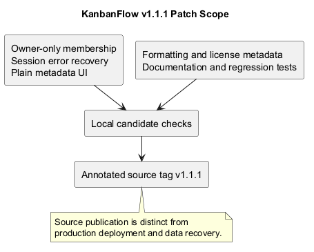
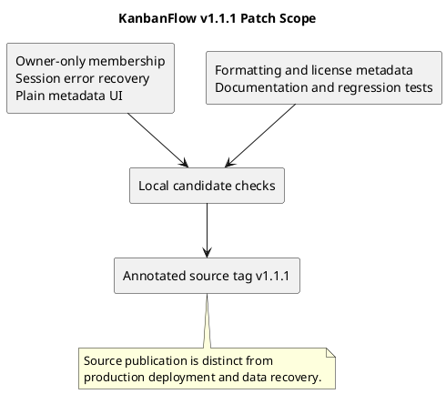

# KanbanFlow v1.1.1

Patch source release dated 2026-10-10, following v1.1.0. This record covers the tagged source; it does not establish production deployment or a separate GitHub Release publication.

## Fixed

- Close the manager remove/re-add role bypass by making all workspace membership mutations owner-only. Managers retain project/board management and permitted activity access through a separate permission.
- Preserve protected-route recovery on network/server session-check failures. Only HTTP 401 redirects to login; other failures offer retry without exposing protected content.
- Display board creator/date and project dates as plain metadata rather than input-like boxes.
- Align Composer license metadata with existing proprietary repository terms.
- Correct backend formatting and add ten focused frontend session regression tests to CI.

## Documentation

Complete the project definition, management, release, SDLC, sprint, and main README guidance accumulated since v1.1.0. Preserve historical records and identify the corrected membership rule through the dated QA amendment.

## Verification

Local final candidate checks: backend regression suite, Laravel Pint check, Composer validation, frontend session tests, lint, TypeScript/Vite build, and local documentation link checks. See [QA corrections](../SDLC/06-testing/qa-corrections-2026-10-10.md) for the fix evidence. Remote CI results must be checked against the actual pushed commit.

Browser journeys, accessibility, MySQL contention, and production recovery have not been freshly demonstrated for this candidate. Component session tests use controlled query outcomes and do not replace browser acceptance.

## Upgrade and rollback

No schema migration or dependency version changes. Update the backend and rebuild the frontend; keep the existing environment, application key, and data. Managers must ask the workspace owner to change membership.

Rolling back to v1.1.0 restores the known membership-role bypass and old session error behavior. Prefer a forward correction for defects; code rollback does not restore data. See [upgrade guidance](upgrade-and-rollback.md).

## Source identity

Annotated tag: `v1.1.1`. Resolve the tag to obtain the exact commit. Its annotation summarizes the corrections and validation; the tag is not a runtime deployment identity.

## Patch scope diagram

[Editable PlantUML](diagrams/v1.1.1.puml)

