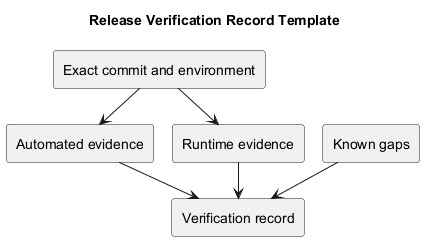
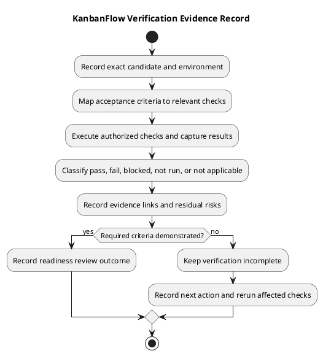

# KanbanFlow Release Verification Record Template

> **Policy amendment (2026-10-10):** Membership mutations are now owner-only; DEC-003/PB-001's bypass is fixed. Earlier open-policy text and diagrams below describe the preceding state. See [QA corrections](../SDLC/06-testing/qa-corrections-2026-10-10.md) for the selected rule and regression evidence.

## Purpose and use

Use this template to record actual checks against a specific source candidate. It supports release review without turning historical counts, linked test files, or an unexecuted checklist into fresh evidence.

Replace placeholders with observations. Pending checks remain pending. No reviewer, approval, date, environment, result, or deployment is inferred from the template itself.

## Copyable record

````markdown
# Verification — KanbanFlow <candidate/version>

## Identity
- Status: <Draft / In progress / Complete with stated scope>
- Candidate full SHA: <Exact tested commit>
- Baseline/tag: <Actual reference>
- Proposed release tag: <Actual value or not selected>
- Verification date/time: <Actual value and timezone>
- Tester/reviewer: <Actual identity when recorded>

## Scope
- Acceptance criteria: <IDs and observable outcomes>
- Affected journeys/resources: <Actual scope>
- Exclusions: <Explicit boundaries>
- Known policy dependencies: <Open or resolved with evidence>

## Environment
| Field | Observed value |
| --- | --- |
| OS and host context | <Actual setup; avoid secrets> |
| PHP/Node and relevant tooling | <Observed versions> |
| Database and isolation | <Engine/version, isolated dataset> |
| Browser and viewport | <Actual browser/version/layout when checked> |
| Configuration assumptions | <Hosts/origins and relevant non-secret settings> |

## Check results
| ID | Criterion/scenario or command | Tested SHA/environment | State | Evidence | Gap/next action |
| --- | --- | --- | --- | --- | --- |
| CHECK-001 | <Actual check> | <Exact identity> | <Pass/Fail/Blocked/Not run/Not applicable> | <Log/link/observation> | <Reason/action> |

## Persisted-state and failure observations
<Accepted state, rejected actions, refresh behavior, relevant concurrency observations.>

## CI
- Run/job links: <Actual references>
- Head SHA: <Exact run commit>
- Result: <Observed status/conclusion>
- Coverage limits: <What the workflow does not exercise>

## Residual issues
| Issue | Impact | State | Required action |
| --- | --- | --- | --- |
| <Actual issue> | <Observed/assessed consequence> | <Open/resolved with evidence> | <Next step> |

## Review outcome
- Demonstrated criteria: <Evidence-backed list>
- Failed/unverified criteria: <Explicit list>
- Readiness decision: <Actual recorded outcome, or pending>
- Publication/deployment authorization: <Actual scope, or not recorded>
- Follow-up: <Actual agreed action/owner when available>

## Delivery verification when performed
- Remote tag resolves to: <Full SHA>
- Published release URL/state: <Actual result>
- Source/notes match: <Observed result>
- Deployment evidence: <Separate actual record, or not performed>
````

## Result states

| State | Meaning |
| --- | --- |
| Pass | Expected behavior demonstrated for the recorded scope/environment. |
| Fail | Observed result contradicts the criterion or check. |
| Blocked | Required policy, prerequisite, or environment prevents execution. |
| Not run | Check not executed; record reason and relevance. |
| Not applicable | Check genuinely outside scope; provide the rationale. |

Do not label a skipped check Pass. Record flaky or inconsistent observations explicitly rather than hiding them through retries.

## Exact identity and reproducibility

Record full candidate SHA, actual environment, check command/scenario, and supporting artifacts. CI head identity must match the relevant candidate; results from earlier source do not automatically validate later metadata/code changes.

A dirty working tree can differ from its recorded commit. Identify relevant pending changes instead of implying the commit alone describes what was tested. Preserve unrelated work and keep secrets out of logs.

## Automated check evidence

| Area | Typical KanbanFlow evidence | Limit |
| --- | --- | --- |
| Backend | php artisan test, counts, result, relevant assertions. | [SQLite test configuration](../../backend/phpunit.xml) does not prove MySQL contention. |
| Frontend lint | npm run lint result. | Static checks do not establish runtime behavior. |
| Type/build | npm run build result and relevant output. | Build success does not prove accessibility or production operation. |
| CI | Exact run/job links, head SHA, and final conclusion. | [Workflow](../../.github/workflows/ci.yml) covers backend and frontend checks, not all runtime boundaries. |

Counts are context rather than complete requirement coverage. Historical results in [release records](README.md) must stay identified as historical.

## Runtime evidence

Select affected journeys and failure boundaries:

- Authentication, expired sessions, and configured origins/cookies.
- Direct/nested-resource permission denials and private visibility.
- Task creation, assignment, movement, WIP rejection, and state after refresh.
- Failed optimistic mutations, rollback, and retry feedback.
- Keyboard focus/dialogs/movement, narrow layouts, and themes.
- Comments, notifications, activity, and analytics refresh.

Record steps, expected/actual results, browser/environment, and evidence. Screenshots are useful for visual claims but do not establish persistence or authorization alone.

## Concurrency and recovery evidence

Use isolated authorized data for MySQL contention, stale-state, and recovery experiments. Record competing operations, accepted/rejected results, final stored invariants, and cleanup boundaries.

Do not perform unapproved production writes or destructive restore tests to fill a record. Build/SQLite checks cannot substitute for database contention or restore evidence.

## Documentation verification

Check relative links, moved paths, claim accuracy, inline/standalone PlantUML equality, successful rendering, and preview readability. Link validation proves references exist, not that their claims are semantically correct.

Use [documentation traceability](../Project-Management/documentation-traceability.md).

## Known issues and review decisions

Keep the manager remove/re-add membership loophole open until DEC-003 and regression-verified enforcement close it. A general passing suite does not by itself prove closure.

Record residual security, integrity, operational, and usability risks with impact and next action. Review decisions must be actual decisions; do not fabricate acceptance of a gap.

Use the [quality plan](../Project-Management/quality-and-risk-plan.md) and [risk criteria](../Project-Definition/risks-and-success-criteria.md).

## Publication and deployment boundaries

Verification completion does not automatically authorize tag publication or deployment. Follow the [release checklist](release-checklist.md) and [pipeline](../Project-Management/release-pipeline.md).

When publication occurs, verify tag identity, release notes/state, and actual remote results. Deployment and recovery evidence remain separate environment-specific records.

## Maintenance

Update this template when tooling, evidence practices, or release criteria change. Keep actual verification records attached to their exact source/environment and preserve historical outcomes. Synchronize PlantUML source and preview.

## PlantUML diagram



[Editable source](diagrams/verification-template.puml)

