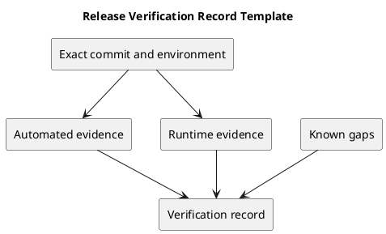

# Release Verification Record Template

Copy this template for an actual release. Replace placeholders with observed evidence; pending checks remain pending.

| Field | Value to record |
| --- | --- |
| Release and commit | Version, full commit SHA, tag identity. |
| Environment | OS, PHP/Node versions, database engine, isolated test setup. |
| Frontend lint/build | Commands, result, date, and log or CI link. |
| Backend tests | Command, counts, result, and evidence link. |
| Browser journeys | Scenarios, result, browser, and screenshots when useful. |
| Concurrency checks | Scenario, database, result; or not run with reason. |
| Documentation | Links, source/preview consistency, and review result. |
| Known issues | Open defects, policy decisions, and upgrade limitations. |
| Reviewer | Actual reviewer and review date when available. |

Backend automated tests use in-memory SQLite in the checked-in test configuration. Passing them does not establish MySQL contention behavior. Build success does not establish accessibility or user-journey correctness.

## PlantUML diagram

[Editable source](diagrams/verification-template.puml)

