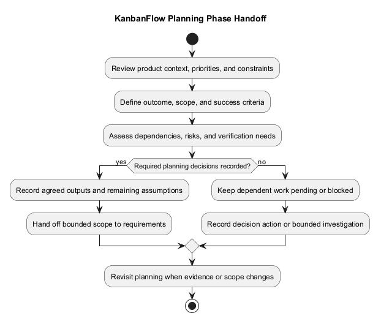
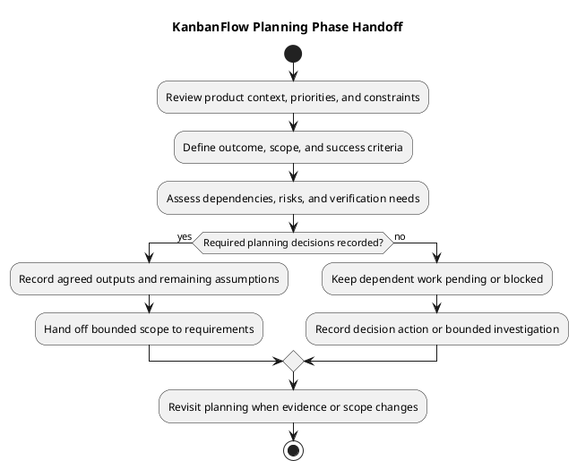

# KanbanFlow SDLC — 01 Planning

> **Policy amendment (2026-10-10):** Membership mutations are now owner-only; DEC-003/PB-001's bypass is fixed. Earlier open-policy text and diagrams below describe the preceding state. See [QA corrections](../06-testing/qa-corrections-2026-10-10.md) for the selected rule and regression evidence.

Planning turns a product need into bounded work with explicit outcomes, scope, dependencies, risks, and evidence expectations. It prepares the requirements phase and management backlog without assuming committed delivery dates or staffing.

This folder contains working guidance, not proof that planning has been completed for every feature or that production delivery has occurred. Planning can be revisited as requirements, implementation evidence, or priorities change.

## Guides in this folder

| Document | Use it for |
| --- | --- |
| [Planning process and record](planning.md) | Step-by-step planning, dependencies, and a copyable decision record |
| [Project planning overview](project-planning-overview.md) | Understanding how product definition, management, lifecycle work, and sprints connect |

Start with the overview for context, then use the planning guide for a specific proposed change. This index describes phase boundaries and the handoff to requirements.

## Inputs

| Input | What it contributes |
| --- | --- |
| [Problem statement](../../Project-Definition/project-problem-statement.md) | User problem and intended benefit |
| [Overview and goals](../../Project-Definition/overview-and-goals.md) | Product direction and observable outcomes |
| [Scope and stakeholders](../../Project-Definition/scope-and-stakeholders.md) | Actors, responsibilities, and boundaries |
| [Assumptions and constraints](../../Project-Definition/assumptions-and-constraints.md) | Conditions to validate and known limitations |
| [Product backlog](../../Project-Management/product-backlog.md) | Candidate work and existing dependencies |
| [Decision register](../../Project-Management/decision-register.md) | Established policy and unresolved choices |
| [Quality and risk plan](../../Project-Management/quality-and-risk-plan.md) | Relevant risks and verification needs |

Use actual evidence and available resources. Historical milestones provide context, but their commits and test totals do not establish future capacity or candidate verification.

## Activities and responsibilities

1. Describe the affected user problem and intended outcome.
2. Define included scope, exclusions, and observable success criteria.
3. Assess permissions, data, compatibility, and relevant operational implications.
4. Identify dependencies, uncertainty, and decisions that prevent progress.
5. Plan feasible verification and proportionate follow-up work.
6. Record actual scope agreement and the next handoff or refinement action.

Record the actual people responsible for scope decisions, planning follow-up, and relevant review. Do not invent formal roles, estimates, or ownership. Missing ownership remains explicit until agreed.

## Outputs

| Output | Expected content |
| --- | --- |
| Bounded planning record | Problem, outcome, scope, exclusions, and decision context |
| Success criteria | Observable behavior and relevant failure boundaries |
| Dependency record | Required conditions, owners where agreed, and next actions |
| Risk and assumption references | Material uncertainty and its impact |
| Verification approach | Feasible checks, environment needs, and known limits |
| Backlog/requirements handoff | Linked proposed work and the next phase's inputs |

Keep planning outputs linked to their owning records rather than duplicating conflicting requirements. The [traceability guide](../../Project-Management/traceability.md) explains how needs, decisions, items, checks, and delivery evidence connect.

## Handoff criteria and unresolved work

Proceed with bounded requirements work when the problem, scope, intended outcome, essential decisions, and next actions are clear enough for that work. Record remaining assumptions explicitly. If a missing condition prevents the proposed next step, keep dependent work pending or blocked and identify the decision action.

The manager remove/re-add role loophole remains an open membership-policy and enforcement issue tracked by DEC-003 and PB-001. Do not plan dependent enforcement as if its required rule were already agreed. A bounded policy or technical investigation can have its own question and evidence output without claiming implementation is ready.

Planning completion means the agreed planning outputs exist. It does not establish that a feature meets the Definition of Done, that every lifecycle phase is complete, or that a release has been deployed.

## Next phase and execution planning

Hand scope and outcome criteria to [02 Requirements](../02-requirements/README.md), keeping unresolved dependencies visible. Iterate with [analysis](../03-analysis/README.md) when further evidence is needed.

For actual sprint selection, use [sprint planning](../../Sprints/sprint-planning.md) and the [Definition of Ready](../../Sprints/definition-of-ready.md). Roadmap candidates and phase guidance do not assign sprint dates or capacity. Item completion later follows the [Definition of Done](../../Sprints/definition-of-done.md).

Release publication and deployment require their own checks and authorization through [release guidance](../../Releases/README.md). A planning record establishes no production capacity, recovery, or operational guarantee.

## Review and maintenance

- Check that the outcome, scope, criteria, and dependencies are understandable.
- Distinguish agreed decisions from proposals and unknown values.
- Record material scope changes and their impact.
- Keep future checks separate from actual verification results.
- Repair related links when records move or change.
- Preserve historical decisions and label later corrections.

Update the planning record when evidence or policy changes. Maintain the PlantUML source, embedded block, and preview together using the [diagram guide](../../diagram-guide.md). Keep credentials and unnecessary personal data out of planning records.

## Related indexes

- [SDLC index](../README.md)
- [Documentation index](../../README.md)
- [Project Management](../../Project-Management/README.md)
- [Roadmap](../../Project-Management/roadmap.md)
- [Sprints](../../Sprints/README.md)

## Planning phase diagram

[PlantUML source](diagrams/workflow.puml)

