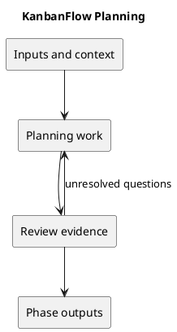

# Planning

## Purpose and activities

Define the user problem, scope, priorities, dependencies, and risks before scheduling work. Use the existing management roadmap and backlog as proposals; do not infer committed dates or staffing.

## Completion evidence

A clear goal, scope boundaries, dependencies, and open decisions. Membership permissions remain an open policy question.

## Related guidance

- [Supporting documentation](../../Project-Management/roadmap.md)
- [SDLC index](../README.md)

## PlantUML workflow

[Editable source](diagrams/workflow.puml)

