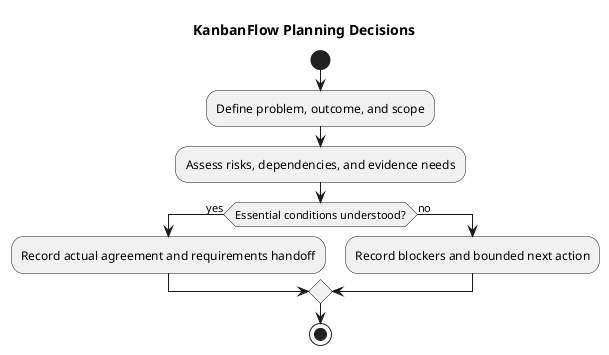

# KanbanFlow Planning

Use this guide to turn a product need into bounded, reviewable work before requirements and implementation proceed. Planning records intentions and decisions; it does not establish completed development, staffing, dates, or production readiness.

## Inputs

| Input | Planning use |
| --- | --- |
| [Problem statement](../../Project-Definition/project-problem-statement.md) | Identify the user problem and expected benefit |
| [Scope and stakeholders](../../Project-Definition/scope-and-stakeholders.md) | Define affected actors and boundaries |
| [Assumptions and constraints](../../Project-Definition/assumptions-and-constraints.md) | Make uncertainty and limitations visible |
| [Product backlog](../../Project-Management/product-backlog.md) | Identify candidate work and existing dependencies |
| [Decision register](../../Project-Management/decision-register.md) | Separate established policy from unresolved choices |
| [Quality and risk plan](../../Project-Management/quality-and-risk-plan.md) | Plan evidence proportionate to risk |

Use actual available resources and evidence. Historical commits or release test totals do not establish future capacity or verification results.

## Planning steps

1. Describe the problem, affected users, and intended outcome.
2. Define included behavior and explicit exclusions.
3. Identify permission, data, compatibility, and operational implications.
4. Record dependencies, assumptions, and unresolved decisions.
5. Define observable success criteria and a feasible verification approach.
6. Refine bounded candidates and agree priorities using the management backlog.
7. Record actual scope agreement and next actions before dependent work begins.

Keep implementation details open when they can be resolved within bounded analysis. Do not leave essential policy undefined while treating dependent implementation as ready. DEC-003 and PB-001 track the unresolved manager membership remove/re-add role issue.

## Copyable planning record

```text
Planning item and decision date:
User problem and intended outcome:
Affected stakeholders:
Scope and exclusions:
Observable success criteria:
Permission, data, and compatibility implications:
Dependencies and unresolved decisions:
Assumptions and evidence needed:
Verification approach and authorized environment:
Actual capacity or sizing basis, if used:
Agreed owner and scope-decision responsibility:
Decision: proceed / refine / blocked, with reason:
Next action and review point:
```

The fields are placeholders, not agreed project commitments. Unknown dates, owners, and estimates remain pending. Link decisions and evidence instead of inventing sign-off.

## Risks and dependencies

| Condition | Response |
| --- | --- |
| Essential policy unresolved | Keep dependent enforcement work blocked; record a decision action |
| Verification environment unavailable | Record the gap and dependency before selection |
| Scope exceeds realistic capacity | Split or defer work and preserve outcome/dependency links |
| Proposed behavior conflicts with current evidence | Clarify the requirement and document the decision |

An investigation can be planned separately with a question, expected evidence output, and stopping point. Investigation completion does not automatically authorize the resulting feature or resolve policy.

## Review and handoff

Before proceeding, check that the outcome, boundaries, criteria, dependencies, and open decisions are understandable. Link the planning record into [requirements](../02-requirements/README.md) and the product backlog. Use the [Definition of Ready](../../Sprints/definition-of-ready.md) before sprint selection and [sprint planning](../../Sprints/sprint-planning.md) for actual goals, dates, ownership, and capacity.

Planning completion means the agreed planning outputs exist. It does not mean the product change is Done or released. Required gaps remain visible rather than being treated as success.

## Changes and maintenance

Reassess the plan when scope, evidence, policy, or dependencies change. Preserve material decisions and their impact. Update the owning documentation instead of maintaining conflicting copies. Keep credentials and personal account details out of records.

See the [planning overview](project-planning-overview.md), [planning index](README.md), [roadmap](../../Project-Management/roadmap.md), and [diagram guide](../../diagram-guide.md).

## PlantUML diagram


[PlantUML source](diagrams/planning.puml)


