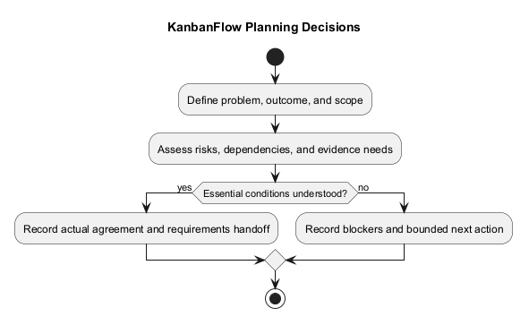
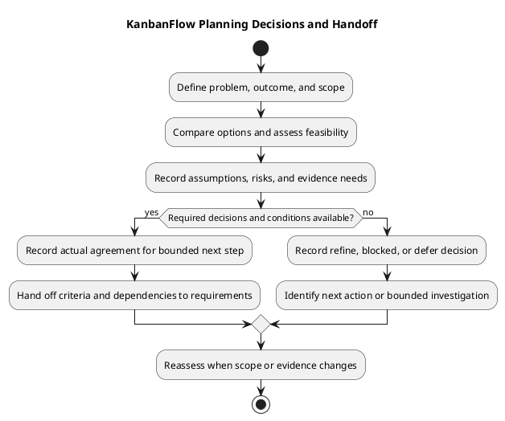

# KanbanFlow Planning

> **Policy amendment (2026-10-10):** Membership mutations are now owner-only; DEC-003/PB-001's bypass is fixed. Current guidance below reflects this rule; historical records retain their original scope. See [QA corrections](../06-testing/qa-corrections-2026-10-10.md) for the selected rule and regression evidence.

Use this guide to turn a product need into bounded, reviewable work before requirements and implementation proceed. Planning records intentions and decisions; it does not establish completed development, staffing, dates, or production readiness.

## Inputs

| Input | Planning use |
| --- | --- |
| [Problem statement](../../Project-Definition/project-problem-statement.md) | Identify the user problem and expected benefit |
| [Scope and stakeholders](../../Project-Definition/scope-and-stakeholders.md) | Define affected actors and boundaries |
| [Assumptions and constraints](../../Project-Definition/assumptions-and-constraints.md) | Make uncertainty and limitations visible |
| [Product backlog](../../Project-Management/product-backlog.md) | Identify candidate work and existing dependencies |
| [Decision register](../../Project-Management/decision-register.md) | Separate established policy from unresolved choices |
| [Quality and risk plan](../../Project-Management/quality-and-risk-plan.md) | Plan evidence proportionate to risk |

Use actual available resources and evidence. Historical commits or release test totals do not establish future capacity or verification results.

## Planning steps

1. Describe the problem, affected users, and intended outcome.
2. Define included behavior and explicit exclusions.
3. Identify permission, data, compatibility, and operational implications.
4. Record dependencies, assumptions, and unresolved decisions.
5. Define observable success criteria and a feasible verification approach.
6. Refine bounded candidates and agree priorities using the management backlog.
7. Record actual scope agreement and next actions before dependent work begins.

Keep implementation details open when they can be resolved within bounded analysis. Do not leave essential policy undefined while treating dependent implementation as ready. Membership additions, removals, and role changes are owner-only under DEC-003/PB-001; the 2026-10-10 correction closes the manager remove/re-add bypass.

## Copyable planning record

```text
Planning item and decision date:
User problem and intended outcome:
Affected stakeholders:
Scope and exclusions:
Observable success criteria:
Permission, data, and compatibility implications:
Dependencies and unresolved decisions:
Assumptions and evidence needed:
Verification approach and authorized environment:
Actual capacity or sizing basis, if used:
Agreed owner and scope-decision responsibility:
Decision: proceed / refine / blocked / defer, with reason:
Next action and review point:
```

The fields are placeholders, not agreed project commitments. Unknown dates, owners, and estimates remain pending. Link decisions and evidence instead of inventing sign-off.

## Risks and dependencies

| Condition | Response |
| --- | --- |
| Essential policy unresolved | Keep dependent enforcement work blocked; record a decision action |
| Verification environment unavailable | Record the gap and dependency before selection |
| Scope exceeds realistic capacity | Split or defer work and preserve outcome/dependency links |
| Proposed behavior conflicts with current evidence | Clarify the requirement and document the decision |

An investigation can be planned separately with a question, expected evidence output, and stopping point. Investigation completion does not automatically authorize the resulting feature or resolve policy.

## Review and handoff

Before proceeding, check that the outcome, boundaries, criteria, dependencies, and open decisions are understandable. Link the planning record into [requirements](../02-requirements/README.md) and the product backlog. Use the [Definition of Ready](../../Sprints/definition-of-ready.md) before sprint selection and [sprint planning](../../Sprints/sprint-planning.md) for actual goals, dates, ownership, and capacity.

Planning completion means the agreed planning outputs exist. It does not mean the product change is Done or released. Required gaps remain visible rather than being treated as success.

## Evaluate options and feasibility

Compare plausible approaches before committing dependent work. Include retaining current behavior or deferring the change when those are viable. Use evidence and explicit trade-offs rather than inventing numerical scores.

| Option | Expected user benefit | Dependencies | Permission/data impact | Verification cost | Main uncertainty |
| --- | --- | --- | --- | --- | --- |
| Actual proposed option | Observable benefit | Required conditions | Assessed impact | Actual basis or unknown | Evidence still needed |

Record why the chosen approach fits the intended outcome and constraints. Material architecture or policy choices belong in the decision register; this planning record links to them. Technical analysis can refine an approach without silently changing its agreed user outcome.

Assess feasibility across implementation, review, verification, and configuration. An available coding environment does not imply available browser, database, or operational evidence. Where resource needs are unknown, define a bounded investigation instead of claiming a delivery estimate.

## Track assumptions and risks

Distinguish a known constraint, an uncertain assumption, a risk, and a blocking dependency. An assumption needs validation; a blocker prevents a required next step. Record actual ownership where agreed.

| Reference | Type | Condition and evidence | Impact if wrong/unresolved | Validation or mitigation | Owner | Review trigger |
| --- | --- | --- | --- | --- | --- | --- |
| Local reference | Assumption / risk / constraint / dependency | Actual observation or hypothesis | Affected outcome | Concrete action | Agreed person or unassigned | Agreed event/date or pending |

Do not mark a risk resolved simply because a mitigation is proposed. Link the result when the action occurs. Reassess when policy, environment, scope, or evidence changes. An unresolved risk outside the selected scope remains tracked with its impact rather than disappearing from the record.

## Plan evidence by affected boundary

| Boundary | Planning questions |
| --- | --- |
| Access and membership | Which actors and current/removed memberships must be checked? Can direct and aggregate responses expose restricted data? |
| User interaction | Which keyboard, focus, responsive, and failure-feedback scenarios matter? |
| Persistence and movement | What must remain correct after rejection, reload, or stale requests? |
| Database concurrency | Does the change affect locks, WIP limits, or position allocation? Is an isolated MySQL check needed? |
| Configuration and compatibility | Which actual hosts, origins, dependencies, or data formats affect the outcome? |
| Documentation | Which factual sources, relative links, and diagram previews need review? |

Use the [verification template](../../Releases/verification-template.md) for eventual results. At planning time, name expected checks and environment dependencies, leaving execution pending. Historical suite totals, SQLite regressions, and build success each have limits; none substitutes for evidence at a different affected boundary.

## Record the planning decision

| Decision | Meaning | Next step |
| --- | --- | --- |
| Proceed | Bounded next-phase work has sufficiently clear scope and required decisions | Link outputs to requirements or refinement |
| Refine | Scope, criteria, or feasibility need clarification | Assign a specific question or split the work |
| Blocked | A condition prevents the required next step | Record dependency, impact, and next action |
| Defer | Work is deliberately outside current selection | Preserve rationale and a reconsideration trigger if agreed |

Proceed applies to the recorded next step, not every downstream phase. A bounded investigation may proceed while dependent implementation remains blocked. Record the actual decision date, responsible person, rationale, and source references. Pending agreement remains pending; elapsed time is not approval.

## Requirements handoff checklist

- User problem, affected actors, and intended outcome are explicit.
- Included behavior and exclusions are bounded.
- Success and relevant failure criteria are observable.
- Essential policy decisions are recorded or block dependent work.
- Assumptions, risks, and environment needs have clear next actions.
- Proposed work links to the product backlog and owning decisions.
- Planned checks remain distinct from actual evidence.
- The next-phase scope and actual agreement are understandable.

Hand these outputs to requirements while preserving remaining uncertainty. Requirements work elaborates behavior and constraints; planning does not need to fabricate a finished design or commit a schedule in order to hand off bounded work.

## Scope changes and follow-up

| Observation date | Changed condition or scope | Reason/evidence | Effect on outcome | Actual decision | Next action |
| --- | --- | --- | --- | --- | --- |
| Actual date | Actual change | Source reference | Explicit impact | Agreement or pending | Concrete action |

Keep earlier context and label later corrections. If a change alters acceptance criteria, capacity, or a required permission rule, update the relevant owning record and reassess readiness. Do not silently turn an unrelated request into selected implementation scope.

Planning, sprint selection, item completion, publication, and deployment remain separate decisions. Follow [release guidance](../../Releases/README.md) for actual delivery work; the planning decision alone establishes no production readiness or recovery guarantee.

## Changes and maintenance

Reassess the plan when scope, evidence, policy, or dependencies change. Preserve material decisions and their impact. Update the owning documentation instead of maintaining conflicting copies. Keep credentials and personal account details out of records.

See the [planning overview](project-planning-overview.md), [planning index](README.md), [roadmap](../../Project-Management/roadmap.md), and [diagram guide](../../diagram-guide.md).

## PlantUML diagram



[PlantUML source](diagrams/planning.puml)


