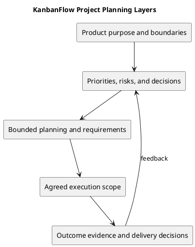

# KanbanFlow Project Planning Overview

This overview connects KanbanFlow's product definition, management planning, lifecycle guidance, and sprint records. It provides a navigation and decision framework, not a committed schedule or a claim that every lifecycle phase has been completed.

## Product context

KanbanFlow organizes work through workspaces, projects, boards, columns, and tasks. Planning should connect a proposed change to an identifiable user problem and the relevant access, data, or interaction boundaries. Read the [overview and goals](../../Project-Definition/overview-and-goals.md) and [project context](../../Project-Definition/project-context-diagram.md) for the owning product definition.

## Planning layers

| Layer | Owning guidance | Output |
| --- | --- | --- |
| Product purpose | [Project Definition](../../Project-Definition/README.md) | Goals, scope, actors, assumptions |
| Priorities and decisions | [Project Management](../../Project-Management/README.md) | Candidate work, policy decisions, risks |
| Lifecycle planning | [Planning guide](planning.md) | Bounded outcomes and requirements handoff |
| Execution selection | [Sprints](../../Sprints/README.md) | Actually agreed goal, scope, owners, and dates |
| Verification and delivery | [Releases](../../Releases/README.md) | Candidate evidence and separately recorded publication |

Use links across these layers instead of duplicating contradictory requirements. A roadmap proposal is not a sprint commitment; a sprint agreement is not a completed outcome; source publication is not deployment.

## Scope and priorities

Use the [scope boundary](../../Project-Definition/scope-boundary-diagram.md) to distinguish current product responsibilities from proposed integrations or operational ambitions. Refine priorities through the [product backlog](../../Project-Management/product-backlog.md) and [roadmap](../../Project-Management/roadmap.md).

Consider user impact, dependencies, uncertainty, and verification cost when sequencing work. Do not invent numerical priority scores, target dates, staffing, or velocity where no agreement exists. Historical [milestones](../../Project-Management/milestones.md) provide delivery context, not forecasts.

## Decisions and known constraints

Record important policy choices in the [decision register](../../Project-Management/decision-register.md). The manager remove/re-add membership role loophole remains an unresolved policy and enforcement issue in DEC-003/PB-001. Planning must keep that dependency visible for affected work.

Environment and test boundaries matter: SQLite regressions do not establish MySQL contention behavior, and frontend build success does not demonstrate browser usability. Plan appropriate evidence using the [quality and risk plan](../../Project-Management/quality-and-risk-plan.md).

## Planning outputs and checkpoints

| Checkpoint | Expected record |
| --- | --- |
| Problem understood | Affected users and observable intended benefit |
| Scope bounded | Included behavior, exclusions, and compatibility implications |
| Dependencies assessed | Required decisions, conditions, ownership, and next actions |
| Work ready for refinement | Acceptance criteria and verification approach |
| Selection agreed | Actual sprint goal, capacity, dates, and owners, if a sprint is used |
| Outcome assessed | Exact revision evidence and unfinished work |

No checkpoint automatically approves a later one. Use the [Definition of Ready](../../Sprints/definition-of-ready.md) and [Definition of Done](../../Sprints/definition-of-done.md) for item selection and completion respectively.

## Evidence and change control

Identify actual sources, decisions, and revisions. Keep planned checks separate from performed results. Record scope changes with their reason and effect on the goal. Unknown values stay pending, and material policy changes need their actual decision recorded.

At review, assess demonstrated outcomes rather than activity counts. Follow-up work returns to refinement or explicit future selection; it is not automatically scheduled. Use [traceability](../../Project-Management/traceability.md) to connect needs, items, decisions, checks, and release records.

## Next phase and maintenance

Hand agreed planning outputs to [requirements](../02-requirements/README.md), then iterate through the [SDLC](../README.md) as evidence changes. Publication and deployment require their own applicable checks and authorization; planning establishes no production or recovery guarantee.

Maintain this overview as a map to owning documents. Keep diagrams consistent with their source and preview using the [diagram guide](../../diagram-guide.md). Return to the [planning index](README.md) or [documentation index](../../README.md).

## PlantUML diagram

[PlantUML source](diagrams/project-planning-overview.puml)

