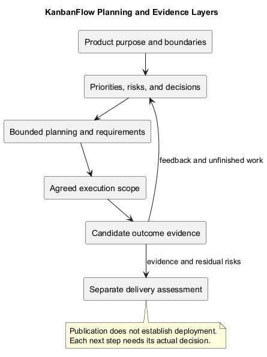
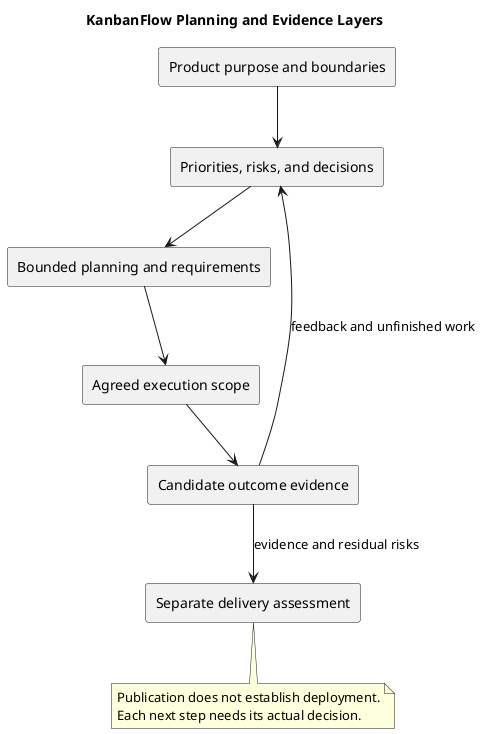

# KanbanFlow Project Planning Overview

This overview connects KanbanFlow's product definition, management planning, lifecycle guidance, and sprint records. It provides a navigation and decision framework, not a committed schedule or a claim that every lifecycle phase has been completed.

## Product context

KanbanFlow organizes work through workspaces, projects, boards, columns, and tasks. Planning should connect a proposed change to an identifiable user problem and the relevant access, data, or interaction boundaries. Read the [overview and goals](../../Project-Definition/overview-and-goals.md) and [project context](../../Project-Definition/project-context-diagram.md) for the owning product definition.

## Planning layers

| Layer | Owning guidance | Output |
| --- | --- | --- |
| Product purpose | [Project Definition](../../Project-Definition/README.md) | Goals, scope, actors, assumptions |
| Priorities and decisions | [Project Management](../../Project-Management/README.md) | Candidate work, policy decisions, risks |
| Lifecycle planning | [Planning guide](planning.md) | Bounded outcomes and requirements handoff |
| Execution selection | [Sprints](../../Sprints/README.md) | Actually agreed goal, scope, owners, and dates |
| Verification and delivery | [Releases](../../Releases/README.md) | Candidate evidence and separately recorded publication |

Use links across these layers instead of duplicating contradictory requirements. A roadmap proposal is not a sprint commitment; a sprint agreement is not a completed outcome; source publication is not deployment.

## Scope and priorities

Use the [scope boundary](../../Project-Definition/scope-boundary-diagram.md) to distinguish current product responsibilities from proposed integrations or operational ambitions. Refine priorities through the [product backlog](../../Project-Management/product-backlog.md) and [roadmap](../../Project-Management/roadmap.md).

Consider user impact, dependencies, uncertainty, and verification cost when sequencing work. Do not invent numerical priority scores, target dates, staffing, or velocity where no agreement exists. Historical [milestones](../../Project-Management/milestones.md) provide delivery context, not forecasts.

## Decisions and known constraints

Record important policy choices in the [decision register](../../Project-Management/decision-register.md). The manager remove/re-add membership role loophole remains an unresolved policy and enforcement issue in DEC-003/PB-001. Planning must keep that dependency visible for affected work.

Environment and test boundaries matter: SQLite regressions do not establish MySQL contention behavior, and frontend build success does not demonstrate browser usability. Plan appropriate evidence using the [quality and risk plan](../../Project-Management/quality-and-risk-plan.md).

## Planning outputs and checkpoints

| Checkpoint | Expected record |
| --- | --- |
| Problem understood | Affected users and observable intended benefit |
| Scope bounded | Included behavior, exclusions, and compatibility implications |
| Dependencies assessed | Required decisions, conditions, ownership, and next actions |
| Work ready for refinement | Acceptance criteria and verification approach |
| Selection agreed | Actual sprint goal, capacity, dates, and owners, if a sprint is used |
| Outcome assessed | Exact revision evidence and unfinished work |

No checkpoint automatically approves a later one. Use the [Definition of Ready](../../Sprints/definition-of-ready.md) and [Definition of Done](../../Sprints/definition-of-done.md) for item selection and completion respectively.

## Evidence and change control

Identify actual sources, decisions, and revisions. Keep planned checks separate from performed results. Record scope changes with their reason and effect on the goal. Unknown values stay pending, and material policy changes need their actual decision recorded.

At review, assess demonstrated outcomes rather than activity counts. Follow-up work returns to refinement or explicit future selection; it is not automatically scheduled. Use [traceability](../../Project-Management/traceability.md) to connect needs, items, decisions, checks, and release records.

## Responsibilities and agreement

Identify the actual people responsible for each planning decision. One person may hold several responsibilities in a small project; this overview assigns no staffing or formal role titles.

| Responsibility | Expected contribution | Record location |
| --- | --- | --- |
| Product scope decision | Agree the intended outcome, boundaries, and priorities | Product/backlog and linked planning decision |
| Technical assessment | Identify implementation constraints and compatibility implications | Planning or analysis record |
| Verification assessment | Identify feasible checks, environments, and evidence gaps | Quality plan and candidate verification record |
| Work ownership | Agree selected work and its next action | Actual backlog or sprint record |
| Delivery decision | Assess publication and environment-change readiness | Separate release or deployment record |

Pending ownership remains pending. A document edit, elapsed time, or roadmap entry does not establish agreement by another person. Record actual decisions and reference the owning source rather than repeating policy inconsistently.

## Information flow across the lifecycle

| From | To | Information to preserve |
| --- | --- | --- |
| Product definition | Planning | Problem, actors, goals, scope boundaries, and assumptions |
| Planning | Requirements | Bounded intended behavior, success criteria, and unresolved dependencies |
| Requirements | Analysis/design | Constraints, failure conditions, and decision questions |
| Analysis/design | Implementation | Agreed behavior, trade-offs, and compatibility boundaries |
| Implementation | Testing/review | Exact candidate revisions and affected acceptance criteria |
| Review | Backlog and planning | Demonstrated outcomes, unfinished work, and actual feedback |
| Candidate verification | Delivery assessment | Evidence, residual risks, and recovery/configuration implications |

These are information handoffs, not a mandatory one-pass sequence. Iterate when evidence changes. Avoid interpreting phase navigation as proof that implementation, testing, or deployment has occurred.

## Planning status and horizon

Distinguish broad direction, refined candidates, selected work, and demonstrated outcomes. A roadmap stage describes direction; a Ready item satisfies its readiness criteria; selected sprint work reflects actual agreement; completed work needs its own evidence.

Use explicit decision states such as Proceed, Refine, Blocked, or Defer in the [planning guide](planning.md). Proceed applies to a bounded next step, not every later phase. Record a reconsideration trigger for deferred work where agreed, without inventing a delivery date.

A bounded investigation can reduce uncertainty before implementation selection. Define its question, scope, output, and stopping point. Its completion does not automatically establish policy agreement or authorize the resulting feature.

## Minimum planning packet

A proposed change should be understandable from a small linked set of records:

- Problem and intended user or operational outcome.
- Scope, exclusions, and observable criteria.
- Relevant permission, data, and compatibility boundaries.
- Decisions, assumptions, risks, dependencies, and next actions.
- Verification approach and required environment access.
- Actual agreement for the next step and responsible people where agreed.

Use the planning guide's copyable record for the detail. This overview remains the navigation map; it should not become a second source of acceptance criteria or a fabricated project schedule.

## Evidence maturity and interpretation

| Record type | What it establishes | What remains separate |
| --- | --- | --- |
| Proposal | Intended direction or option | Actual agreement and execution |
| Planning decision | Agreed bounded next step | Implemented behavior |
| Progress observation | Actual work or blocker at a point in time | Complete acceptance evidence |
| Verification result | Observed check at an identified revision/environment | Universal correctness or production readiness |
| Published version | Source/version publication identity | Actual environment deployment |

Use the [verification template](../../Releases/verification-template.md) for new evidence. Historical release results retain their tagged context; no fresh application test result is asserted by this overview.

## Change and recovery considerations

When scope or constraints change, record the reason and reassess affected criteria, dependencies, and selected work. Keep unfinished items visible and obtain actual agreement for material substitutions. Relevant review findings return to refinement rather than becoming automatic future commitments.

For delivery-related planning, identify configuration, asset, and data compatibility implications early. Follow [upgrade and rollback guidance](../../Releases/upgrade-and-rollback.md) for actual recovery preparation. A source rollback does not restore data, and a planning document cannot establish a successful backup/restore exercise.

Use [release pipeline guidance](../../Project-Management/release-pipeline.md) to distinguish merge, tag, publication, and deployment decisions. Keep secrets and unnecessary personal data out of all records.

## Next phase and maintenance

Hand agreed planning outputs to [requirements](../02-requirements/README.md), then iterate through the [SDLC](../README.md) as evidence changes. Publication and deployment require their own applicable checks and authorization; planning establishes no production or recovery guarantee.

Maintain this overview as a map to owning documents. Keep diagrams consistent with their source and preview using the [diagram guide](../../diagram-guide.md). Return to the [planning index](README.md) or [documentation index](../../README.md).

## PlantUML diagram

[PlantUML source](diagrams/project-planning-overview.puml)

