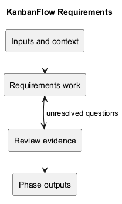
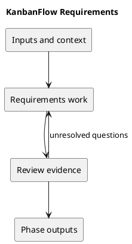

# Requirements

## Purpose and activities

Write observable outcomes and acceptance criteria. Include role permissions, validation, failure behavior, persistence, and accessibility where relevant. Distinguish delivered behavior from proposed changes.

## Completion evidence

Requirements linked to a user need, agreed policy, and verification method. Resolve ambiguous permission rules before implementation.

## Related guidance

- [Supporting documentation](../../Project-Definition/scope-and-stakeholders.md)
- [SDLC index](../README.md)

## PlantUML workflow

[Editable source](diagrams/workflow.puml)

