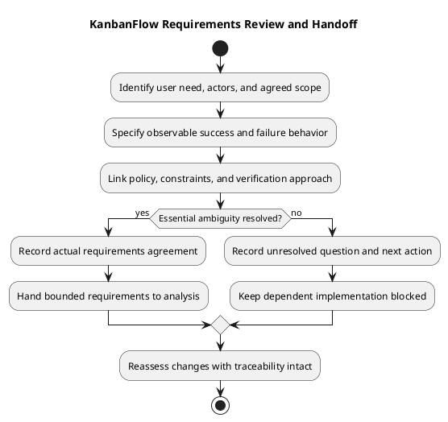

# KanbanFlow SDLC — 02 Requirements

Requirements translate a user need and agreed planning scope into observable behavior and constraints. Include relevant role permissions, validation, failure feedback, persistence, and accessibility. Keep delivered behavior, proposed changes, and unresolved decisions distinct.

This guide defines a working process and reusable record. It does not establish that every requirement is agreed, implemented, tested, or deployed. Iterate when analysis or new evidence reveals ambiguity.

## Guides in this folder

- [KanbanFlow Requirements Specification Guide](requirements.md)
- [KanbanFlow Functional Requirements](functional-requirements.md)
- [KanbanFlow Non-functional Requirements](non-functional-requirements.md)
- [KanbanFlow Roles and Use Cases](roles-and-use-cases.md)
- [KanbanFlow Security and Privacy Requirements](security-and-privacy-requirements.md)
- [KanbanFlow User Stories and Use Cases](user-stories-and-use-cases.md)
- [KanbanFlow Validation and Acceptance Criteria](validation-and-acceptance-criteria.md)

## Inputs

| Input | Contribution |
| --- | --- |
| [Planning](../01-planning/README.md) | Problem, intended outcome, scope, exclusions, and dependencies |
| [Scope and stakeholders](../../Project-Definition/scope-and-stakeholders.md) | Affected actors and product boundaries |
| [Assumptions and constraints](../../Project-Definition/assumptions-and-constraints.md) | Conditions to validate and known limits |
| [Decision register](../../Project-Management/decision-register.md) | Agreed policy and unresolved choices |
| [Product backlog](../../Project-Management/product-backlog.md) | Candidate references and priorities |
| [Quality and risk plan](../../Project-Management/quality-and-risk-plan.md) | Evidence requirements and material risks |

Check actual implementation when describing current behavior; a proposed requirement is not proof of an existing feature. Historical release evidence supports its recorded revision, not every later candidate.

## Requirement categories

| Category | Questions to answer |
| --- | --- |
| Functional outcome | What does the actor trigger, under which conditions, and what should happen? |
| Authorization | Which current roles/memberships can act, and which requests must be rejected? |
| Validation and errors | What input or state is invalid, and what feedback is expected? |
| Persistence and integrity | What must remain correct after reload, failure, or a stale operation? |
| Interaction and accessibility | Which keyboard, focus, responsive, and readable-state outcomes matter? |
| Compatibility and configuration | Which hosts, dependencies, data formats, or upgrades constrain the outcome? |
| Operational quality | What measurable capacity or recovery expectation is actually agreed, if any? |

Do not invent numerical performance targets, service guarantees, or browser-support commitments. If an operational requirement needs a measurement target or environment that is not agreed, record the question and dependency.

## Write testable criteria

State the actor, preconditions, trigger, expected result, and relevant rejection behavior. Keep the user outcome separate from a suggested implementation so analysis can assess viable approaches.

For example, a proposed rejected-task-move criterion could require restoration of both visible lists and confirmation of original persisted state after reload. This is an illustrative criterion, not a new scheduled item or fresh check result.

Avoid vague statements such as “secure” or “easy to use” without an observable boundary. Include direct requests and aggregate responses where private data or permissions are affected; hiding a control alone does not enforce server authorization.

## Copyable requirement record

Replace placeholders with agreed facts. Identifiers are assigned in the actual record, not automatically GitHub issue numbers.

```text
Requirement identifier and user-need reference:
Status: proposed / agreed / blocked / superseded, based on actual decisions:
Affected actors and preconditions:
Intended outcome:
Included scope and exclusions:
Trigger and success behavior:
Failure/rejection behavior:
Permission and policy references:
Persistence, data, and compatibility constraints:
Accessibility or operational criteria, where relevant:
Dependencies and unresolved questions:
Verification method and required environment:
Actual agreement date and responsible person, or pending:
Related backlog, analysis, and evidence references:
```

### Acceptance table

| Criterion | Conditions/trigger | Expected observation | Verification approach | Dependency or gap |
| --- | --- | --- | --- | --- |
| Actual criterion | Specific actor and state | Observable outcome | Planned check, not claimed result | Explicit condition or none identified |

Leave missing ownership, dates, policy, and evidence pending. Record actual agreement rather than inferring sign-off from a document edit or elapsed time.

## Permission decisions and blockers

Resolve essential permission ambiguity before dependent enforcement implementation. The manager remove/re-add role issue remains tracked by DEC-003 and PB-001 in the decision register and product backlog. Do not describe its intended policy as settled or its enforcement as complete.

Differentiate a bounded policy investigation from implementing a chosen rule. The investigation can define its question and output while dependent work remains blocked. Record the next action, affected requirement, and agreed owner or missing ownership.

## Traceability and evidence planning

Connect need → requirement → decision/backlog item → implementation → check → delivery record using the [traceability guide](../../Project-Management/traceability.md). Use links to owning records instead of copying conflicting rules.

Plan checks through the quality and risk guidance. Use the [verification template](../../Releases/verification-template.md) for actual results later. SQLite regressions do not establish MySQL contention behavior, and build success does not establish browser usability. Required unavailable environments remain explicit dependencies.

Requirement status and check results are separate: agreement does not mean Pass, and a passing unrelated check does not demonstrate the requirement. Identify exact tested revisions when evidence becomes available.

## Review and analysis handoff

Before handing bounded work to [03 Analysis](../03-analysis/README.md), confirm:

- The user need, scope, actors, and preconditions are clear.
- Success and relevant failure criteria are observable.
- Essential permission decisions are agreed or block dependent work.
- Data, compatibility, and relevant interaction constraints are recorded.
- Verification is feasible or its environment dependency is visible.
- Backlog and decision references preserve traceability.
- Proposals, current behavior, and evidence claims are distinguished.

Analysis may reveal new questions or trade-offs. Return them to requirements with their effect on scope and criteria instead of silently changing the requested outcome.

## Change control and completion boundaries

Record material additions, removals, and changed criteria with their reason, impact, and actual decision. Mark superseded requirements and preserve their references. Do not lower criteria silently to fit a failed check.

An agreed requirements record completes its agreed documentation task; it does not establish implemented behavior or product completion. Use the [Definition of Ready](../../Sprints/definition-of-ready.md) for selection and [Definition of Done](../../Sprints/definition-of-done.md) for completed work. Publication and deployment follow separate [release guidance](../../Releases/README.md).

## Maintenance and related guidance

Keep unknown values explicit, exclude credentials and unnecessary personal data, and repair links when records move. Preserve historical decisions and label later corrections. Maintain diagram source, embedded block, and preview together using the [diagram guide](../../diagram-guide.md).

See the [SDLC index](../README.md), [documentation index](../../README.md), [backlog refinement](../../Project-Management/backlog-refinement.md), and [documentation traceability](../../Project-Management/documentation-traceability.md).

## Requirements workflow diagram


[PlantUML source](diagrams/workflow.puml)


