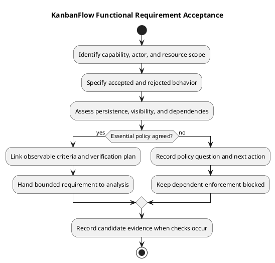

# KanbanFlow Functional Requirements

This catalog identifies functional areas and the behavior that a change-specific specification must clarify. It reflects the documented product scope without asserting a complete endpoint permission matrix or fresh feature verification.

## Functional areas

| Area | Intended behavior | Acceptance boundary |
| --- | --- | --- |
| Accounts | Register, sign in/out, and access protected resources | Session, validation, expired-session, and rejection behavior |
| Workspaces | Organize workspace resources and membership | Current membership and applicable role policy |
| Projects and boards | Organize projects and permitted boards | Nested resource scope and board visibility |
| Columns | Maintain ordered workflow stages and optional WIP limits | Valid positions and rejected capacity violations |
| Tasks | Maintain task details, assignments, completion, and movement | Authorization, persistence, and valid transitions |
| Collaboration | Comments, activity, database notifications, and analytics | Permitted data only; accepted mutations reflected in affected state |
| Navigation and search | Find permitted resources and show useful empty/error states | Search does not bypass access or obscure failure |

## Specify each change

Record actor, current membership, resource ancestry, preconditions, trigger, expected persisted result, and relevant failure response. Include direct requests as well as UI interaction when authorization is involved.

For movement, clarify source/destination state, WIP constraints, ordering, stale requests, rejection feedback, and persistence after reload. For collaboration, clarify who can inspect or mutate data after membership changes.

## Capability and acceptance catalog

The FR identifiers below are document-local catalog references, not external issue numbers, committed scope, or completed checks. They organize the documented capabilities. A change-specific record must establish exact policy, inputs, and evidence before claiming acceptance.

| ID | Capability | Expected functional outcome | Relevant acceptance scenarios |
| --- | --- | --- | --- |
| FR-01 | Registration and sessions | Users can establish and end an authenticated session through permitted flows | Valid/invalid input, trusted origin, sign-in/out, expired session, protected access |
| FR-02 | Workspace organization | Users can inspect and manage workspaces according to applicable authorization | Current membership, permitted mutations, inaccessible resources, validation failures |
| FR-03 | Membership administration | Applicable membership actions enforce the agreed role policy | Owner actions, direct role updates, removal/revocation, indirect role-change policy gap |
| FR-04 | Projects | Permitted users can maintain project information within its workspace | Create/edit/delete, resource ancestry, persisted fields, affected summary refresh |
| FR-05 | Boards and visibility | Users see and act on boards allowed by membership and visibility | Workspace/private boards, creator/owner/manager access, ordinary member restrictions |
| FR-06 | Columns and WIP | Permitted users maintain ordered workflow columns and applicable limits | Creation/deletion ordering, capacity rejection, isolated contention where relevant |
| FR-07 | Task information | Permitted users maintain task descriptions, priority, due dates, assignments, and completion | Valid/invalid changes, assignment access, persistence, rejected unauthorized mutation |
| FR-08 | Task movement | Accepted moves preserve valid source/destination state and ordering | Keyboard movement, reload persistence, WIP rejection, rollback, stale operation |
| FR-09 | Comments | Permitted users inspect and perform applicable comment actions | Private-board scope, author permissions, removed-member edit/delete rejection |
| FR-10 | Activity | Activity information respects permitted resources | Direct and nested reads, private task visibility, unavailable resource handling |
| FR-11 | Database notifications | Relevant recorded assignment notifications are available through permitted access | Correct recipient/data scope and observed state behavior |
| FR-12 | Analytics | Permitted summaries reflect accepted changes within the tested scope | Private data exclusion, project mutation invalidation, refreshed displayed totals |
| FR-13 | Resource discovery | Workspace/project/board search provides meaningful results and empty feedback | Accessible resources only, result counts, ordering restrictions while filtered |
| FR-14 | Interface preferences and navigation | Users can navigate and select Light, Dark, or System appearance | Browser-local preference persistence, tab synchronization, route/error recovery |

This catalog does not specify every endpoint or field rule. Inspect the owning implementation and decisions for exact role permissions, data formats, and response contracts. Do not invent numerical limits or response codes from these summaries.

## Resource and access boundaries

The resource hierarchy is workspace → project → board → column → task. A request must refer to a resource in the applicable access context. Task comments, activity, notifications, and analytics add data-exposure boundaries beyond the main screen.

Private-board access is documented for the creator and current workspace owners/managers, subject to membership. Ordinary membership does not grant access to another user's private board. Removed membership revokes applicable access, including comment mutations by a former author.

Specify both UI behavior and server enforcement. A hidden button or filtered list does not prevent direct requests. Include cross-resource identifiers, role changes, removal, and stale sessions when those conditions affect a change.

## Accepted mutations and failure behavior

For every mutation, identify the accepted persisted result, affected visible state, and rejection behavior. A failure should not leave the interface claiming success. Do not infer instantaneous synchronization across all users from local cache invalidation.

For task movement, record source/destination state, WIP applicability, ordered position expectations, and stale-state handling. Verify rollback and reload separately: a restored card does not by itself demonstrate correct persisted ordering.

For project changes, specify relevant analytics refresh. For deletion, identify affected ordering and resource access without inventing undocumented data-retention or cascading-deletion rules.

## Change-specific requirement record

```text
FR catalog reference and actual backlog item:
Affected actor, membership, and resource ancestry:
Existing behavior and evidence source:
Proposed change and explicit exclusions:
Preconditions and trigger:
Accepted response, visible state, and persisted result:
Validation, permission, and failure/recovery behavior:
Dependencies and policy decision references:
Observable acceptance criteria:
Verification environment and planned checks:
Actual agreement and status, or pending:
```

Use the [requirements guide](requirements.md), [roles and use cases](roles-and-use-cases.md), and [security/privacy guide](security-and-privacy-requirements.md) for supporting detail. Keep proposed changes distinct from existing capability descriptions.

## Dependencies and prioritization

Link candidate work to the [product backlog](../../Project-Management/product-backlog.md). Catalog numbering does not assign priority, dates, capacity, or sprint selection. Essential policy ambiguity blocks dependent enforcement implementation.

The membership role loophole in FR-03 requires DEC-003/PB-001 follow-up. A separate bounded investigation can clarify options without claiming the role policy is agreed or the loophole fixed. Record actual decisions through the [decision register](../../Project-Management/decision-register.md).

## Verification matrix

| Criterion | Candidate revision | Scenario/environment | Result | Evidence or gap |
| --- | --- | --- | --- | --- |
| Actual criterion linked to FR/item | Exact revision or pending | Relevant check | Pass / Fail / Blocked / Not run / justified Not applicable | Actual record link or explicit limitation |

Select checks using the [quality and risk plan](../../Project-Management/quality-and-risk-plan.md). Build success does not demonstrate browser usability; SQLite regressions do not demonstrate MySQL contention behavior. Historical release results support their recorded candidates only.

Required failed, blocked, or unexecuted criteria prevent declaring the affected outcome complete. Reassess evidence after source changes and record the effect of candidate/environment differences.

## Review and maintenance

Before analysis handoff, check scope, actors, preconditions, accepted/rejected behavior, dependencies, and feasible evidence. Link requirements, decisions, implementation, and checks through [traceability](../../Project-Management/traceability.md).

Preserve superseded criteria and explain material changes. Requirement agreement, item completion, merge, publication, and deployment remain separate events. Exclude secrets and unnecessary personal data, and keep the catalog consistent with its owning product scope and release context.

## Constraints and exclusions

Database notifications do not promise email/SMS delivery. Browser-local theme preferences do not imply account-wide synchronization. No automatic real-time external integration or offline persistence guarantee is established here.

The manager remove/re-add role loophole remains unresolved in DEC-003/PB-001. Do not turn documented intended owner-only direct role changes into a claim that every indirect path is already enforced.

## Evidence

Link change-specific criteria to [validation and acceptance](validation-and-acceptance-criteria.md) and actual [verification records](../../Releases/verification-template.md). Historical release behavior is contextual evidence, not a new test run.

## Related guidance

See the [requirements index](README.md), [planning phase](../01-planning/README.md), [analysis phase](../03-analysis/README.md), and [diagram guide](../../diagram-guide.md). Keep proposed rules, actual decisions, and performed evidence distinct.

## PlantUML diagram


[PlantUML source](diagrams/functional-requirements.puml)


