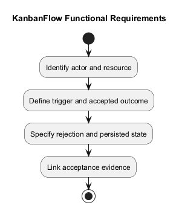
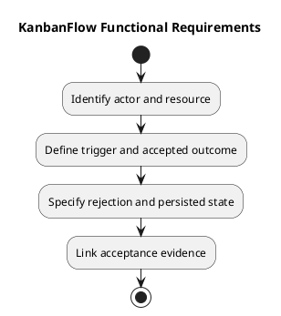

# KanbanFlow Functional Requirements

This catalog identifies functional areas and the behavior that a change-specific specification must clarify. It reflects the documented product scope without asserting a complete endpoint permission matrix or fresh feature verification.

## Functional areas

| Area | Intended behavior | Acceptance boundary |
| --- | --- | --- |
| Accounts | Register, sign in/out, and access protected resources | Session, validation, expired-session, and rejection behavior |
| Workspaces | Organize workspace resources and membership | Current membership and applicable role policy |
| Projects and boards | Organize projects and permitted boards | Nested resource scope and board visibility |
| Columns | Maintain ordered workflow stages and optional WIP limits | Valid positions and rejected capacity violations |
| Tasks | Maintain task details, assignments, completion, and movement | Authorization, persistence, and valid transitions |
| Collaboration | Comments, activity, database notifications, and analytics | Permitted data only; accepted mutations reflected in affected state |
| Navigation and search | Find permitted resources and show useful empty/error states | Search does not bypass access or obscure failure |

## Specify each change

Record actor, current membership, resource ancestry, preconditions, trigger, expected persisted result, and relevant failure response. Include direct requests as well as UI interaction when authorization is involved.

For movement, clarify source/destination state, WIP constraints, ordering, stale requests, rejection feedback, and persistence after reload. For collaboration, clarify who can inspect or mutate data after membership changes.

## Constraints and exclusions

Database notifications do not promise email/SMS delivery. Browser-local theme preferences do not imply account-wide synchronization. No automatic real-time external integration or offline persistence guarantee is established here.

The manager remove/re-add role loophole remains unresolved in DEC-003/PB-001. Do not turn documented intended owner-only direct role changes into a claim that every indirect path is already enforced.

## Evidence

Link change-specific criteria to [validation and acceptance](validation-and-acceptance-criteria.md) and actual [verification records](../../Releases/verification-template.md). Historical release behavior is contextual evidence, not a new test run.

## Related guidance

See the [requirements index](README.md), [planning phase](../01-planning/README.md), [analysis phase](../03-analysis/README.md), and [diagram guide](../../diagram-guide.md). Keep proposed rules, actual decisions, and performed evidence distinct.

## PlantUML diagram

[PlantUML source](diagrams/functional-requirements.puml)

