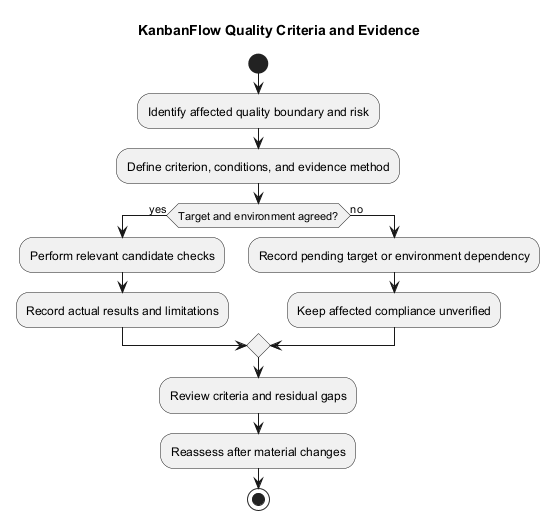
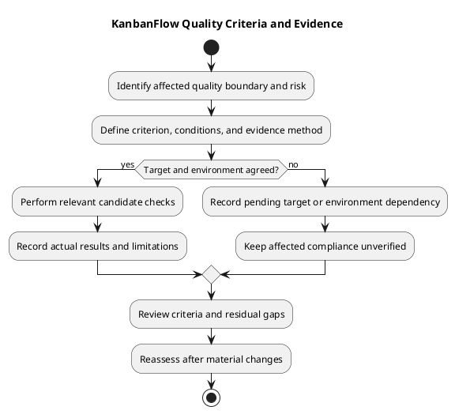

# KanbanFlow Non-functional Requirements

Quality requirements describe observable constraints on behavior. This guide identifies relevant categories without inventing numerical service targets, a complete browser matrix, or production certification.

## Quality categories

| Category | Requirement formulation | Evidence |
| --- | --- | --- |
| Accessibility | State required keyboard, focus, label, and error-feedback outcomes | Affected browser observations and appropriate checks |
| Responsive readability | Define relevant viewport and light/dark states | Visual/runtime inspection at recorded conditions |
| Integrity | Preserve ordering, WIP rules, and accepted persisted changes | Regression tests and relevant isolated database checks |
| Recoverability | Define expected rejection/rollback and configuration recovery | Failure-path observations and actual recovery exercises where required |
| Maintainability | Keep scope, ownership, and documentation understandable | Scoped review, source consistency, and link checks |
| Performance | Specify workload, environment, metric, and threshold only when agreed | Reproducible measurements with sample limits |
| Availability | Define actual operational expectation only when agreed | Appropriate deployed-environment evidence |

## Quality requirement catalog

The NFR identifiers are local documentation references, not issue numbers, agreed service levels, or completed checks. Select and agree applicable criteria for each bounded change.

| ID | Quality concern | Observable criterion to specify | Evidence boundary |
| --- | --- | --- | --- |
| NFR-01 | Keyboard accessibility | Affected controls can be reached and operated with visible focus and appropriate recovery | Recorded journeys; no full accessibility certification inferred |
| NFR-02 | Accessible feedback | Relevant fields, labels, validation, and failures provide understandable feedback | Inspect affected states and semantics |
| NFR-03 | Responsive readability | Content and controls remain usable at agreed viewports and theme states | Record browser, viewport, and state |
| NFR-04 | Data integrity | Accepted operations preserve applicable ordering, WIP limits, and resource consistency | Sequential regressions plus relevant contention checks |
| NFR-05 | Failure recovery | Rejected operations do not present false success or leave misleading cached state | Observe rejection and persisted state after reload |
| NFR-06 | Access protection | Roles, membership, and visibility restrict relevant data/actions | Direct, nested, and aggregate scenarios |
| NFR-07 | Performance | Agreed journey/workload meets a defined metric under recorded conditions | Reproducible measurements; target pending until agreed |
| NFR-08 | Availability | An actual operational service meets its agreed availability expectation | Deployment monitoring and defined measurement window |
| NFR-09 | Backup and restoration | Required recovery is demonstrated under an agreed recovery scenario | Actual restore evidence; source rollback is insufficient |
| NFR-10 | Compatibility | The agreed runtime/browser/configuration combination supports affected behavior | Tested combinations and explicit exclusions |
| NFR-11 | Maintainability | Changes remain scoped, understandable, and linked to relevant evidence | Actual review and meaningful regression checks |
| NFR-12 | Documentation quality | Owning guidance, relative links, diagram source, and previews remain consistent | Content/link/render/visual checks |

Do not treat this catalog as a universal checklist for every edit. A documentation-only change normally requires documentation checks, while changed authorization, interaction, or locking behavior needs evidence at those boundaries.

## Define a measurable criterion

Specify the journey or operation, conditions, observable result, and assessment method. If a numerical threshold is needed, agree its metric, unit, workload, environment, and measurement window before assessing compliance.

Example formulation only: for a chosen browser and viewport, a dialog can be opened, navigated by keyboard, dismissed, and return focus to its trigger. This example is not a new scheduled requirement or fresh browser result.

For performance, distinguish initial load, interaction latency, API response time, and build artifact size. A smaller individual chunk does not establish lower total transfer or faster end-to-end loading. Report sample counts and variability when measuring; do not invent percentiles from insufficient observations.

## Targets and evidence status

| State | Meaning | Next action |
| --- | --- | --- |
| Proposed | Quality outcome is being defined | Clarify conditions and criteria |
| Agreed | Applicable criterion and assessment basis are recorded | Plan/execute candidate checks |
| Blocked | Required decision or environment is unavailable | Record dependency and responsible next action |
| Superseded | A recorded decision replaces the criterion | Preserve history and link the replacement |

These are requirement states, not test results. Checks use Pass, Fail, Blocked, Not run, and justified Not applicable in the [verification template](../../Releases/verification-template.md).

No numerical latency, uptime, capacity, recovery time, recovery point, or full browser-support target is established here. Unknown targets remain pending. Do not declare a proposed target achieved from unrelated historical release evidence.

## Operational and compatibility considerations

Record actual runtime, browser, database, configuration assumptions, and workload. Manifest ranges or CI versions do not prove every compatible combination. Local development hosts and origins must be appropriate to the actual environment; do not copy development values into production requirements without assessment.

Availability and restore criteria require evidence from the relevant operational environment or authorized isolated exercise. Published source, a tag, or passing CI does not demonstrate uptime, backup completeness, or restore success. Follow [upgrade and rollback guidance](../../Releases/upgrade-and-rollback.md) for recovery planning and compatibility boundaries.

Browser-local theme storage is separate from shared work data; it does not imply account-wide preference synchronization. Do not introduce offline or universal real-time consistency guarantees without explicit requirements and evidence.

## Risk-based selection

Assess affected user journeys and failure consequences using the quality and risk plan. Include permission revocation, stale state, rollback, and contention when relevant. The manager remove/re-add role loophole remains tracked in DEC-003/PB-001; an access-protection criterion depending on its unresolved policy cannot be declared complete.

Use the [decision register](../../Project-Management/decision-register.md) for actual policy or target agreement and [product backlog](../../Project-Management/product-backlog.md) for follow-up work. Keep unrelated residual risks visible without treating every one as a blocker for every documentation item.

## Evidence matrix

| NFR/criterion | Candidate revision | Conditions and method | Result/value | Evidence | Limitation |
| --- | --- | --- | --- | --- | --- |
| Actual criterion | Exact revision or pending | Actual environment and check | Observed value/state or unknown | Actual reference or pending | Sample or environment gap |

Record evidence at the final assessed candidate. If later source or environment changes affect the criterion, reassess the earlier result. Historical test counts do not establish coverage percentages, capacity, or fresh verification.

## Review and change control

Review whether each applicable criterion is meaningful, measurable or observable, feasible, and linked to the affected requirement. Record material target or scope changes with their rationale and actual agreement; do not lower criteria silently after failure.

Required unmet or unexecuted criteria prevent claiming the affected outcome complete under the [Definition of Done](../../Sprints/definition-of-done.md). Agreement, item completion, publication, and deployment remain separate decisions.

Maintain links to [traceability](../../Project-Management/traceability.md) and preserve superseded criteria. Exclude credentials and unnecessary personal data from evidence. Keep source and preview aligned when the diagram changes.

## Measurable record

```text
Quality requirement and affected journey:
Conditions and environment:
Metric or observable result:
Threshold and actual agreement, if applicable:
Measurement/check method:
Dependencies and limitations:
Evidence reference or pending:
```

Leave targets unknown until agreed. Code splitting or a smaller individual bundle does not by itself establish faster end-to-end loading. Test counts do not establish coverage percentages or capacity.

## Verification boundaries

Build success does not prove usability. SQLite tests do not prove MySQL contention behavior. A source release does not establish deployed uptime or successful restore. Record applicable checks and missing evidence explicitly.

Use the [quality and risk plan](../../Project-Management/quality-and-risk-plan.md), [security requirements](security-and-privacy-requirements.md), and [acceptance guide](validation-and-acceptance-criteria.md). Reassess quality constraints when scope or environment changes.

## Related guidance

See the [requirements index](README.md), [planning phase](../01-planning/README.md), [analysis phase](../03-analysis/README.md), and [diagram guide](../../diagram-guide.md). Keep proposed rules, actual decisions, and performed evidence distinct.

## PlantUML diagram



[PlantUML source](diagrams/non-functional-requirements.puml)


