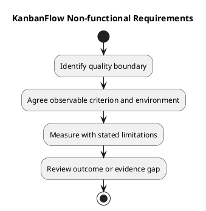

# KanbanFlow Non-functional Requirements

Quality requirements describe observable constraints on behavior. This guide identifies relevant categories without inventing numerical service targets, a complete browser matrix, or production certification.

## Quality categories

| Category | Requirement formulation | Evidence |
| --- | --- | --- |
| Accessibility | State required keyboard, focus, label, and error-feedback outcomes | Affected browser observations and appropriate checks |
| Responsive readability | Define relevant viewport and light/dark states | Visual/runtime inspection at recorded conditions |
| Integrity | Preserve ordering, WIP rules, and accepted persisted changes | Regression tests and relevant isolated database checks |
| Recoverability | Define expected rejection/rollback and configuration recovery | Failure-path observations and actual recovery exercises where required |
| Maintainability | Keep scope, ownership, and documentation understandable | Scoped review, source consistency, and link checks |
| Performance | Specify workload, environment, metric, and threshold only when agreed | Reproducible measurements with sample limits |
| Availability | Define actual operational expectation only when agreed | Appropriate deployed-environment evidence |

## Measurable record

```text
Quality requirement and affected journey:
Conditions and environment:
Metric or observable result:
Threshold and actual agreement, if applicable:
Measurement/check method:
Dependencies and limitations:
Evidence reference or pending:
```

Leave targets unknown until agreed. Code splitting or a smaller individual bundle does not by itself establish faster end-to-end loading. Test counts do not establish coverage percentages or capacity.

## Verification boundaries

Build success does not prove usability. SQLite tests do not prove MySQL contention behavior. A source release does not establish deployed uptime or successful restore. Record applicable checks and missing evidence explicitly.

Use the [quality and risk plan](../../Project-Management/quality-and-risk-plan.md), [security requirements](security-and-privacy-requirements.md), and [acceptance guide](validation-and-acceptance-criteria.md). Reassess quality constraints when scope or environment changes.

## Related guidance

See the [requirements index](README.md), [planning phase](../01-planning/README.md), [analysis phase](../03-analysis/README.md), and [diagram guide](../../diagram-guide.md). Keep proposed rules, actual decisions, and performed evidence distinct.

## PlantUML diagram


[PlantUML source](diagrams/non-functional-requirements.puml)


