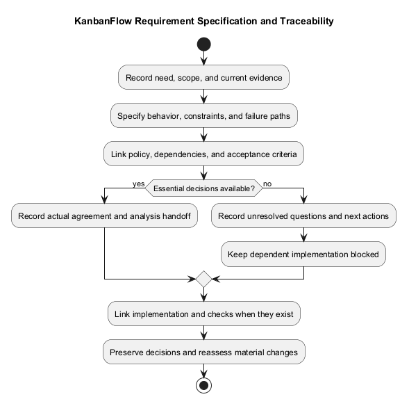
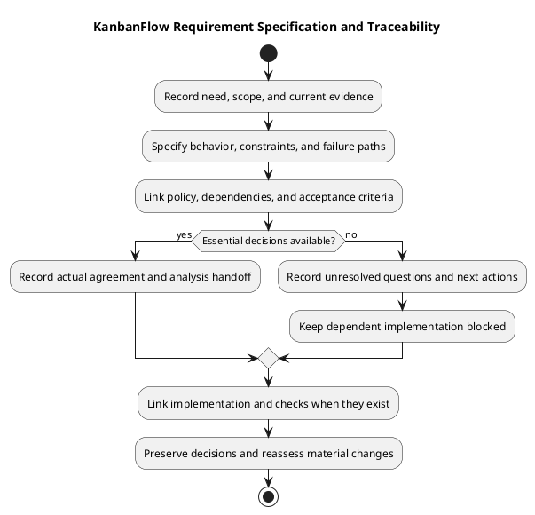

# KanbanFlow Requirements Specification Guide

> **Policy amendment (2026-10-10):** Membership mutations are now owner-only; DEC-003/PB-001's bypass is fixed. Earlier open-policy text and diagrams below describe the preceding state. See [QA corrections](../06-testing/qa-corrections-2026-10-10.md) for the selected rule and regression evidence.

Use this document to organize requirements for a bounded change. It is a specification framework, not a completed approval or verification record. The [requirements index](README.md) defines the phase and its analysis handoff.

## Specification contents

| Section | Required detail |
| --- | --- |
| Need | Affected actors, problem, and intended benefit |
| Scope | Included behavior, exclusions, and dependencies |
| Functional behavior | Triggers, preconditions, successful results, and failures |
| Quality constraints | Observable interaction, integrity, and operational constraints |
| Access and privacy | Applicable roles, membership, visibility, and sensitive data |
| Acceptance | Checkable criteria and feasible evidence plan |

## Requirement record

```text
Identifier and owning need:
Status: proposed / agreed / blocked / superseded:
Actors and preconditions:
Trigger and expected outcome:
Failure and rejection behavior:
Scope and exclusions:
Constraints and policy references:
Dependencies and unresolved questions:
Verification approach:
Actual decision reference or pending:
```

Identifiers are local record references unless linked to an actual issue. Preserve source decisions and label proposals separately from current behavior. Unknown values remain pending.

## Specialist documents

- [Functional requirements](functional-requirements.md)
- [Non-functional requirements](non-functional-requirements.md)
- [Roles and use cases](roles-and-use-cases.md)
- [Security and privacy](security-and-privacy-requirements.md)
- [User stories and use cases](user-stories-and-use-cases.md)
- [Validation and acceptance criteria](validation-and-acceptance-criteria.md)

## Establish the specification context

Identify the proposed change, owning user need, affected actors, and relevant current behavior. Record source references or the inspected revision when describing implementation. Distinguish observed behavior from desired behavior and unresolved policy.

Use the [planning record](../01-planning/planning.md), [product scope](../../Project-Definition/scope-and-stakeholders.md), and [product backlog](../../Project-Management/product-backlog.md) as inputs. Do not infer a committed schedule, named reviewer, or verification result from a requirements document.

## Requirement register

| Identifier | Type | Need/reference | Bounded outcome | Status | Dependencies | Acceptance reference |
| --- | --- | --- | --- | --- | --- | --- |
| Actual local identifier | Functional / quality / access / constraint | Actual source | Observable intended behavior | Proposed | Explicit condition or none identified | Criteria link or pending |

Use stable identifiers and link related FR/NFR catalog references where applicable. Catalog identifiers organize documentation; they do not automatically create issues or imply implementation. Keep shared rules in their owning documents and link them from change-specific records.

## Status and agreement

| Status | Meaning | Required context |
| --- | --- | --- |
| Proposed | Requirement is under clarification | Need, assumptions, and unanswered questions |
| Agreed | Actual decision establishes the bounded requirement | Decision reference, date, and responsible person |
| Blocked | A condition prevents a required next step | Impact, next action, and agreed owner or unassigned |
| Superseded | A later decision replaces the requirement | Replacement link and reason; preserve history |

Requirement status is separate from backlog state and verification result. Agreed does not mean Ready, Done, or Pass. Use the [Definition of Ready](../../Sprints/definition-of-ready.md) for selection and [Definition of Done](../../Sprints/definition-of-done.md) for completed work.

An agreed requirement can still have a blocked implementation dependency. Record both facts rather than losing the agreement or concealing the blocker.

## Specify boundaries and failure paths

For each behavior, identify actor, membership, resource ancestry, preconditions, trigger, accepted visible/persisted result, and relevant rejection path. Include missing or stale resources, validation errors, changed membership, and conflicting state when they affect the outcome.

The workspace → project → board → column → task hierarchy constrains access context. Related comments, activity, notifications, and analytics must not leak restricted data. UI controls cannot replace backend authorization.

Avoid prescribing every implementation detail unless it is a real constraint. Analysis may compare approaches, but it must not silently change the requested user outcome. Operational targets, input limits, or browser commitments remain pending unless established by actual rules or agreement.

## Policy, assumptions, and dependencies

| Reference | Question/condition | Effect on requirement | Evidence or decision needed | Next action/owner |
| --- | --- | --- | --- | --- |
| Actual reference | Specific uncertainty | Affected scope or criterion | Actual source or pending | Concrete action and agreed person, or unassigned |

The manager remove/re-add role loophole remains tracked by DEC-003/PB-001. Resolve essential membership-policy ambiguity before dependent enforcement implementation. Do not treat direct owner-only role updates as proof that every indirect path is closed.

Use the [decision register](../../Project-Management/decision-register.md). A bounded investigation can specify its question and expected output while dependent implementation remains blocked. Elapsed time and document edits do not constitute another person's agreement.

## Traceability matrix

| Need | Requirement | Decision/backlog | Analysis or implementation | Acceptance/check | Evidence |
| --- | --- | --- | --- | --- | --- |
| Actual need | Stable requirement reference | Actual links | Pending or actual revision/reference | Observable criterion | Pending or actual result record |

Populate downstream references when they exist, without inventing commits or results. Use the [traceability guide](../../Project-Management/traceability.md) and [documentation traceability](../../Project-Management/documentation-traceability.md) to keep owning records discoverable.

## Acceptance and evidence planning

Map each criterion to a feasible check and required environment using the [quality and risk plan](../../Project-Management/quality-and-risk-plan.md). Include failure/recovery observations where material. Record unavailable environments as dependencies.

Detailed results belong in the [verification template](../../Releases/verification-template.md), identifying exact revision, environment, result state, and limits. Planned checks are not executed evidence. Historical suite totals do not verify a new candidate; build success does not prove usability; SQLite tests do not prove MySQL contention behavior.

## Review checklist

- The need and intended outcome are explicit.
- Scope, exclusions, actors, and preconditions are bounded.
- Success and relevant failure criteria are observable.
- Functional and quality constraints do not contradict each other.
- Access, data, and compatibility implications are assessed.
- Essential policy decisions are agreed or block dependent work.
- Verification is feasible and limitations remain visible.
- Requirement state, agreement, and traceability are recorded honestly.

Hand bounded requirements to analysis with unresolved questions visible. Return new questions or material trade-offs to the owning requirement and decision record rather than silently assuming a rule.

## Change record and maintenance

| Change date | Requirement/reference | Earlier scope | New scope and reason | Impact | Actual decision |
| --- | --- | --- | --- | --- | --- |
| Actual date | Actual reference | Recorded baseline | Specific change | Criteria/dependency/evidence effect | Agreement or pending |

Preserve superseded references and explain corrections. Reassess affected tests and documentation when criteria change; do not lower criteria silently to fit a failed check. Keep secrets and unnecessary personal data out of records.

Requirement agreement, item completion, merge, publication, and deployment remain separate events. Follow [release guidance](../../Releases/README.md) for delivery decisions; a specification establishes no production or recovery guarantee.

## Review and change control

Check completeness, conflicts, observable criteria, and dependencies before analysis. Record changed scope and actual agreement; preserve superseded references. Link needs, decisions, backlog items, and eventual evidence using [traceability](../../Project-Management/traceability.md). Requirement agreement does not establish implementation or deployment.

## Related guidance

See the [requirements index](README.md), [planning phase](../01-planning/README.md), [analysis phase](../03-analysis/README.md), and [diagram guide](../../diagram-guide.md). Keep proposed rules, actual decisions, and performed evidence distinct.

## PlantUML diagram



[PlantUML source](diagrams/requirements.puml)


