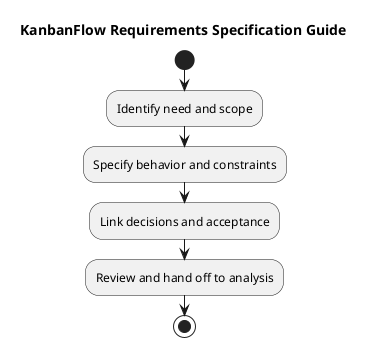

# KanbanFlow Requirements Specification Guide

Use this document to organize requirements for a bounded change. It is a specification framework, not a completed approval or verification record. The [requirements index](README.md) defines the phase and its analysis handoff.

## Specification contents

| Section | Required detail |
| --- | --- |
| Need | Affected actors, problem, and intended benefit |
| Scope | Included behavior, exclusions, and dependencies |
| Functional behavior | Triggers, preconditions, successful results, and failures |
| Quality constraints | Observable interaction, integrity, and operational constraints |
| Access and privacy | Applicable roles, membership, visibility, and sensitive data |
| Acceptance | Checkable criteria and feasible evidence plan |

## Requirement record

```text
Identifier and owning need:
Status: proposed / agreed / blocked / superseded:
Actors and preconditions:
Trigger and expected outcome:
Failure and rejection behavior:
Scope and exclusions:
Constraints and policy references:
Dependencies and unresolved questions:
Verification approach:
Actual decision reference or pending:
```

Identifiers are local record references unless linked to an actual issue. Preserve source decisions and label proposals separately from current behavior. Unknown values remain pending.

## Specialist documents

- [Functional requirements](functional-requirements.md)
- [Non-functional requirements](non-functional-requirements.md)
- [Roles and use cases](roles-and-use-cases.md)
- [Security and privacy](security-and-privacy-requirements.md)
- [User stories and use cases](user-stories-and-use-cases.md)
- [Validation and acceptance criteria](validation-and-acceptance-criteria.md)

## Review and change control

Check completeness, conflicts, observable criteria, and dependencies before analysis. Record changed scope and actual agreement; preserve superseded references. Link needs, decisions, backlog items, and eventual evidence using [traceability](../../Project-Management/traceability.md). Requirement agreement does not establish implementation or deployment.

## Related guidance

See the [requirements index](README.md), [planning phase](../01-planning/README.md), [analysis phase](../03-analysis/README.md), and [diagram guide](../../diagram-guide.md). Keep proposed rules, actual decisions, and performed evidence distinct.

## PlantUML diagram


[PlantUML source](diagrams/requirements.puml)


