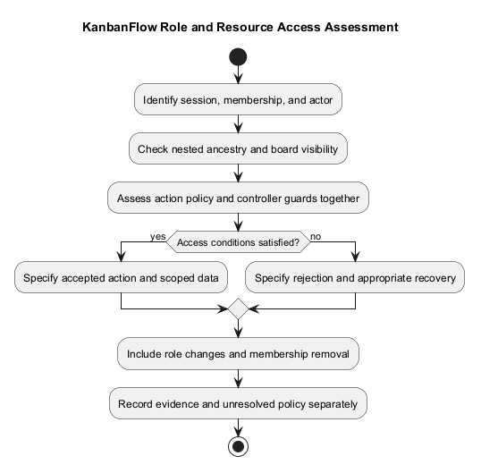
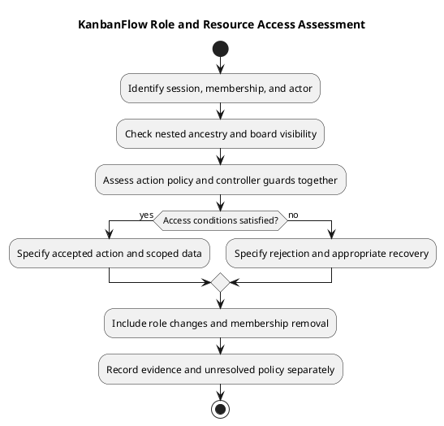

# KanbanFlow Roles and Use Cases

> **Policy amendment (2026-10-10):** Membership mutations are now owner-only; DEC-003/PB-001's bypass is fixed. Current guidance below reflects this rule; historical records retain their original scope. See [QA corrections](../06-testing/qa-corrections-2026-10-10.md) for the selected rule and regression evidence.

Roles describe a workspace access context. Stakeholder responsibilities are not a substitute for backend permissions. Check routes, policies, membership, resource ancestry, and visibility before specifying a role-dependent change.

## Actor categories

| Actor | Use-case interest | Boundary |
| --- | --- | --- |
| Guest | Registration and sign-in | Protected work remains unavailable |
| Workspace owner | Workspace and membership administration | Actual backend rules and current membership apply |
| Manager | Coordinate permitted resources | Membership mutations are reserved to the owner |
| Member | Contribute to permitted tasks and collaboration | Resource visibility and action-specific authorization apply |
| Viewer | Inspect permitted progress | Verify read access and rejection of unauthorized mutations |
| Maintainer/operator | Maintain/configure the application | Responsibility does not automatically grant in-app workspace rights |

## Use-case access record

```text
Use case and actor:
Current workspace membership:
Resource hierarchy and board visibility:
Requested action:
Allowed conditions and policy reference:
Rejected conditions:
Expected data exposure:
Verification scenarios:
Unresolved question or pending decision:
```

Private boards are documented as accessible to their creator and current workspace owners/managers, subject to workspace membership. Do not describe them as universally creator-only. Nested tasks, comments, activity, and analytics must respect applicable visibility.

## Required edge cases

Consider removed membership, changed roles, stale sessions, private versus workspace-visible boards, cross-workspace identifiers, and direct requests. A hidden button does not prevent a server mutation. Removal must revoke applicable access even for previously authored comments.

Membership additions, removals, and role changes are owner-only under DEC-003/PB-001; the 2026-10-10 correction closes the manager remove/re-add bypass. Use the [decision register](../../Project-Management/decision-register.md) and [security guide](security-and-privacy-requirements.md).

## Source-grounded authorization boundaries

The following describes inspected source boundaries, not a complete endpoint matrix or fresh runtime verification. Controllers, request validation, nested-resource checks, and policies must be evaluated together.

| Boundary | Inspected source | Recorded rule/limit |
| --- | --- | --- |
| Workspace viewing | [WorkspacePolicy](../../../backend/app/Policies/WorkspacePolicy.php) | Viewing checks current membership. |
| Workspace update/delete | WorkspacePolicy | Checks `owner_id`; do not infer every surrounding guard from this method alone. |
| Member management | WorkspacePolicy | Only the workspace owner can pass `manageMembers`. |
| Direct member-role change | WorkspacePolicy | Owner-only policy; add/remove operations enforce the same boundary. |
| Project view/update/delete | [ProjectPolicy](../../../backend/app/Policies/ProjectPolicy.php) | Viewing checks membership; update/delete policy allows owner or manager. |
| Board view/update/delete | [BoardPolicy](../../../backend/app/Policies/BoardPolicy.php) | View uses visibility scope; update/delete first require view, then owner/manager. |
| Board visibility | [Board model](../../../backend/app/Models/Board.php) | Current workspace membership is required; private visibility adds creator/owner/manager conditions. |
| Comment access | [Comment controller](../../../backend/app/Http/Controllers/Api/TaskCommentController.php) and [comment policy](../../../backend/app/Policies/TaskCommentPolicy.php) | Nested ancestry and board view checks surround action rules; policy methods alone are insufficient to describe endpoint access. |

Policy methods for restore/force-delete do not establish a user-facing endpoint or screen. Verify routes and controllers before documenting those as available use cases. Maintainer/operator responsibilities remain separate from application authorization.

## Use-case catalog

These UC identifiers organize this document; they are not issue numbers or selected work.

| ID | Use case | Actor/access context | Relevant alternate path |
| --- | --- | --- | --- |
| UC-01 | Establish/end a session | Guest or authenticated account, as applicable | Invalid input, throttling, expired session |
| UC-02 | Inspect a workspace/project | Current workspace member | Removed membership or cross-workspace resource |
| UC-03 | Manage workspace settings | Owner, with applicable request guards | Unauthorized direct mutation |
| UC-04 | Manage membership | Workspace owner | Manager/member requests rejected; owner and current-member protections apply |
| UC-05 | Change a member role directly | Owner under the role-change policy | Manager update/add/remove rejected; persisted membership remains unchanged |
| UC-06 | Inspect permitted boards | Current member plus board visibility | Another user's private board unavailable to ordinary members |
| UC-07 | Manage permitted project/board | Applicable owner/manager rules and resource guards | Invisible board, invalid ancestry, rejected mutation |
| UC-08 | Contribute to tasks/comments | Action-specific role, authorship, and visibility checks | Validation, removal, stale state, and WIP rejection |
| UC-09 | Inspect summaries/activity | Permitted resource context | Restricted data excluded from nested/aggregate responses |

For UC-08, inspect the specific action's controller before deciding whether a viewer or another role may contribute. Do not derive all mutation permissions from the words member, contributor, or viewer.

## Detailed use-case record

```text
UC reference and actual requirement/backlog link:
Actor and authenticated session context:
Current membership and role:
Workspace/project/board ancestry and visibility:
Preconditions and trigger:
Allowed action and policy/controller references:
Accepted visible and persisted outcome:
Rejected conditions and recovery:
Expected data exposure:
Dependencies and unresolved policy:
Verification scenarios and candidate revision:
Actual result or pending evidence:
```

Use observable outcomes and distinguish current rules from proposed changes. Unknown permission details remain questions until inspected or agreed. Record actual agreement through the decision register when policy changes.

## Role transition and revocation scenarios

| Scenario | What to specify/check |
| --- | --- |
| User removed from workspace | Loss of applicable board and nested-resource access, including previously authored comments |
| User role changes | Which actions become available/unavailable, with fresh server authorization |
| Private-board creator no longer belongs | Membership restriction still applies to visibility |
| Session expires | Protected requests reject appropriately and UI provides useful recovery |
| Client caches an old role | Server guards prevent relying on stale UI permissions |
| Cross-resource identifier submitted | Nested ancestry must match the requested workspace/project/board |

Removal/re-addition and direct role change are different paths. Both enforce owner-only authority; verification must cover manager add/remove rejection and unchanged persisted membership.

## Acceptance and evidence

| Use case/criterion | Actor/resource conditions | Expected outcome | Candidate/environment | Result/evidence |
| --- | --- | --- | --- | --- |
| Actual reference | Specific membership, role, and visibility | Accepted or rejected behavior | Exact candidate or pending | Actual result or not run |

Use the [acceptance guide](validation-and-acceptance-criteria.md) and [verification template](../../Releases/verification-template.md). Check direct requests, list/aggregate responses, UI feedback, and persistence when relevant. Historical tests are not fresh evidence for a different candidate.

Required unresolved policy or unexecuted acceptance checks prevent claiming the affected enforcement work complete. Keep unrelated residual issues tracked without pretending that every documentation edit is blocked by them.

## Review and maintenance checklist

- Actor responsibility is separated from actual application permission.
- Current membership, ancestry, and board visibility are explicit.
- Policies and controller/request guards are interpreted together.
- Direct mutations and aggregate exposure are covered when relevant.
- Role transitions and revoked access have observable criteria.
- Proposed rules and unresolved decisions remain distinct from current behavior.
- Source references and actual evidence identify their scope and limitations.

Reassess this guide when permissions or controller guards change. Preserve decision context, repair links, and update diagram source and preview together. Do not include credentials or unnecessary personal information in role examples.

## Review

Link each use case to [stories](user-stories-and-use-cases.md) and observable criteria. Record intended rules separately from current defects and actual test results. Avoid inventing a complete authorization matrix from stakeholder descriptions.

## Related guidance

See the [requirements index](README.md), [planning phase](../01-planning/README.md), [analysis phase](../03-analysis/README.md), and [diagram guide](../../diagram-guide.md). Keep proposed rules, actual decisions, and performed evidence distinct.

## PlantUML diagram



[PlantUML source](diagrams/roles-and-use-cases.puml)


