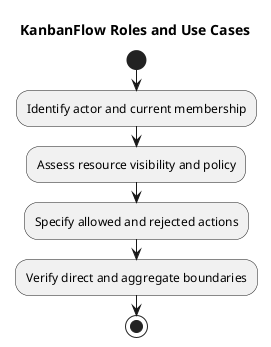

# KanbanFlow Roles and Use Cases

Roles describe a workspace access context. Stakeholder responsibilities are not a substitute for backend permissions. Check routes, policies, membership, resource ancestry, and visibility before specifying a role-dependent change.

## Actor categories

| Actor | Use-case interest | Boundary |
| --- | --- | --- |
| Guest | Registration and sign-in | Protected work remains unavailable |
| Workspace owner | Workspace and membership administration | Actual backend rules and current membership apply |
| Manager | Coordinate permitted resources | Indirect membership role changes remain a policy/enforcement issue |
| Member | Contribute to permitted tasks and collaboration | Resource visibility and action-specific authorization apply |
| Viewer | Inspect permitted progress | Verify read access and rejection of unauthorized mutations |
| Maintainer/operator | Maintain/configure the application | Responsibility does not automatically grant in-app workspace rights |

## Use-case access record

```text
Use case and actor:
Current workspace membership:
Resource hierarchy and board visibility:
Requested action:
Allowed conditions and policy reference:
Rejected conditions:
Expected data exposure:
Verification scenarios:
Unresolved question or pending decision:
```

Private boards are documented as accessible to their creator and current workspace owners/managers, subject to workspace membership. Do not describe them as universally creator-only. Nested tasks, comments, activity, and analytics must respect applicable visibility.

## Required edge cases

Consider removed membership, changed roles, stale sessions, private versus workspace-visible boards, cross-workspace identifiers, and direct requests. A hidden button does not prevent a server mutation. Removal must revoke applicable access even for previously authored comments.

DEC-003/PB-001 track the manager remove/re-add role loophole. Keep dependent enforcement requirements blocked until essential policy is agreed. Use the [decision register](../../Project-Management/decision-register.md) and [security guide](security-and-privacy-requirements.md).

## Review

Link each use case to [stories](user-stories-and-use-cases.md) and observable criteria. Record intended rules separately from current defects and actual test results. Avoid inventing a complete authorization matrix from stakeholder descriptions.

## Related guidance

See the [requirements index](README.md), [planning phase](../01-planning/README.md), [analysis phase](../03-analysis/README.md), and [diagram guide](../../diagram-guide.md). Keep proposed rules, actual decisions, and performed evidence distinct.

## PlantUML diagram


[PlantUML source](diagrams/roles-and-use-cases.puml)


