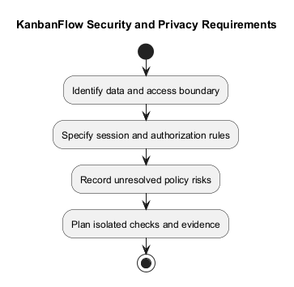
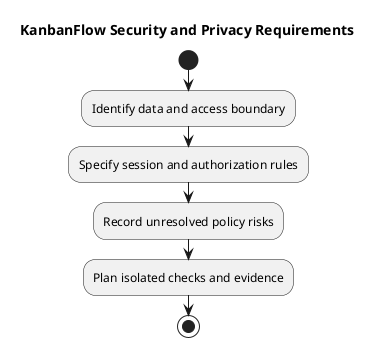

# KanbanFlow Security and Privacy Requirements

Specify security and privacy at the affected access and data boundary. This guide is not a security audit, compliance certification, or proof that all defects are closed.

## Requirement boundaries

| Boundary | Required specification |
| --- | --- |
| Authentication | Session lifecycle, protected access, origin/CSRF configuration, and understandable errors |
| Authorization | Role, current membership, resource ancestry, and board visibility |
| Private data | Restrict direct, nested, aggregate, and activity responses to permitted resources |
| Revocation | Define loss of access after removal or role change |
| Abuse controls | Define applicable request limits and structured rejection behavior |
| Input/data integrity | Validate inputs and reject invalid or conflicting operations |
| Documentation/evidence | Exclude credentials and unnecessary personal data from records and screenshots |

## Recorded context

The review release recorded login limits of five requests per minute per account/IP pair and thirty per minute per IP, plus JSON authentication errors. These are documented behavior, not a recommendation to invent new limits without analysis. Inspect relevant source when changing the rule.

Private-board visibility applies to listings, nested tasks/comments, analytics, and activity. Removed members must lose applicable mutations even for comments they authored. Server enforcement remains necessary regardless of frontend controls.

## Known unresolved issue

The manager remove/re-add membership role loophole remains open under DEC-003/PB-001. Direct owner-only role updates do not close the indirect path. Owners should manage membership until the policy and enforcement are resolved. Link the [decision register](../../Project-Management/decision-register.md) rather than presenting an undecided rule as settled.

## Change-specific record

```text
Affected actors and data:
Allowed and rejected actions:
Membership/session transitions:
Threat or failure scenario:
Policy and configuration assumptions:
Verification approach and isolated test data:
Remaining risks and next actions:
```

Use authorized isolated checks for roles, revocation, cross-resource requests, and aggregate exposure. Record actual revisions and gaps through the [verification template](../../Releases/verification-template.md).

## Privacy limits

Specify any new collection, retention, export, or deletion requirement explicitly; do not infer legal compliance or an implemented retention policy. Keep secrets out of diagrams and logs. Review actual environment configuration without copying credentials into documentation.

See [roles](roles-and-use-cases.md), [acceptance](validation-and-acceptance-criteria.md), and the [quality plan](../../Project-Management/quality-and-risk-plan.md).

## Related guidance

See the [requirements index](README.md), [planning phase](../01-planning/README.md), [analysis phase](../03-analysis/README.md), and [diagram guide](../../diagram-guide.md). Keep proposed rules, actual decisions, and performed evidence distinct.

## PlantUML diagram



[PlantUML source](diagrams/security-and-privacy-requirements.puml)


