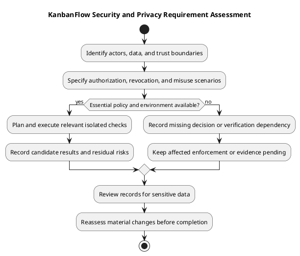

# KanbanFlow Security and Privacy Requirements

> **Policy amendment (2026-10-10):** Membership mutations are now owner-only; DEC-003/PB-001's bypass is fixed. Current guidance below reflects this rule; historical records retain their original scope. See [QA corrections](../06-testing/qa-corrections-2026-10-10.md) for the selected rule and regression evidence.

Specify security and privacy at the affected access and data boundary. This guide is not a security audit, compliance certification, or proof that all defects are closed.

## Requirement boundaries

| Boundary | Required specification |
| --- | --- |
| Authentication | Session lifecycle, protected access, origin/CSRF configuration, and understandable errors |
| Authorization | Role, current membership, resource ancestry, and board visibility |
| Private data | Restrict direct, nested, aggregate, and activity responses to permitted resources |
| Revocation | Define loss of access after removal or role change |
| Abuse controls | Define applicable request limits and structured rejection behavior |
| Input/data integrity | Validate inputs and reject invalid or conflicting operations |
| Documentation/evidence | Exclude credentials and unnecessary personal data from records and screenshots |

## Recorded context

The review release recorded login limits of five requests per minute per account/IP pair and thirty per minute per IP, plus JSON authentication errors. These are documented behavior, not a recommendation to invent new limits without analysis. Inspect relevant source when changing the rule.

Private-board visibility applies to listings, nested tasks/comments, analytics, and activity. Removed members must lose applicable mutations even for comments they authored. Server enforcement remains necessary regardless of frontend controls.

## Known unresolved issue

Membership additions, removals, and role changes are owner-only under DEC-003/PB-001; the 2026-10-10 correction closes the manager remove/re-add bypass. The add/remove endpoints enforce the same owner-only boundary. Link the [decision register](../../Project-Management/decision-register.md) for the selected rule and dated regression evidence.

## Change-specific record

```text
Affected actors and data:
Allowed and rejected actions:
Membership/session transitions:
Threat or failure scenario:
Policy and configuration assumptions:
Verification approach and isolated test data:
Remaining risks and next actions:
```

Use authorized isolated checks for roles, revocation, cross-resource requests, and aggregate exposure. Record actual revisions and gaps through the [verification template](../../Releases/verification-template.md).

## Control and evidence catalog

The SP identifiers organize this document; they are not issue numbers, selected scope, or evidence that all controls are implemented. A change-specific requirement must distinguish the existing rule, proposed change, and actual check result.

| ID | Concern | Required outcome to specify | Verification focus |
| --- | --- | --- | --- |
| SP-01 | Protected access | Unauthenticated or expired sessions cannot access protected work | Direct requests and useful session recovery feedback |
| SP-02 | Session/origin boundary | Actual cookie, CSRF, and stateful-origin configuration supports authorized sessions | Sign-in/out and state-changing requests in the relevant environment |
| SP-03 | Membership and roles | Actions use current membership and applicable role policy | Removed/changed membership and stale client state |
| SP-04 | Resource ancestry | Requested nested resources belong to the expected access context | Cross-workspace/project/board identifiers rejected |
| SP-05 | Private visibility | Restricted board data stays within permitted access | Listings, tasks/comments, activity, and analytics |
| SP-06 | Mutation integrity | Invalid, unauthorized, or conflicting changes do not produce accepted persisted results | Rejection, stale operations, and relevant data consistency |
| SP-07 | Abuse feedback | Applicable request limits reject excess requests with structured feedback | Isolated limit scenarios; no unrestricted load testing inferred |
| SP-08 | Sensitive evidence | Records and screenshots exclude credentials and unnecessary personal data | Evidence and commit review |
| SP-09 | Privacy lifecycle | Any collection, retention, export, and deletion rule is explicitly agreed | Actual data flows and implemented behavior, or pending policy |
| SP-10 | Delivery configuration | Environment-specific security assumptions and recovery risks are assessed | Actual configuration review without exposing secrets |

## Data and trust boundaries

| Data/context | Boundary to assess |
| --- | --- |
| Account/session information | Authentication and browser/backend session interaction |
| Workspace membership | Current access context and role-dependent actions |
| Projects, boards, columns, tasks | Nested ancestry, visibility, and mutation authorization |
| Comments and activity | Authorship does not override revoked workspace/board access |
| Notifications and analytics | Recipient/resource scoping and aggregate data exposure |
| Theme preference | Browser-local preference, separate from shared work records |
| Logs and verification artifacts | Necessary evidence only, without secrets or irrelevant personal details |

The browser is a client, not the authority for server access. Hidden controls and cached role labels cannot replace backend checks. Policy methods, request validation, controller guards, and visibility scopes need to be interpreted together, as described in [roles and use cases](roles-and-use-cases.md).

## Threat and misuse scenarios

| Scenario | Expected specification/check |
| --- | --- |
| Removed user reuses a resource URL | Applicable access is denied, including prior comment authorship |
| Ordinary member requests another user's private board | Restricted board and nested/aggregate data remain unavailable |
| Client submits an identifier from another resource hierarchy | Ancestry and authorization checks reject the request |
| Client keeps outdated permissions | Server uses current rules rather than trusting cached UI state |
| Manager changes a role through remove/re-add | Reject manager add/remove requests and preserve persisted membership under DEC-003 |
| Repeated login attempts | Assess recorded limits and structured rejection in isolated checks |
| Error output or screenshot includes secrets | Remove sensitive detail and retain a safe, relevant summary |

These scenarios guide bounded verification; they are not newly performed tests. Do not infer that every attack class has been assessed or that the application is certified secure.

## Session and configuration requirements

Specify actual browser/backend hosts, stateful origins, and cookie/CSRF assumptions for the environment. Development defaults do not establish production suitability. Invalid or expired sessions should produce understandable feedback without claiming a successful mutation.

Use the [setup guide](../../../README.md) and [upgrade guidance](../../Releases/upgrade-and-rollback.md) for owning configuration instructions. Record which settings were assessed, excluding their secret values. No complete security-header, transport, or deployment-hardening audit is asserted here.

## Privacy decisions and minimization

For a new data-handling change, identify the data, purpose, necessary access, storage location, exposure paths, and requested lifecycle behavior. Retention periods, export scope, deletion behavior, and backup implications require actual decisions and implementation evidence.

Do not invent legal bases, retention durations, consent flows, or compliance guarantees. A privacy policy document does not demonstrate a corresponding implemented control. Keep privacy questions in the decision register and dependent work explicit.

Use disposable or appropriately isolated test data. Avoid real credentials and unnecessary personal account information in demonstrations, diagrams, commits, logs, and shared evidence. If an artifact contains sensitive information, produce a sanitized relevant record rather than distributing it unchanged.

## Requirement and evidence matrix

| SP/criterion | Actor and resource conditions | Expected accepted/rejected result | Revision/environment | Result and evidence | Remaining risk |
| --- | --- | --- | --- | --- | --- |
| Actual criterion | Specific state and access context | Observable boundary | Exact candidate or pending | Actual result or not run | Explicit gap or none observed |

Use Pass, Fail, Blocked, Not run, and justified Not applicable through the verification template. Historical release results are not fresh candidate evidence. A passing build does not prove authorization correctness; SQLite tests do not demonstrate all MySQL concurrency boundaries.

Required unresolved policy and required failed/unexecuted checks prevent claiming the affected outcome complete. Preserve residual risks with impact and next actions rather than describing all findings as fixed.

## Review, changes, and delivery boundaries

- Identify affected actors, data, and trust boundaries.
- Include revocation, direct requests, nested ancestry, and aggregate exposure where relevant.
- Separate intended rules from known defects and undecided policy.
- Record exact candidate evidence and unavailable checks.
- Review evidence and changed files for secrets and unnecessary personal data.
- Link actual policy decisions and implementation follow-up.

Record material requirement changes with their reason and actual agreement. Maintain [traceability](../../Project-Management/traceability.md). Source publication does not establish secure deployment, uptime, or tested recovery; follow the [release checklist](../../Releases/release-checklist.md) for actual delivery decisions.

## Privacy limits

Specify any new collection, retention, export, or deletion requirement explicitly; do not infer legal compliance or an implemented retention policy. Keep secrets out of diagrams and logs. Review actual environment configuration without copying credentials into documentation.

See [roles](roles-and-use-cases.md), [acceptance](validation-and-acceptance-criteria.md), and the [quality plan](../../Project-Management/quality-and-risk-plan.md).

## Related guidance

See the [requirements index](README.md), [planning phase](../01-planning/README.md), [analysis phase](../03-analysis/README.md), and [diagram guide](../../diagram-guide.md). Keep proposed rules, actual decisions, and performed evidence distinct.

## PlantUML diagram


[PlantUML source](diagrams/security-and-privacy-requirements.puml)


