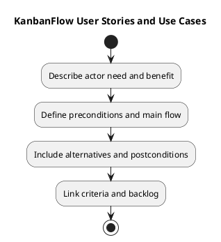

# KanbanFlow User Stories and Use Cases

Use stories to explain the actor's need and use cases to describe observable interactions. The examples and templates here are planning aids, not scheduled work or completed user research.

## Story template

```text
Story identifier:
As an actual actor category,
I want a bounded capability,
so that an identifiable outcome is possible.
Scope and exclusions:
Acceptance criteria:
Dependencies and policy references:
Verification approach:
Backlog reference and actual status:
```

Do not invent user feedback or prioritization. Connect stories to an actual need and the [product backlog](../../Project-Management/product-backlog.md).

## Use-case template

| Field | Detail |
| --- | --- |
| Actor and goal | Who acts and what outcome is sought |
| Preconditions | Session, membership, resource, and state assumptions |
| Trigger | Action that begins the interaction |
| Main flow | Observable steps and accepted result |
| Alternatives | Relevant validation, rejection, and recovery paths |
| Postconditions | Persisted state and visible feedback |
| Constraints | Policy, compatibility, or environment dependency |
| Evidence plan | Criteria and feasible checks |

## Illustrative use case

A permitted contributor moves a task to another column. The specification identifies membership and visibility, source/destination state, optional WIP limits, accepted ordering, and persistence after reload. A rejected move restores appropriate visible state and leaves the accepted server state intact.

This example explains how to structure a use case. It is not a fresh demonstration or a newly agreed change. Confirm actual permission and failure rules through [roles](roles-and-use-cases.md) and the owning decisions.

## Review and traceability

Separate user outcomes from suggested implementation. Split stories with independent outcomes or unclear boundaries. Link criteria through [validation and acceptance](validation-and-acceptance-criteria.md) and [traceability](../../Project-Management/traceability.md).

If essential policy remains unresolved, record the question and keep dependent implementation blocked. Preserve changed or superseded stories with decision context rather than silently rewriting scope after a failed check.

## Related guidance

See the [requirements index](README.md), [planning phase](../01-planning/README.md), [analysis phase](../03-analysis/README.md), and [diagram guide](../../diagram-guide.md). Keep proposed rules, actual decisions, and performed evidence distinct.

## PlantUML diagram


[PlantUML source](diagrams/user-stories-and-use-cases.puml)


