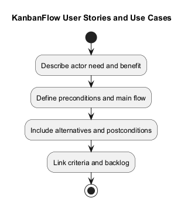
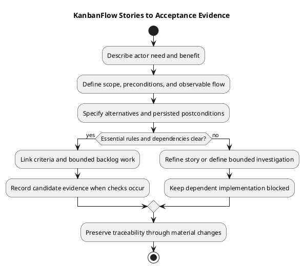

# KanbanFlow User Stories and Use Cases

> **Policy amendment (2026-10-10):** Membership mutations are now owner-only; DEC-003/PB-001's bypass is fixed. Current guidance below reflects this rule; historical records retain their original scope. See [QA corrections](../06-testing/qa-corrections-2026-10-10.md) for the selected rule and regression evidence.

Use stories to explain the actor's need and use cases to describe observable interactions. The examples and templates here are planning aids, not scheduled work or completed user research.

## Story template

```text
Story identifier:
As an actual actor category,
I want a bounded capability,
so that an identifiable outcome is possible.
Scope and exclusions:
Acceptance criteria:
Dependencies and policy references:
Verification approach:
Backlog reference and actual status:
```

Do not invent user feedback or prioritization. Connect stories to an actual need and the [product backlog](../../Project-Management/product-backlog.md).

## Use-case template

| Field | Detail |
| --- | --- |
| Actor and goal | Who acts and what outcome is sought |
| Preconditions | Session, membership, resource, and state assumptions |
| Trigger | Action that begins the interaction |
| Main flow | Observable steps and accepted result |
| Alternatives | Relevant validation, rejection, and recovery paths |
| Postconditions | Persisted state and visible feedback |
| Constraints | Policy, compatibility, or environment dependency |
| Evidence plan | Criteria and feasible checks |

## Illustrative use case

A permitted contributor moves a task to another column. The specification identifies membership and visibility, source/destination state, optional WIP limits, accepted ordering, and persistence after reload. A rejected move restores appropriate visible state and leaves the accepted server state intact.

This example explains how to structure a use case. It is not a fresh demonstration or a newly agreed change. Confirm actual permission and failure rules through [roles](roles-and-use-cases.md) and the owning decisions.

## Stories, use cases, and criteria

| Record | Purpose | Boundary |
| --- | --- | --- |
| Story | Explain actor need and benefit | Does not enumerate every permission or failure path |
| Use case | Describe conditions, interaction, alternatives, and postconditions | Does not prove the interaction was tested |
| Acceptance criterion | Define an observable result | Needs candidate evidence before being marked demonstrated |
| Backlog item | Track bounded work and actual state | Selection and completion require their own decisions |

Link these records instead of treating a short story sentence as a complete specification. Keep implementation suggestions separate from the intended user outcome.

## Illustrative story catalog

The ST identifiers below are local examples, not issue numbers, selected sprint scope, or validated research findings. They express documented product concerns and require change-specific refinement.

| Example | Actor need and benefit | Use-case/acceptance focus |
| --- | --- | --- |
| ST-01 | As an account user, I want to sign in so I can access permitted work | Session establishment, validation, protected access, expired-session feedback |
| ST-02 | As a workspace owner, I want controlled membership administration so access reflects agreed policy | Role/membership transitions, direct and indirect paths, revocation |
| ST-03 | As a permitted contributor, I want to move tasks so their workflow state reflects progress | Authorization, ordering, WIP rejection, rollback, reload persistence |
| ST-04 | As a permitted collaborator, I want comments and activity context so I can understand work | Visibility, authorship boundaries, removed-member access |
| ST-05 | As a permitted viewer, I want readable summaries so I can inspect available progress | Scoped aggregates, empty/error states, refreshed affected totals |
| ST-06 | As an interface user, I want readable appearance and keyboard controls so I can work in the chosen context | Light/dark/system behavior, focus, keyboard interaction, browser-local preference |

Verify actual roles through the owning policies and controllers. “Contributor” and “collaborator” describe a need, not a new application role or universal mutation permission.

## Detailed task-movement example

This is an illustrative specification outline, not a performed check or new delivery commitment.

| Element | Example detail to clarify |
| --- | --- |
| Actor | User with actual permission to move the task |
| Preconditions | Authenticated, current membership, visible board, valid nested task context |
| Trigger | User requests movement to a specified column/position |
| Main flow | Request is validated; accepted server state and visible lists reflect the move |
| Postconditions | Task column/ordering remain correct after reload |
| WIP alternative | Limit violation rejects movement and restores appropriate visible state |
| Stale-state alternative | Conflicting stale operation is rejected without an incorrect accepted mutation |
| Session/access alternative | Expired or revoked access rejects appropriately and provides useful feedback |
| Keyboard path | Relevant pickup, movement, drop, and cancellation behavior is specified |

### Example acceptance links

| Criterion | Planned observation | Required context |
| --- | --- | --- |
| Accepted move persists | Reload and inspect task column/order | Exact candidate and permitted actor |
| Rejected move recovers | Inspect both lists and persisted state | Defined rejection scenario |
| Unauthorized move is denied | Direct request and resulting server state | Relevant role/removal/visibility condition |
| Applicable WIP behavior holds | Relevant regression and isolated contention checks | Database/environment appropriate to the boundary |

Build success does not demonstrate these observations, and SQLite tests do not establish MySQL contention behavior. Actual results belong in the [verification template](../../Releases/verification-template.md).

## Refine and split stories

Split when a story mixes independent outcomes, has unclear boundaries, or cannot be verified in the agreed scope. Preserve links between supporting tasks and the user outcome so completing a technical subtask does not silently replace acceptance of the whole need.

Use the [Definition of Ready](../../Sprints/definition-of-ready.md) before selection. Missing essential policy or environment access remains a dependency. Membership stories must follow the owner-only rule recorded in DEC-003/PB-001 and preserve denied-manager regression coverage.

A bounded investigation can have a question, expected evidence output, and stopping point. It does not automatically authorize implementation of its recommendation.

## Story-to-evidence record

| Story/use case | Need source | Requirement/criterion | Decision or dependency | Actual backlog item | Evidence |
| --- | --- | --- | --- | --- | --- |
| Actual reference | Actual source or pending | Observable criterion | Actual link or unresolved question | Actual reference or unselected | Pending or candidate result |

Do not infer actual user feedback, satisfaction, estimates, or priority from examples. Mark historical observations and proposed changes clearly. Downstream implementation and check references are added only when they exist.

## Review checklist

- Actor need and benefit are identifiable.
- Scope and exclusions are bounded.
- Preconditions include session, membership, ancestry, and visibility where relevant.
- Main flow, alternatives, and persisted postconditions are observable.
- Actual permission rules are linked rather than guessed from actor labels.
- Verification is feasible and missing dependencies remain visible.
- Example text and planned checks are distinguished from performed evidence.
- Changes preserve decision context and traceability.

Use the [requirements guide](requirements.md), [functional catalog](functional-requirements.md), and [security/privacy guide](security-and-privacy-requirements.md) for owning boundaries. Item completion follows the [Definition of Done](../../Sprints/definition-of-done.md); agreement and release/deployment remain separate events.

## Maintenance

Record material changes with their reason and actual agreement. Preserve superseded stories and criteria with replacement links. Reassess evidence after source changes instead of carrying historical results forward as fresh checks. Keep secrets and unnecessary personal details out of examples and evidence.

## Review and traceability

Separate user outcomes from suggested implementation. Split stories with independent outcomes or unclear boundaries. Link criteria through [validation and acceptance](validation-and-acceptance-criteria.md) and [traceability](../../Project-Management/traceability.md).

If essential policy remains unresolved, record the question and keep dependent implementation blocked. Preserve changed or superseded stories with decision context rather than silently rewriting scope after a failed check.

## Related guidance

See the [requirements index](README.md), [planning phase](../01-planning/README.md), [analysis phase](../03-analysis/README.md), and [diagram guide](../../diagram-guide.md). Keep proposed rules, actual decisions, and performed evidence distinct.

## PlantUML diagram



[PlantUML source](diagrams/user-stories-and-use-cases.puml)


