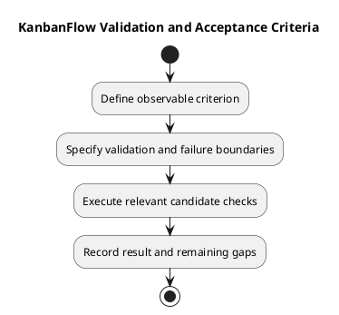

# KanbanFlow Validation and Acceptance Criteria

Acceptance criteria define observable success for an agreed requirement. Validation rules specify allowed input and state conditions. Neither is a performed test result until evidence is recorded at an identified candidate.

## Criterion structure

Use actor, preconditions, trigger, expected response, and persisted result. Include relevant failures and recovery. A Given/When/Then form is useful but optional:

```text
Given the agreed actor, membership, and resource state,
when the specified action occurs,
then the observable result and persisted state meet the requirement.
Relevant rejection or recovery condition:
Verification method and environment:
```

## Validation boundaries

| Area | Specify |
| --- | --- |
| Input | Required fields, formats, applicable limits, and error feedback |
| Resource access | Membership, role, ancestry, and visibility |
| State transitions | Accepted/rejected changes and stale-state handling |
| Ordering and WIP | Position consistency, limit enforcement, and recovery |
| UI feedback | Loading, error, empty, keyboard, and focus behavior where relevant |

Use actual rules or explicitly proposed changes. Do not invent numerical input limits, error codes, or complete support targets. Frontend validation does not replace server validation.

## Acceptance/evidence table

| Criterion | Scenario and expected outcome | Revision/environment | Result | Evidence/gap |
| --- | --- | --- | --- | --- |
| Actual criterion | Specific observation | Pending until checked | Not run | Planned method or actual evidence |

Use Pass, Fail, Blocked, Not run, and justified Not applicable. A required failed or unexecuted criterion prevents claiming the affected outcome complete. A demonstration that omits the failing boundary cannot close a defect.

## Evidence selection

Choose proportionate automated, browser, and database checks using the [quality plan](../../Project-Management/quality-and-risk-plan.md). Build success does not prove usability; SQLite tests do not prove MySQL contention behavior. Historical totals cannot substitute for fresh candidate evidence.

Record exact revisions and environment through the [verification template](../../Releases/verification-template.md). Reassess evidence after source changes. If an environment is unavailable, retain the dependency and gap rather than assuming success.

## Agreement and completion

Record material criterion changes with their reason and actual agreement. Do not lower criteria silently after failure. Use the [Definition of Ready](../../Sprints/definition-of-ready.md) for selection and [Definition of Done](../../Sprints/definition-of-done.md) for completion. Acceptance and publication/deployment remain separate decisions.

## Related guidance

See the [requirements index](README.md), [planning phase](../01-planning/README.md), [analysis phase](../03-analysis/README.md), and [diagram guide](../../diagram-guide.md). Keep proposed rules, actual decisions, and performed evidence distinct.

## PlantUML diagram


[PlantUML source](diagrams/validation-and-acceptance-criteria.puml)


