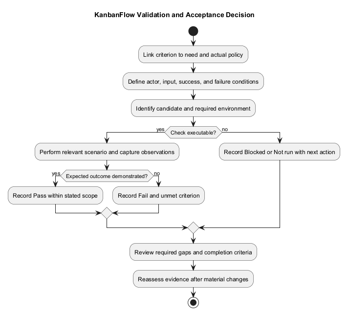
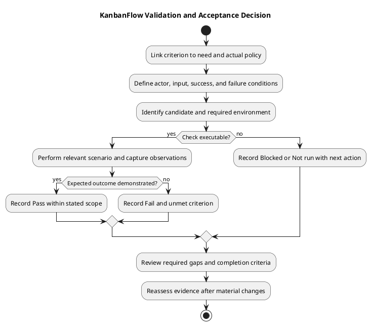

# KanbanFlow Validation and Acceptance Criteria

Acceptance criteria define observable success for an agreed requirement. Validation rules specify allowed input and state conditions. Neither is a performed test result until evidence is recorded at an identified candidate.

## Criterion structure

Use actor, preconditions, trigger, expected response, and persisted result. Include relevant failures and recovery. A Given/When/Then form is useful but optional:

```text
Given the agreed actor, membership, and resource state,
when the specified action occurs,
then the observable result and persisted state meet the requirement.
Relevant rejection or recovery condition:
Verification method and environment:
```

## Validation boundaries

| Area | Specify |
| --- | --- |
| Input | Required fields, formats, applicable limits, and error feedback |
| Resource access | Membership, role, ancestry, and visibility |
| State transitions | Accepted/rejected changes and stale-state handling |
| Ordering and WIP | Position consistency, limit enforcement, and recovery |
| UI feedback | Loading, error, empty, keyboard, and focus behavior where relevant |

Use actual rules or explicitly proposed changes. Do not invent numerical input limits, error codes, or complete support targets. Frontend validation does not replace server validation.

## Acceptance/evidence table

| Criterion | Scenario and expected outcome | Revision/environment | Result | Evidence/gap |
| --- | --- | --- | --- | --- |
| Actual criterion | Specific observation | Pending until checked | Not run | Planned method or actual evidence |

Use Pass, Fail, Blocked, Not run, and justified Not applicable. A required failed or unexecuted criterion prevents claiming the affected outcome complete. A demonstration that omits the failing boundary cannot close a defect.

## Evidence selection

Choose proportionate automated, browser, and database checks using the [quality plan](../../Project-Management/quality-and-risk-plan.md). Build success does not prove usability; SQLite tests do not prove MySQL contention behavior. Historical totals cannot substitute for fresh candidate evidence.

Record exact revisions and environment through the [verification template](../../Releases/verification-template.md). Reassess evidence after source changes. If an environment is unavailable, retain the dependency and gap rather than assuming success.

## Criterion design and traceability

Give each criterion a stable local reference and link its requirement, actual backlog item, and applicable policy decision. A criterion should express one assessable outcome without losing the resource and actor context. Local references are not automatically issue numbers or performed tests.

Separate the requested behavior from the method used to check it. For example, “accepted task ordering persists after reload” is an outcome; a browser observation or backend regression is an evidence method. Both must identify relevant conditions.

Use the [requirements guide](requirements.md), [functional catalog](functional-requirements.md), and [non-functional catalog](non-functional-requirements.md) for owning criteria. Avoid unsupported numerical targets and undocumented field rules.

## Scenario selection

| Scenario class | Specify/check |
| --- | --- |
| Accepted path | Valid actor, input, and resource state produce the expected visible and persisted result |
| Invalid input | Required/format/boundary conditions reject appropriately without false success |
| Unauthorized action | Direct requests and UI behavior reflect actual server permission rules |
| Resource mismatch | Cross-workspace/project/board identifiers do not bypass ancestry checks |
| Revoked access | Removed membership or changed role is evaluated using current server state |
| Stale or conflicting state | Operation rejects or resolves according to the agreed rule without corrupting accepted state |
| Recovery | Rejection restores relevant interface state and reload confirms persistence |
| Accessibility/interaction | Required keyboard, focus, responsive, and error-feedback behavior is observable |

Choose relevant scenarios, not every possible case for every edit. For input boundaries, inspect actual validation rules before choosing empty, malformed, minimum/maximum, or out-of-range values. A client-side check cannot replace server rejection.

## Illustrative acceptance set

The following examples are specification aids, not newly agreed scope or fresh results.

| Example | Given/when | Expected observation | Evidence boundary |
| --- | --- | --- | --- |
| Accepted move | Permitted actor moves a task within valid constraints | Correct visible lists and persisted column/order after reload | Candidate and relevant resource state identified |
| Rejected WIP move | Move violates an applicable WIP limit | Rejection and restored lists; accepted server state remains correct | Relevant browser/regression checks; isolated contention if needed |
| Private data access | Ordinary member requests another user's private board context | Restricted board/nested data is unavailable under the actual rule | Direct and aggregate paths as applicable |
| Removed comment author | Former member attempts a comment mutation | Applicable access is revoked despite authorship | Combined controller and policy checks |
| Invalid form | Input violates an actual validation rule | Useful field/error feedback and no false persisted success | Actual field rule and request behavior |

Do not close a defect using a demonstration that omits its failing boundary. The manager remove/re-add role loophole remains tracked by DEC-003/PB-001; a direct owner-only role-update check does not close that indirect path.

## Copyable criterion and check record

```text
Criterion identifier and requirement reference:
Agreed outcome and policy references:
Actor, membership, visibility, and resource ancestry:
Preconditions and test data:
Trigger/input:
Expected response and visible state:
Expected persisted state:
Relevant rejection/recovery path:
Planned method and required environment:
Actual candidate revision and local differences, if any:
Observed result and evidence:
Result state and limitation:
Next action if unmet or unavailable:
```

Keep planned and actual fields separate. Record real timestamps/owners only when available; unknown values stay pending. Use isolated data appropriate to the scenario and exclude secrets or unnecessary personal information from evidence.

## Result interpretation

| Result | Meaning | Effect on acceptance |
| --- | --- | --- |
| Pass | The specified observation is demonstrated within the recorded scope | Supports that criterion at the checked candidate |
| Fail | Observation conflicts with the expected result | Required criterion remains unmet |
| Blocked | A condition prevents meaningful execution | Required evidence remains unavailable |
| Not run | Check has not been executed | No result can be inferred |
| Not applicable | Check does not apply, with an explicit rationale | Review the rationale against the actual scope |

Result states describe checks, not requirement agreement. A passing unrelated check cannot compensate for an unmet essential criterion. A waived or changed scope needs its actual decision recorded; it must not be represented as a passed check.

## Candidate evidence and reproducibility

Identify the implemented/tested revision, environment, scenario data, and relevant configuration without exposing secrets. Disclose uncommitted changes when they affect the checked candidate. Record how results were observed and their practical limits.

Use the detailed verification record rather than duplicating inconsistent logs across requirements and sprint documents. Historical test totals support their historical revision, not current acceptance. Browser observations and database experiments have separate scopes from automated lint/build or SQLite tests.

After source, policy, environment, or criteria changes, reassess affected evidence and rerun applicable checks. Do not broaden testing merely by habit when no change or unresolved concern justifies it; choose checks proportionate to the affected boundary.

## Review and unresolved gaps

- Criteria identify actual actors, conditions, outcomes, and relevant failures.
- Validation rules and policy references are sourced or explicitly proposed.
- Planned checks are feasible and required environments are identified.
- Actual results identify candidate, method, evidence, and limitations.
- Required failures, blockers, and unexecuted checks remain visible.
- Criterion changes preserve their reason and actual agreement.
- Completion is assessed against the final agreed criteria.

Record gaps with their impact, next action, and agreed owner or unassigned status. A missing policy decision can block dependent implementation even before testing. Use the [decision register](../../Project-Management/decision-register.md) and [product backlog](../../Project-Management/product-backlog.md) for follow-up.

## Change control and maintenance

| Change date | Criterion | Changed condition/outcome | Reason and impact | Actual decision | Evidence to reassess |
| --- | --- | --- | --- | --- | --- |
| Actual date | Stable reference | Specific change | Explicit effect | Agreement or pending | Affected check references |

Preserve superseded criteria and label corrections. Link needs, decisions, implementation, and checks through [traceability](../../Project-Management/traceability.md). Repair links and keep the diagram source, embedded block, and preview synchronized.

Item acceptance, sprint review, source merge, publication, and deployment are separate events. Passing criteria here establish no production capacity or recovery guarantee. Use the [release checklist](../../Releases/release-checklist.md) for actual delivery readiness decisions.

## Agreement and completion

Record material criterion changes with their reason and actual agreement. Do not lower criteria silently after failure. Use the [Definition of Ready](../../Sprints/definition-of-ready.md) for selection and [Definition of Done](../../Sprints/definition-of-done.md) for completion. Acceptance and publication/deployment remain separate decisions.

## Related guidance

See the [requirements index](README.md), [planning phase](../01-planning/README.md), [analysis phase](../03-analysis/README.md), and [diagram guide](../../diagram-guide.md). Keep proposed rules, actual decisions, and performed evidence distinct.

## PlantUML diagram



[PlantUML source](diagrams/validation-and-acceptance-criteria.puml)


