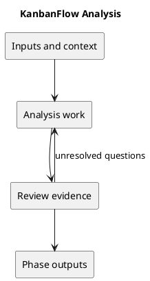

# Analysis

## Guides in this folder

- [KanbanFlow Analysis Decisions and Open Questions](analysis-decisions-and-open-questions.md)
- [KanbanFlow Analysis Guide](analysis.md)
- [KanbanFlow Business Rules Catalog](business-rules-catalog.md)
- [KanbanFlow Data Classification and Lifecycle](data-classification-and-lifecycle.md)
- [KanbanFlow Data Flow Diagram](data-flow-diagram.md)
- [KanbanFlow Domain Model](domain-model.md)
- [KanbanFlow Resuming Editing Activity](resume-editing-activity.md)
- [KanbanFlow Resuming an Interaction — State Diagram](resume-state-diagram.md)
- [KanbanFlow Security Threat Model and Risk Analysis](security-threat-model-and-risk-analysis.md)

The requested resume filenames describe resuming KanbanFlow interactions; they do not introduce a CV product or automatic draft persistence.

## Purpose and activities

Trace affected frontend/backend flows, database records, API boundaries, and current tests. Reproduce defects and identify their cause before choosing a fix. Assess sessions, authorization, WIP limits, and concurrent ordering when affected.

## Completion evidence

An evidence-based impact assessment with dependencies, compatibility risks, and a scoped implementation approach.

## Related guidance

- [Supporting documentation](../../Project-Definition/project-context-diagram.md)
- [SDLC index](../README.md)

## PlantUML workflow

[Editable source](diagrams/workflow.puml)

