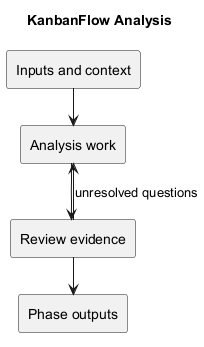
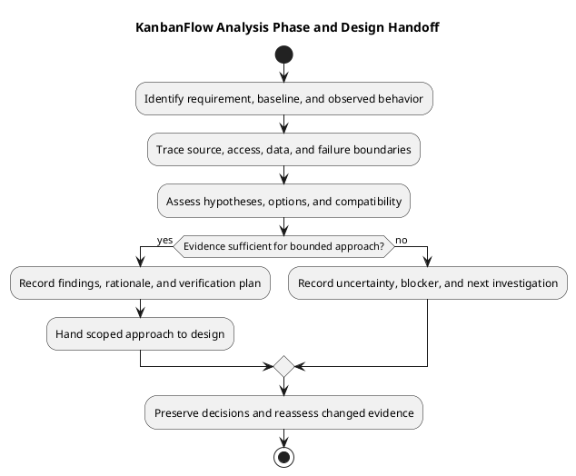

# KanbanFlow SDLC — 03 Analysis

> **Policy amendment (2026-10-10):** Membership mutations are now owner-only; DEC-003/PB-001's bypass is fixed. Current guidance below reflects this rule; historical records retain their original scope. See [QA corrections](../06-testing/qa-corrections-2026-10-10.md) for the selected rule and regression evidence.

Analysis connects agreed requirements to an evidence-based understanding of affected behavior, data, permissions, and technical constraints. Reproduce a defect when applicable, distinguish supported causes from hypotheses, and compare bounded approaches before handing work to design.

This folder provides investigation guides and conceptual models. It does not establish a newly reproduced defect, complete security audit, exact physical database schema, or fresh application test result.

## Guides in this folder

| Guide | Use it for |
| --- | --- |
| [Analysis process](analysis.md) | Baseline, observations, hypotheses, impact, and approach |
| [Decisions and open questions](analysis-decisions-and-open-questions.md) | Evidence, trade-offs, unresolved dependencies, and actual decisions |
| [Business rules catalog](business-rules-catalog.md) | Domain rules and source/policy boundaries |
| [Data classification and lifecycle](data-classification-and-lifecycle.md) | Storage, access, derived data, and lifecycle questions |
| [Data flow diagram](data-flow-diagram.md) | Browser/API/database flow and response/recovery boundaries |
| [Domain model](domain-model.md) | Conceptual hierarchy and model-change implications |
| [Resuming editing activity](resume-editing-activity.md) | Returning to editing with current access and data |
| [Resuming interaction state diagram](resume-state-diagram.md) | Conceptual editing, submission, acceptance, and rejection states |
| [Threat model and risk analysis](security-threat-model-and-risk-analysis.md) | Bounded misuse scenarios, controls, and residual risks |

The retained `resume-*` filenames refer to resuming KanbanFlow interactions. They do not define a CV feature, stored task statuses, automatic draft recovery, or offline editing support. Conceptual models must not be presented as implemented features.

## Inputs

| Input | Investigation use |
| --- | --- |
| [Requirements](../02-requirements/README.md) | Outcome, actors, constraints, and acceptance boundaries |
| [Planning](../01-planning/README.md) | Scope, dependencies, and agreed next step |
| Source and relevant tests | Actual routes, controllers, policies, frontend calls, migrations, and models |
| [Decision register](../../Project-Management/decision-register.md) | Established policy and unresolved choices |
| [Quality and risk plan](../../Project-Management/quality-and-risk-plan.md) | Material consequences and verification needs |
| [Product backlog](../../Project-Management/product-backlog.md) | Candidate references and follow-up work |

Identify the exact baseline and relevant environment. A historical release result supports its recorded revision, not a later candidate. Record local changes if they affect the inspected or tested behavior.

## Investigation workflow

1. Restate expected behavior and the actual observation or question.
2. Identify the owning requirement and affected user journey.
3. Inspect relevant source boundaries before broadening investigation.
4. Reproduce or perform discriminating checks where appropriate and authorized.
5. Separate evidence-backed causes from hypotheses and unknowns.
6. Assess dependencies, data compatibility, failure paths, and viable approaches.
7. Record a scoped recommendation and evidence plan, or a bounded next investigation.

Analysis should answer the material question without claiming certainty unsupported by the evidence. Keep unrelated findings as tracked follow-up rather than expanding implementation scope silently.

## Boundaries to inspect

| Boundary | Questions |
| --- | --- |
| Session | Do actual hosts/origins and expired-session behavior match the journey? |
| Authorization | Do membership, role, ancestry, and visibility checks apply together? |
| Data exposure | Are nested, aggregate, activity, and notification responses appropriately scoped? |
| Persistence | What is accepted, rejected, or unchanged after reload? |
| Ordering and WIP | Which locks, state checks, and contention conditions matter? |
| Interface recovery | Do loading, rejection, rollback, keyboard, and focus paths remain understandable? |
| Compatibility | Are configuration, assets, schema, or data changes needed? |

Policy methods alone do not describe an endpoint's complete access boundary. Read surrounding controllers/request guards and visibility scopes. Conceptual domain diagrams do not establish exact keys, cardinalities, or deletion cascades.

## Evidence and known dependencies

Use the [verification template](../../Releases/verification-template.md) for actual checks, with revision, environment, result, and limits. Build success does not establish usability; SQLite tests do not establish MySQL contention behavior. Missing or blocked checks remain explicit.

Membership additions, removals, and role changes are owner-only under DEC-003/PB-001; the 2026-10-10 correction closes the manager remove/re-add bypass. Record actual decisions in their owning register.

## Outputs and design handoff

| Output | Expected content |
| --- | --- |
| Findings | Expected/observed behavior and source or runtime evidence |
| Cause assessment | Supported explanation, alternative hypotheses, and limitations |
| Impact map | Affected UI/API/data/access boundaries and dependencies |
| Approach comparison | Viable options, trade-offs, and compatibility implications |
| Scoped recommendation | Bounded next step and actual decision or pending agreement |
| Verification plan | Criteria, relevant checks, environment needs, and known gaps |

Hand work to [04 Design](../04-design/README.md) when evidence supports the bounded next step. Essential uncertainty may instead require another investigation or block dependent implementation. Do not invent approval, estimates, or a completed design to satisfy the phase label.

## Review and maintenance

- Findings identify their actual baseline and evidence.
- Hypotheses and conceptual models are clearly labeled.
- Relevant access, data, and recovery boundaries are assessed.
- Dependencies and policy questions remain visible.
- The proposed approach preserves the requirement's outcome and scope.
- Verification limits and residual risks are explicit.
- Material decisions and corrections preserve traceability.

Link needs, decisions, implementation, and checks using [traceability](../../Project-Management/traceability.md). Preserve superseded findings and explain changed evidence. Exclude secrets and unnecessary personal information from records and diagrams.

Analysis completion, implementation completion, merge, publication, and deployment remain separate events. Use [release guidance](../../Releases/README.md) for delivery decisions; analysis establishes no production capacity or restore guarantee.

## Related indexes

- [SDLC index](../README.md)
- [Documentation index](../../README.md)
- [Project context](../../Project-Definition/project-context-diagram.md)
- [Diagram guide](../../diagram-guide.md)

## Analysis phase diagram

[PlantUML source](diagrams/workflow.puml)

