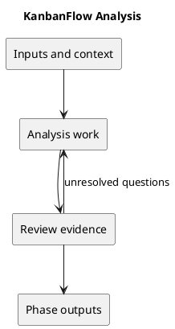

# Analysis

## Purpose and activities

Trace affected frontend/backend flows, database records, API boundaries, and current tests. Reproduce defects and identify their cause before choosing a fix. Assess sessions, authorization, WIP limits, and concurrent ordering when affected.

## Completion evidence

An evidence-based impact assessment with dependencies, compatibility risks, and a scoped implementation approach.

## Related guidance

- [Supporting documentation](../../Project-Definition/project-context-diagram.md)
- [SDLC index](../README.md)

## PlantUML workflow

[Editable source](diagrams/workflow.puml)

