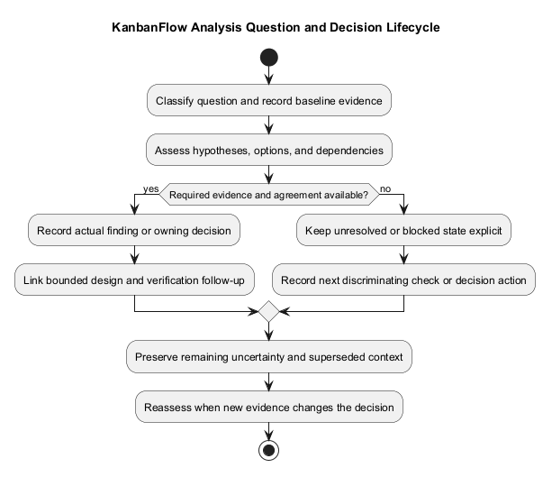
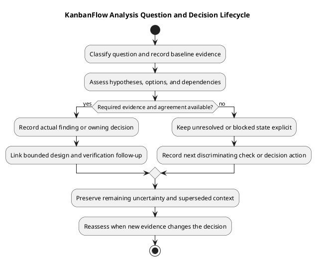

# KanbanFlow Analysis Decisions and Open Questions

> **Policy amendment (2026-10-10):** Membership mutations are now owner-only; DEC-003/PB-001's bypass is fixed. Earlier open-policy text and diagrams below describe the preceding state. See [QA corrections](../06-testing/qa-corrections-2026-10-10.md) for the selected rule and regression evidence.

Record analysis findings, competing explanations, and decisions without turning an assumption into an established rule. This guide is a reusable register, not actual sign-off or completed investigation evidence.

## Decision and question register

| Reference | Question or finding | Evidence | Options/trade-offs | Status | Next action/owner |
| --- | --- | --- | --- | --- | --- |
| Local reference | Actual question | Source/revision or pending | Relevant alternatives | Open / investigated / decided / superseded | Agreed action and person, or unassigned |

Keep policy decisions in the [decision register](../../Project-Management/decision-register.md). Link analysis rather than maintaining a conflicting copy. Record actual decision dates and responsibility; elapsed time is not agreement.

## Known question

DEC-003/PB-001 track the manager remove/re-add role loophole. Dependent enforcement requires an agreed membership policy; direct owner-only role updates do not close the indirect path. A bounded investigation may assess options without claiming a policy decision.

## Investigation method

Identify the requirement, source baseline, affected boundary, and evidence that would distinguish alternatives. Compare viable approaches using compatibility, risk, and verification cost. Record unsupported causal explanations as hypotheses.

## Classify the question

| Type | What needs resolution | Appropriate output |
| --- | --- | --- |
| Behavior ambiguity | Expected outcome or failure rule is unclear | Clarified requirement and actual agreement |
| Policy choice | Permission or lifecycle rule is undecided | Owning decision-register entry |
| Technical diagnosis | Cause of an observation is uncertain | Evidence-backed finding or remaining hypotheses |
| Compatibility question | Source, configuration, or data implications are unknown | Scoped impact assessment and dependencies |
| Verification gap | Required scenario/environment evidence is unavailable | Next check, condition, and explicit limitation |

Keep facts, hypotheses, recommendations, and actual decisions separate. A recommendation is not approval; an investigated question is not necessarily resolved.

## State conventions

| State | Meaning | Required context |
| --- | --- | --- |
| Open | Question is recorded but unresolved | Impact and next action |
| In investigation | Bounded evidence collection is underway | Baseline, discriminating checks, and ownership |
| Investigated | Findings are available | Evidence, limits, and whether a decision is still needed |
| Decided | Actual decision establishes a choice | Rationale, date, responsibility, and owning reference |
| Blocked | A condition prevents the next investigation/decision step | Dependency, impact, and next action |
| Superseded | Later findings or decisions replace this record | Replacement link and reason |

These states track analysis records, not implemented fixes or passing tests. Decided does not mean deployed or verified. Retain unanswered subquestions even when one part is decided.

## Detailed record template

```text
Local reference and owning requirement/backlog item:
Question type and affected boundary:
Observation or decision needed:
Exact source baseline and environment:
Known facts and evidence references:
Hypotheses and competing options:
Discriminating check or information needed:
Compatibility, data, and permission implications:
Blocking dependencies:
Agreed investigator/decision responsibility, or unassigned:
Current state and next action:
Actual decision date, rationale, and owning reference, or pending:
Remaining uncertainty and verification plan:
Follow-up implementation/evidence references when available:
```

Identifiers are local references unless linked to actual external issues. Do not invent reviewers, dates, estimates, or sign-off. Missing ownership remains explicit until agreed.

## Compare options with evidence

| Option | Outcome addressed | Supporting evidence | Compatibility/risk | Verification needs | Remaining uncertainty |
| --- | --- | --- | --- | --- | --- |
| Actual option | Bounded outcome | Actual source/check or pending | Explicit implications | Relevant method/environment | Unanswered question |

Include retaining current behavior or deferring the change when viable. Avoid unsupported numerical scoring. Record why the chosen approach fits the requirement and constraints, not simply which approach is easiest to implement.

For a diagnosis, identify what observation would distinguish competing explanations. Failed checks may narrow possibilities without proving a single cause. Mark the finding unresolved when evidence does not discriminate sufficiently.

## Membership-policy dependency example

DEC-003/PB-001 is an existing open dependency, not a new decision made here. Analysis should distinguish direct role update from removal/re-addition, identify affected actors, and compare policy options without silently choosing one.

Record the intended permitted actions, owner/member protections, rejected paths, and verification implications of any actually agreed rule. Until then, dependent enforcement remains blocked. Investigation completion alone does not close the loophole.

Use the [roles guide](../02-requirements/roles-and-use-cases.md) and [security/privacy requirements](../02-requirements/security-and-privacy-requirements.md) for relevant boundaries.

## Verification and decision evidence

Link actual checks using the [verification template](../../Releases/verification-template.md). Identify exact revision, environment, observed result, and gaps. Historical release results are not fresh evidence; build success does not establish usability, and SQLite tests do not establish MySQL contention behavior.

If a required environment or policy is unavailable, keep the gap and its effect visible. Elapsed time is not agreement. A proposed mitigation is not an implemented control, and a successful unrelated scenario cannot close an untested failing boundary.

## Handoff and closure checklist

- The question and affected requirement are explicit.
- Facts, hypotheses, and recommendations are distinguished.
- Source/check evidence and its limitations are linked.
- Options and material trade-offs are understandable.
- Actual decisions have their owning reference and rationale.
- Remaining dependencies and subquestions have next actions.
- Implementation and verification follow-up are separate from decision closure.

Hand a scoped approach to [design](../04-design/README.md) when evidence supports the next step. If essential uncertainty prevents it, record a bounded investigation or blocker rather than claiming the phase complete.

## Corrections and change control

| Change date | Earlier reference | New evidence/decision | Impact | Replacement or next action |
| --- | --- | --- | --- | --- |
| Actual date | Actual record | Actual source or agreement | Scope, compatibility, or evidence effect | Linked follow-up |

Preserve historical context and mark superseded findings. Reassess affected requirements, source, and checks when evidence changes. Link needs, decisions, implementation, and checks through [traceability](../../Project-Management/traceability.md).

Do not duplicate conflicting policy in this register. Exclude secrets and unnecessary personal data from evidence. Decision agreement, implementation completion, publication, and deployment remain separate events.

## Closure and maintenance

Close a question only with its actual decision or evidence-backed resolution. Preserve superseded decisions and explain changed assumptions. Link follow-up work to the [product backlog](../../Project-Management/product-backlog.md). Analysis completion does not establish implementation or release readiness.

## Related guidance

See the [analysis index](README.md), [requirements](../02-requirements/README.md), [design](../04-design/README.md), and [diagram guide](../../diagram-guide.md). Keep proposed behavior, inspected source, and actual check results distinct.

## PlantUML diagram



[PlantUML source](diagrams/analysis-decisions-and-open-questions.puml)


