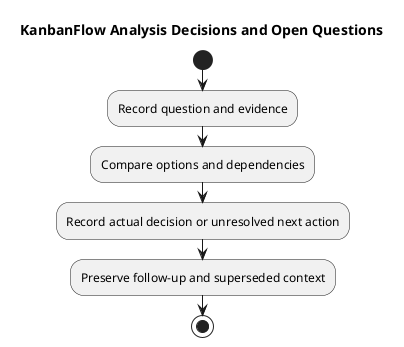

# KanbanFlow Analysis Decisions and Open Questions

Record analysis findings, competing explanations, and decisions without turning an assumption into an established rule. This guide is a reusable register, not actual sign-off or completed investigation evidence.

## Decision and question register

| Reference | Question or finding | Evidence | Options/trade-offs | Status | Next action/owner |
| --- | --- | --- | --- | --- | --- |
| Local reference | Actual question | Source/revision or pending | Relevant alternatives | Open / investigated / decided / superseded | Agreed action and person, or unassigned |

Keep policy decisions in the [decision register](../../Project-Management/decision-register.md). Link analysis rather than maintaining a conflicting copy. Record actual decision dates and responsibility; elapsed time is not agreement.

## Known question

DEC-003/PB-001 track the manager remove/re-add role loophole. Dependent enforcement requires an agreed membership policy; direct owner-only role updates do not close the indirect path. A bounded investigation may assess options without claiming a policy decision.

## Investigation method

Identify the requirement, source baseline, affected boundary, and evidence that would distinguish alternatives. Compare viable approaches using compatibility, risk, and verification cost. Record unsupported causal explanations as hypotheses.

## Closure and maintenance

Close a question only with its actual decision or evidence-backed resolution. Preserve superseded decisions and explain changed assumptions. Link follow-up work to the [product backlog](../../Project-Management/product-backlog.md). Analysis completion does not establish implementation or release readiness.

## Related guidance

See the [analysis index](README.md), [requirements](../02-requirements/README.md), [design](../04-design/README.md), and [diagram guide](../../diagram-guide.md). Keep proposed behavior, inspected source, and actual check results distinct.

## PlantUML diagram

[PlantUML source](diagrams/analysis-decisions-and-open-questions.puml)

