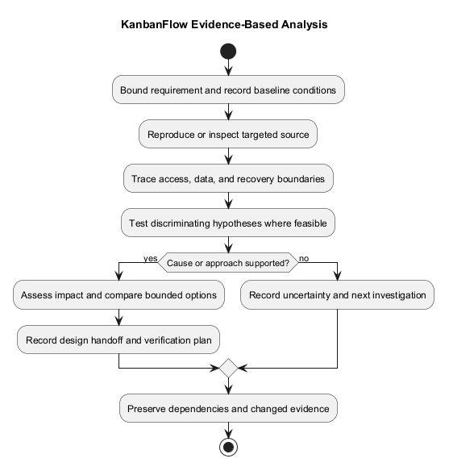
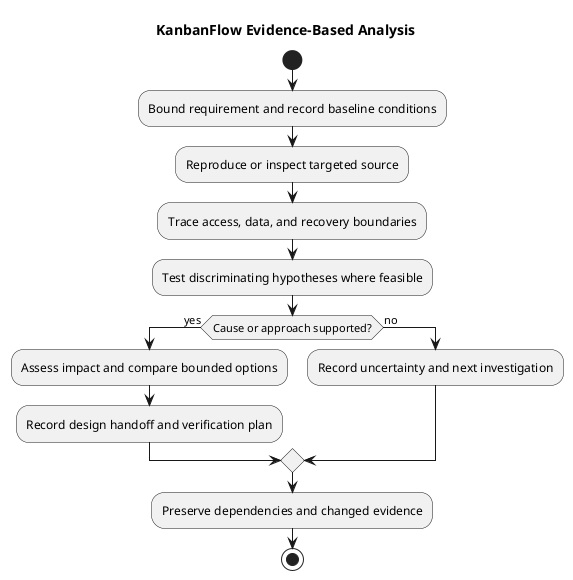

# KanbanFlow Analysis Guide

> **Policy amendment (2026-10-10):** Membership mutations are now owner-only; DEC-003/PB-001's bypass is fixed. Current guidance below reflects this rule; historical records retain their original scope. See [QA corrections](../06-testing/qa-corrections-2026-10-10.md) for the selected rule and regression evidence.

Analyze a bounded requirement or defect before choosing a change. Trace frontend behavior, API requests, authorization, persisted records, and relevant tests. This guide does not assert a newly reproduced defect or fresh verification result.

## Investigation record

```text
Requirement or defect reference:
Exact baseline and environment:
Expected and observed behavior:
Reproduction or source evidence:
Affected frontend/backend/data boundaries:
Hypotheses and discriminating checks:
Cause supported by evidence, or unresolved:
Options and compatibility risks:
Proposed bounded approach:
Verification plan and remaining gaps:
Actual decision or pending:
```

## Activities

1. Restate the outcome and scope from requirements.
2. Inspect the owning implementation and reproduce when appropriate.
3. Follow data and access boundaries, including failures and stale state.
4. Distinguish evidence-backed causes from hypotheses.
5. Compare bounded approaches and dependencies.
6. Hand findings to [design](../04-design/README.md) with remaining questions visible.

## Establish a bounded investigation

Identify whether the task is a new requirement, reported defect, compatibility question, or verification gap. Restate the user outcome and exclusions before inspecting unrelated modules. Use the [requirements guide](../02-requirements/requirements.md) and actual backlog/decision references.

Record the exact baseline, relevant local changes, environment, actor, resource state, and available evidence. Do not assume that a reported symptom has one cause or that historical tests demonstrate current behavior.

## Reproduction and observations

| Field | What to capture |
| --- | --- |
| Preconditions | Session, membership, role, visibility, data, and configuration conditions |
| Trigger | Specific action/input or request sequence |
| Expected behavior | Owning requirement or actual policy reference |
| Observed behavior | Visible result, response, and persisted state where relevant |
| Repeatability | Actual attempts and differences, not invented frequency |
| Evidence limits | Unavailable logs, environments, scenarios, or uncertain assumptions |

Use isolated data when executing mutations or contention checks. If reproduction is unavailable, inspect targeted source and record what it supports and what remains unverified. Do not describe a source inference as a reproduced runtime result.

## Trace affected boundaries

| Boundary | Investigation focus |
| --- | --- |
| Frontend | Owning component, request path, cache state, feedback, keyboard/focus behavior |
| API | Route, request validation, session context, and response contract |
| Authorization | Policies plus controller guards, current membership, ancestry, and visibility |
| Domain/data | Accepted mutations, persistence, ordering, WIP, derived records, and transactions |
| Recovery | Rejection, stale state, rollback, reload, and subsequent allowed actions |
| Configuration | Relevant origins, runtime assumptions, and deployment-specific conditions |

Follow the owning path before broad repository searches. Use the [data flow](data-flow-diagram.md), [domain model](domain-model.md), [business rules](business-rules-catalog.md), and [data lifecycle](data-classification-and-lifecycle.md) as conceptual aids, then confirm detail against actual source.

## Hypotheses and discriminating checks

| Hypothesis | Supporting evidence | Contradicting evidence | Check that distinguishes it | Current conclusion |
| --- | --- | --- | --- | --- |
| Specific explanation | Actual source/observation or pending | Actual evidence or none available | Bounded check and environment | Supported / rejected / unresolved |

Choose checks that separate competing explanations. A failure may narrow possibilities without proving a single cause. Record uncertainty when evidence remains insufficient rather than presenting confidence as proof.

For example, a sign-in symptom may involve input, session/origin configuration, or service availability. This is an illustrative diagnostic distinction, not a newly observed defect. Confirm actual conditions before selecting a fix.

## Impact assessment

| Area | Potential effect | Source/evidence | Dependency or mitigation |
| --- | --- | --- | --- |
| User journey | Accepted/rejected behavior and feedback | Actual reference | Scoped next action |
| Permissions/data | Visibility, revocation, integrity, or exposure | Actual reference | Policy or check requirement |
| Compatibility | API, assets, configuration, schema, or stored data | Actual reference | Upgrade/recovery implications |
| Verification | Tests or runtime scenarios affected | Actual criteria/checks | Environment needs and gaps |
| Documentation | Owning rules and diagrams | Actual files | Update required or not applicable with reason |

Assess only relevant effects and record unknowns. Do not infer schema compatibility, cascade behavior, restore readiness, or full browser support without evidence. Source rollback does not restore records.

## Compare approaches

| Option | Outcome addressed | Scope | Trade-offs and risks | Verification cost | Uncertainty |
| --- | --- | --- | --- | --- | --- |
| Actual viable option | Intended result | Bounded affected work | Explicit implications | Actual basis or unknown | Remaining question |

Include retaining current behavior or deferring work when viable. Prefer an approach that addresses the supported cause and preserves agreed scope. Do not invent scoring, estimates, or approval. Material policy/architecture decisions belong in the [decision register](../../Project-Management/decision-register.md), linked through the analysis decision guide.

## Dependencies and known open policy

Membership additions, removals, and role changes are owner-only under DEC-003/PB-001; the 2026-10-10 correction closes the manager remove/re-add bypass. Analyze direct and indirect paths separately when revising membership authority.

Record next actions and agreed responsibility, or unassigned ownership. A bounded investigation may proceed independently while dependent implementation remains blocked. Unrelated findings become linked follow-up candidates rather than silent scope additions.

## Verification plan and design handoff

Map the proposed change to observable acceptance criteria and relevant checks using the [quality and risk plan](../../Project-Management/quality-and-risk-plan.md). Identify required environments and actual evidence limits. Do not create a test plan that assumes unavailable access.

Before design handoff, confirm:

- Expected behavior and actual findings are distinct and sourced.
- Cause claims have supporting evidence or remain labeled hypotheses.
- Affected boundaries, compatibility, and failure implications are understood.
- Required decisions and unresolved dependencies remain visible.
- The proposed next step is bounded and preserves the requirement.
- Relevant verification methods and gaps are recorded.

If evidence is insufficient, record the next discriminating check or blocking condition. Analysis completion is not implementation completion, merge, publication, or deployment.

## Maintain the investigation record

Preserve earlier observations and explain later corrections or superseded recommendations. Reassess affected findings when source, environment, criteria, or policy changes. Link needs, decisions, implementation, and checks through [traceability](../../Project-Management/traceability.md).

Exclude credentials and unnecessary personal data from logs, examples, and diagrams. Maintain the PlantUML source, embedded block, and preview together. No production capacity, comprehensive security audit, or successful recovery exercise is established by this guide.

## Evidence limits

Build success does not prove usability. SQLite tests do not establish MySQL contention behavior. Historical suite totals are not current candidate results. Use the [verification template](../../Releases/verification-template.md) for actual checks.

## Output

Produce an impact assessment, source references, unresolved questions, compatibility/data implications, and a scoped approach. Link material choices through [analysis decisions](analysis-decisions-and-open-questions.md). Do not silently alter requirements or claim deployment from analysis.

## Related guidance

See the [analysis index](README.md), [requirements](../02-requirements/README.md), [design](../04-design/README.md), and [diagram guide](../../diagram-guide.md). Keep proposed behavior, inspected source, and actual check results distinct.

## PlantUML diagram



[PlantUML source](diagrams/analysis.puml)


