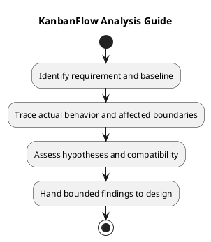

# KanbanFlow Analysis Guide

Analyze a bounded requirement or defect before choosing a change. Trace frontend behavior, API requests, authorization, persisted records, and relevant tests. This guide does not assert a newly reproduced defect or fresh verification result.

## Investigation record

```text
Requirement or defect reference:
Exact baseline and environment:
Expected and observed behavior:
Reproduction or source evidence:
Affected frontend/backend/data boundaries:
Hypotheses and discriminating checks:
Cause supported by evidence, or unresolved:
Options and compatibility risks:
Proposed bounded approach:
Verification plan and remaining gaps:
Actual decision or pending:
```

## Activities

1. Restate the outcome and scope from requirements.
2. Inspect the owning implementation and reproduce when appropriate.
3. Follow data and access boundaries, including failures and stale state.
4. Distinguish evidence-backed causes from hypotheses.
5. Compare bounded approaches and dependencies.
6. Hand findings to [design](../04-design/README.md) with remaining questions visible.

## Evidence limits

Build success does not prove usability. SQLite tests do not establish MySQL contention behavior. Historical suite totals are not current candidate results. Use the [verification template](../../Releases/verification-template.md) for actual checks.

## Output

Produce an impact assessment, source references, unresolved questions, compatibility/data implications, and a scoped approach. Link material choices through [analysis decisions](analysis-decisions-and-open-questions.md). Do not silently alter requirements or claim deployment from analysis.

## Related guidance

See the [analysis index](README.md), [requirements](../02-requirements/README.md), [design](../04-design/README.md), and [diagram guide](../../diagram-guide.md). Keep proposed behavior, inspected source, and actual check results distinct.

## PlantUML diagram


[PlantUML source](diagrams/analysis.puml)


