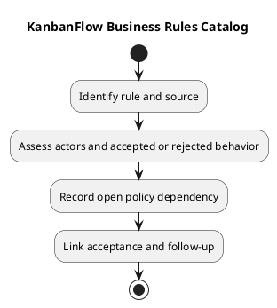

# KanbanFlow Business Rules Catalog

This catalog organizes documented domain rules and open policy boundaries. It is not a complete endpoint matrix or proof that every rule has fresh runtime evidence.

| Rule area | Documented boundary | Analysis focus |
| --- | --- | --- |
| Workspace access | Current membership defines the viewing context | Removal, role changes, and direct requests |
| Private boards | Creator/current owner/manager access additionally requires membership | Nested tasks/comments and aggregate exposure |
| Member-role updates | Direct role changes use owner-only policy | Remove/re-add indirect loophole remains unresolved |
| Task movement | Valid ancestry, authorization, ordering, and applicable WIP constraints | Rejection, persistence, and stale state |
| Ordered resources | Allocation/movement/deletion preserve applicable ordered positions | Locking and database contention |
| Comments | Authorship does not override revoked board/workspace access | Combined controller and policy guards |
| Analytics | Accepted affected mutations refresh scoped summaries | Private-data filtering and cache invalidation |

## Rule record

```text
Rule identifier and requirement:
Current implementation/source revision:
Actor and preconditions:
Accepted/rejected behavior:
Policy decision or unresolved question:
Affected records and operations:
Verification evidence or pending:
```

Use actual source and [roles requirements](../02-requirements/roles-and-use-cases.md) before expanding permission claims. Rules for restore/force-delete in a policy do not prove a corresponding user-facing endpoint exists.

## Review

Record proposed changes separately from current rules. Keep DEC-003/PB-001 visible for membership enforcement. Link criteria to [acceptance guidance](../02-requirements/validation-and-acceptance-criteria.md), and preserve superseded rules with decision context.

## Related guidance

See the [analysis index](README.md), [requirements](../02-requirements/README.md), [design](../04-design/README.md), and [diagram guide](../../diagram-guide.md). Keep proposed behavior, inspected source, and actual check results distinct.

## PlantUML diagram


[PlantUML source](diagrams/business-rules-catalog.puml)


